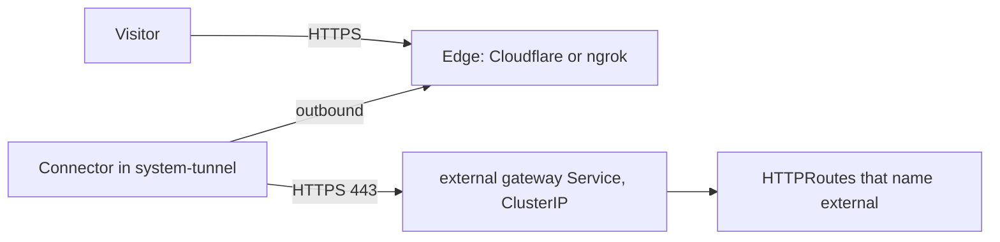

# ADR-0029: Tunnel drivers connect the external gateway to the internet

## Status

Proposed (2026-11-15). Builds on
[ADR-0001](0001-internal-external-gateways-and-dns.md) (the "Tunnel
(planned)" rule), [ADR-0005](0005-secrets-store.md), and
[ADR-0022](0022-gateway-listener-sets.md). Follows the artifact rules of
[ADR-0020](0020-helm-chart-registry.md). Part of the cli v0.10.0 release
(milestone M14).

## Context

A cluster on a workstation, Proxmox, Incus, Hyper-V, vSphere, or bare
metal usually has no public IP address. The external gateway cannot
receive traffic from the internet on these platforms. The load balancer
of the gateway has an address on a private network only.

A tunnel solves this. A connector inside the cluster opens an outbound
connection to an edge service. The edge service receives the public
request and sends it down the connection. The cluster needs no inbound
port and no public address.

ADR-0001 plans for this in one paragraph. A tunnel driver fronts the
external gateway only, the Service of the gateway becomes `ClusterIP`,
and the internal gateway is never tunneled. It also says that a
configured tunnel driver provisions the external gateway. No code exists.
The v0.8.0 roadmap lists "Cloudflare Tunnel first, ngrok/Tailscale
Funnel/Inlets later" and "Cloudflare auth via static in-cluster Secret".

Four facts about the current code limit the design:

- The external gateway has a certificate source rule. On a platform
  where the cluster cannot write the public zone (every platform except
  `aws`, `azure`, `gcp`, and `hetzner`), composition fails outside dev
  unless the context sets `gateway.external.tls.issuer`,
  `gateway.external.tls.cert`, or `pki.acme.server`
  (`contexts/_template/facets/option-gateway.yaml`).
- `gateway.external.service_type` accepts `LoadBalancer` and `NodePort`
  only.
- `dns.public.driver` does not exist. It is a roadmap item
  ([core#3320](https://github.com/windsorcli/core/issues/3320), moved to
  the sdlc roadmap) and has no ADR.
- ADR-0005 is Proposed and its implementation
  ([core#2427](https://github.com/windsorcli/core/pull/2427)) is not
  merged. ADR-0002 `secrets:` placement is shipped.

### Evidence for the driver choice

The table states what each project documents today. A cell that says
"not stated" means the pages that were read do not say. The build issue
for that driver MUST check the point before it relies on it.

| | Cloudflare Tunnel | ngrok operator | Tailscale operator with Funnel | Inlets | Pangolin |
|---|---|---|---|---|---|
| Licence of the in-cluster part | `cloudflared`: Apache-2.0 | Operator: MIT | Tailscale repo: BSD-3-Clause | Commercial, from OpenFaaS Ltd. The docs state no open-source licence | Community Edition AGPL-3. Enterprise Edition under the Fossorial Commercial License |
| Who hosts the edge | Cloudflare | ngrok | Tailscale | You run an exit server on a cloud VM (`inletsctl`, `inlets-operator`), or use Inlets Cloud, which the Pro plans include | You run the Pangolin server on a host with a public IP, or use Pangolin Cloud |
| Cost | The Zero Trust free plan lists $0 for under 50 users. Tunnel limits per account: 1,000 tunnels, 25 replicas per tunnel | Free: no custom domain, one development domain, 1 GB out, 3 endpoints. Pay-as-you-go: $20 per month base, $0.01 per hour for each custom domain, $0.10 per GB over 5 GB | The operator is on all plans. Funnel is in beta with bandwidth limits that you cannot configure | $50 per month for Pro Commercial (2 tunnels, $25 for each extra). The $25 Personal plan forbids commercial use | The cost of the server host. Cloud is a separate paid service |
| Public hostname by HTTP route | Yes. A published application maps a hostname to a Service URL. The zone MUST be on Cloudflare | Yes. A custom domain needs a paid plan | Only `<name>.<tailnet>.ts.net`. Funnel does not support custom domains | Yes. One HTTP tunnel serves many hosts | Resources are HTTPS web apps. Hostname rules: not stated |
| Ports | HTTP and HTTPS applications | HTTP and HTTPS endpoints | 443, 8443, and 10000 | Any, with a TCP tunnel | Not stated |
| TLS owner | Cloudflare edge terminates. Origin TLS is set with `originServerName`, `caPool`, `matchSNItoHost`, and `noTLSVerify` | The ngrok edge terminates. TLS endpoints with SNI routing are also documented | The Tailscale client in the proxy terminates | HTTP tunnel: the exit server. TCP tunnel: the cluster keeps TLS | Not stated |
| In-cluster components | One Deployment. Image `cloudflare/cloudflared`. Cloudflare publishes a manifest and no Helm chart | Chart `ngrok-operator` from `https://charts.ngrok.com` and a separate `ngrok-crds` chart. A manager Deployment and an agent Deployment. Image `docker.io/ngrok/ngrok-operator` | Operator, plus a proxy pod for each Ingress | `inlets-pro` client or operator | `fosrl/newt` from a Helm chart |
| ARM | Yes. Tag `2026.11.0` has `amd64` and `arm64` | Yes. The image has `amd64` and `arm64` | Yes. `k8s-operator` has `386`, `amd64`, `arm`, `arm64` | Not stated | Yes. `newt` has `amd64`, `arm`, `arm64` |
| Gateway API | None. Cloudflare routes in its own config | A GatewayClass turns `Gateway` and `HTTPRoute` objects into endpoints. The operator then acts as its own gateway | Ingress only. Gateway API support is an open feature request, [tailscale#10656](https://github.com/tailscale/tailscale/issues/10656) | Ingress and Istio Gateway in the tutorials. Gateway API: not stated | None found |
| Credential | Tunnel token, run-only | Chart values `credentials.apiKey` and `credentials.authtoken` in chart 0.24.2. The current docs show one `ngrok.credentials.accessToken` | OAuth client | License file per client | `NEWT_ID` and `NEWT_SECRET` per site |

Sources, all read on 2026-11-15:

- [Cloudflare Tunnel](https://developers.cloudflare.com/cloudflare-one/connections/connect-networks/),
  [Kubernetes guide](https://developers.cloudflare.com/cloudflare-one/connections/connect-networks/deployment-guides/kubernetes/),
  [origin configuration](https://developers.cloudflare.com/cloudflare-one/connections/connect-networks/configure-tunnels/origin-configuration/),
  [tunnel tokens](https://developers.cloudflare.com/tunnel/advanced/tunnel-tokens/),
  [account limits](https://developers.cloudflare.com/cloudflare-one/account-limits/),
  [proxy status](https://developers.cloudflare.com/dns/proxy-status/),
  [SSL/TLS modes](https://developers.cloudflare.com/ssl/origin-configuration/ssl-modes/),
  [connection limits](https://developers.cloudflare.com/fundamentals/reference/connection-limits/).
- ngrok: the [Kubernetes operator docs](https://ngrok.com/docs/k8s/),
  [architecture](https://ngrok.com/docs/k8s/installation/architecture),
  [Helm values](https://ngrok.com/docs/gateway/k8s/installation/helm.md),
  [pricing](https://ngrok.com/pricing), and the
  [operator repository](https://github.com/ngrok/ngrok-operator).
- Tailscale: the [operator](https://tailscale.com/kb/1236/kubernetes-operator),
  [Funnel through the operator](https://tailscale.com/docs/kubernetes-operator/ingress/expose-workload-to-internet),
  and [Funnel limits](https://tailscale.com/kb/1223/funnel).
- Inlets: the [docs](https://docs.inlets.dev/) and
  [pricing](https://inlets.dev/pricing).
- Pangolin: the [repository](https://github.com/fosrl/pangolin) and the
  [Kubernetes install page](https://docs.pangolin.net/manage/sites/install-kubernetes).
- Image platforms: `crane manifest` on Docker Hub, 2026-11-15.

## Decision

### 1. A top-level `tunnel` capability with two drivers

`tunnel.driver` selects the driver. Unset means no tunnel. The first two
values are `cloudflare` and `ngrok`.

```yaml
tunnel:
  driver: cloudflare      # cloudflare | ngrok; unset is no tunnel
  cloudflare:
    account_id: ""        # Cloudflare account that owns the tunnel
  ngrok: {}               # no settings in this ADR
```

`tunnel` is a capability name. Vendor names appear only as driver values
and as the per-driver blocks, the same layout as `identity.keycloak`.
The schema adds no field for a module variable.

Three rules apply to every driver:

- A tunnel driver MUST NOT be a default on any platform. Exposure to the
  internet stays opt-in, as ADR-0001 requires for `dns.public_domain`.
- `tunnel.driver` MUST require `dns.public_domain`. The tunnel serves
  `*.<dns.public_domain>` and no other name. A `requires:` rule rejects
  the combination of a driver with no public domain.
- A tunnel driver MUST NOT change how a route chooses a gateway. A route
  is public only when it names the `external` gateway in `parentRefs`.

### 2. The driver set

**First driver: `cloudflare`.** `cloudflared` is Apache-2.0, the edge is
free for this use, and a published application routes a hostname to a
Service URL. Cloudflare documents origin TLS settings that fit a
private CA, so the tunnel can keep HTTPS to the gateway.

**Second driver: `ngrok`.** The operator is MIT and the edge is hosted,
like Cloudflare, so the driver needs no host outside the cluster. The
operator is declarative: endpoints are Kubernetes resources. The cost is
a paid plan, because a custom domain is not on the free plan. The driver
uses the operator `AgentEndpoint` to forward the wildcard domain to the
external gateway. It MUST NOT enable the ngrok `GatewayClass`. With the
`GatewayClass`, the operator would own `Gateway` objects next to the
`external` gateway of ADR-0001 and ADR-0022, and routes could bind to
two gateways for one audience.

The first build issue for `ngrok` MUST run a spike on three points that
the docs reviewed do not state: an `AgentEndpoint` forwards a wildcard
custom domain, the upstream can be HTTPS with a private CA, and the chart
renders no image on a floating tag. Chart 0.24.2 renders
`bitnami/kubectl:latest` in a hook, which the digest policy rejects. If the spike fails, Pangolin
replaces `ngrok` as the second driver, and this ADR gets an amendment.

**Rejected for M14:**

- **Tailscale Funnel.** Funnel serves only `*.ts.net` names, so it cannot
  serve `dns.public_domain`. It also lists a bandwidth limit that the
  operator cannot change, ports 443, 8443, and 10000, and a beta status.
  Gateway API support is a feature request. Tailscale suits private
  access to a cluster, which is a different item.
- **Inlets.** The licence is commercial, with one paid license for each
  client, and the project documents no open-source option. Core ships an
  open-source blueprint, and a driver that needs a purchase for each
  cluster does not fit it. A TCP tunnel would fit the gateway well, and a
  later ADR MAY add it.
- **Pangolin.** It is the open-source candidate, but the operator must
  run a Pangolin server on a host with a public address. That host is a
  second system to deploy and secure outside the blueprint. A driver for
  it MAY follow when a user asks for a self-hosted edge. The Community
  Edition is AGPL-3, and the Enterprise Edition has revenue limits.

### 3. Cloudflare proxy mode is not part of M14

The proxy mode of a public DNS record (the "orange cloud") puts the CDN
and the WAF in front of a public IP address. It needs a public IP and a
zone on Cloudflare. It does not use a tunnel.

It is a property of a DNS record in the public zone. It belongs to
`dns.public.driver: cloudflare` (core#3320), which also supplies the
Cloudflare DNS-01 solver for Let's Encrypt. That item has no ADR yet.
M14 does not implement it.

The two features share a vendor and a zone, and they differ in
everything else:

| | Tunnel | Proxy mode |
|---|---|---|
| Needs a public IP | No | Yes |
| Platform | On-premises and workstation | Any platform with a public load balancer |
| Cloudflare object | A tunnel and a route | A record attribute |
| Credential | Tunnel token | DNS edit token |
| Schema owner | `tunnel` | `dns.public` |

The `cloudflare` tunnel driver creates its own proxied record, a `CNAME`
to `<tunnel id>.cfargotunnel.com`, because the route needs that record
to resolve. This is part of the tunnel and is not a general proxy
setting. A cluster MUST NOT combine `tunnel.driver: cloudflare` with
`dns.public.driver: cloudflare` until the ADR for the DNS driver defines
how the two write the same zone.

### 4. Which platforms use a tunnel

The platform does not select the driver. The user sets `tunnel.driver`.
The platform decides whether the setting is useful:

| Platform | Public IP | Tunnel use |
|---|---|---|
| `docker` (workstation) | No | Share a development cluster |
| `proxmox`, `incus`, `hyperv`, `vsphere`, `metal` | Usually no | The main case |
| `aws`, `azure`, `gcp`, `hetzner` | Yes | Allowed. Not needed for reach |

A tunnel on a cloud platform is legal. On these platforms the public
zone is also provisioned by the platform. When a cloud context sets a
tunnel driver, the platform public zone is not the authority for the
hostnames. The facet MUST reject `dns.public_zone: true` with a tunnel
driver on a cloud platform, with a message in user vocabulary: "A tunnel
serves the public domain from its own DNS zone. Set `dns.public_zone` to
false."

### 5. How the tunnel reaches the external gateway



- **One connector in its own namespace.** The component runs in
  `system-tunnel` and sends requests to the Service of the external
  gateway on port 443. It runs two replicas. Cloudflare documents two
  replicas for availability and says they are not for load balancing.
- **The gateway Service is `ClusterIP`.** A tunnel driver sets
  `gateway.external.service_type` to `ClusterIP`. The schema enum gets
  this value. A tunnel with `gateway.external.ip` or `NodePort` is an
  error. The component MUST address the Service by a stable name. Envoy
  Gateway adds a hash to the name of a generated Service, so the
  implementation MUST set the name (for example, through the
  `EnvoyProxy` resource) and MUST do the equivalent for the Cilium
  driver.
- **Only the external gateway.** The connector has no route to the
  internal gateway. A `NetworkPolicy` in `system-tunnel` MUST allow
  egress to the external gateway Service and to the edge only. This
  keeps ADR-0001: the internal gateway is never tunneled.
- **Wildcard routing.** One route sends `*.<dns.public_domain>` to the
  gateway. For Cloudflare, one wildcard `CNAME` and one wildcard
  published application. The gateway answers a hostname with no route
  with 404. A route that binds to `external` is public. A route that
  does not is not. The utility routes bind to `internal` only
  (ADR-0001), so no dashboard becomes public.
- **Subdomain depth.** Cloudflare Universal SSL covers one label under
  the domain. A name such as `a.b.example.com` needs an Advanced
  Certificate. The guide MUST say so.
- **ListenerSets.** The tunnel carries HTTP and HTTPS applications on
  the default HTTPS port. A ListenerSet listener on another port
  (ADR-0022) is not reachable through the tunnel. The facet MUST reject
  a tunnel together with `gateway.external.node_ports`.
- **External DNS.** With a tunnel, external-dns MUST NOT write records for
  the external gateway. The tunnel owns the wildcard record. The Service
  has no address to publish.

### 6. TLS

There are two hops with two certificate owners:

- Visitor to edge. The edge owns the certificate. Cloudflare issues it
  from Universal SSL. ngrok issues it for the custom domain.
- Connector to external gateway. The gateway owns the certificate.

The connector MUST use HTTPS to the gateway with verification on. A
setting that turns verification off (`noTLSVerify`) MUST NOT be used.
The Cloudflare origin settings are `originServerName`, `matchSNItoHost`
set to true so each request carries its own host name, and `caPool`.

A tunnel driver changes the certificate rules in these ways:

- **A tunnel counts as a certificate source.** The rule that fails
  composition for "no certificate source" does not apply when a tunnel
  driver is set. HTTP-01 cannot work with no public address, and the
  edge has already issued the public certificate.
- **The inferred issuer is the cluster CA.** With a tunnel and no other
  setting, the external gateway uses the `private` issuer
  (`gateway.external.tls.issuer: ca`). The connector trusts the cluster
  CA. The component mounts the CA bundle from trust-manager and sets
  `caPool` to it.
- **`public-acme` still works.** A context that sets
  `gateway.external.tls.issuer: acme` with a solver, or `pki.acme.server`,
  or a supplied `gateway.external.tls.cert`, keeps its certificate. The
  CA bundle is not needed when the chain is publicly trusted, and the
  component then uses the system roots. DNS-01 on a Cloudflare zone needs
  the future `dns.public.driver: cloudflare`. The tunnel does not add it.
- **The gateway certificate is never visible to visitors.** It protects
  the last hop only. A rotation of that certificate does not affect the
  edge.

The edge sees the requests in plain text. Cookies and authorization
headers pass through the edge operator. The guide MUST say so.

### 7. Credentials

The design has two kinds of credential and keeps them apart:

| Credential | Used by | Lives in | Reaches the cluster |
|---|---|---|---|
| Cloudflare API token (`Cloudflare Tunnel: Edit`, `DNS: Edit` on one zone) | Terraform at apply time | The environment of the operator or CI (`CLOUDFLARE_API_TOKEN`) | Never |
| Tunnel token | `cloudflared` | Terraform state, then a Secret | Yes, as a Secret |
| ngrok credentials | The operator | The secrets store, or the operator environment | Yes, as a Secret |

**Cloudflare.** A Terraform module `terraform/tunnel/cloudflare` creates
the tunnel, the remote configuration, and the wildcard record. The
provider version MUST be an exact pin. The module outputs the tunnel
token as a sensitive value. The token never appears in git and never in
`values.yaml`.

**ngrok.** No Terraform step is needed. The operator creates its own
domains and endpoints through the ngrok API. The user supplies the
credential from the operator environment, or from the secrets store.

**Delivery into the cluster.** Both drivers read one Secret,
`tunnel-credentials` in `system-tunnel`. The Secret has one source in
each of two stages:

1. When `secrets_store.enabled` is true, an `ExternalSecret` reads the
   value from the path `tunnel/<driver>` in the store (ADR-0005 and the
   `ExternalSecret` materialization of ADR-0002). The Secret name is the
   same as in stage 2, so the driver needs no schema change.
2. Otherwise, the facet places the Secret with the shipped `secrets:`
   path of ADR-0002. The value is a bare reference with a `when:` guard
   on the flux entry, so the Secret exists only with a real value.

M14 ships stage 2, because ADR-0005 is not implemented. The credential
is never a literal in git. In stage 2 the value is in the Terraform
state of the context, which is the same trust level that ADR-0005 accepts
for the unseal key.

**Rotation.** Cloudflare says that after a token rotation the old token
cannot make new connections and existing connectors stay active until
they restart. With two replicas, a rolling restart causes no gap.

- The schema adds no rotation field in this ADR. The Terraform module
  takes a version counter (default 1) for the tunnel secret. Raising the
  counter and running `windsor apply` replaces the tunnel secret and
  produces a new token. The module MUST use `create_before_destroy`, so
  the record is never absent. The facet exposes the counter only if the
  build shows that users need it.
- The Deployment MUST restart when the Secret changes. The Secret
  version feeds a pod template annotation. The build issue chooses the
  mechanism.
- For ngrok, the operator replaces the value in the secrets store or the
  environment and applies again.

### 8. Chart and image rules (sdlc ADR 0001)

Every artifact a cluster pulls carries an `artifact` tag. Each driver
MUST follow these rules, and the CI check for artifact tags is the test.

- **`cloudflare`: one image, no chart.** Cloudflare publishes a manifest,
  not a chart. Core ships a kustomize Deployment. The image line carries
  `# artifact: type=image name=docker.io/cloudflare/cloudflared`. It is
  pinned to a version tag and a digest, because the Kyverno policy
  `require-image-digest` applies. The image is on Docker Hub, so a site
  with `docker.registries` mirrors it like any other image. No chart
  enters the registry mirror.
- **`ngrok`: two charts, one or more images.** `ngrok-crds` goes to the
  `crds` layer, as the crds vendor-scope rule requires for charts that
  ship install-only CRDs. `ngrok-operator` goes to the install tier. Each
  carries `# artifact: type=chart name=<chart> repo=https://charts.ngrok.com`
  and a pinned version. Each chart name MUST be unique, and `task
  charts:check` MUST pass. The images the chart renders, including the
  hook image, MUST have tags and digests.
- Both drivers MUST work with `charts.registry` and with the image
  mirror, and the CI registry leg MUST cover them.

### 9. Security

**If the Cloudflare tunnel token leaks.** The token lets its holder run
a connector for that tunnel. Cloudflare allows many connectors for one
tunnel, so the holder can receive a share of the real requests. The
holder sees them in plain text, including cookies, and can answer with
any response. The holder cannot change routes, cannot read other
tunnels, and cannot reach the cluster network, because the connection
runs outward from the holder to the edge. The response is to rotate the
token and to delete the connections of the tunnel through the Cloudflare
API, which Cloudflare documents as the compromise procedure.

**If the Cloudflare API token leaks.** The holder can create tunnels,
change the routes, and edit DNS in one zone. This is a stronger
credential than the tunnel token. It stays out of the cluster and out of
git, and the guide MUST tell the user to scope it to one account and one
zone.

**If the ngrok credential leaks.** The docs reviewed do not state the
scope of the access token. The spike MUST find out and the guide MUST
state it. At minimum the holder can create endpoints and use the account
quota. The credential does not give network access to the cluster.

**Default exposure.** A tunnel driver exposes nothing the user did not
bind to the `external` gateway. The utility routes bind to `internal`
only. A cluster with a tunnel and no route on `external` returns 404 for
every name. The connector can reach the external gateway and the edge,
and nothing else.

## Consequences

- A cluster on a platform with no public IP can serve public hostnames
  with one schema value and no inbound port.
- The external gateway gets a third Service form (`ClusterIP`) and a
  certificate rule that treats a tunnel as a source. The change touches
  `option-gateway.yaml`, `platform-base.yaml`, the schema enum, and the
  per-gateway `EnvoyProxy` and Cilium wiring.
- The edge operator terminates TLS and sees plain-text traffic. A user
  who cannot accept this MUST NOT enable a tunnel.
- The `cloudflare` driver adds a Terraform provider and a Cloudflare
  account dependency. The `ngrok` driver adds a paid plan for custom
  domains.
- Proxy mode and the Cloudflare DNS-01 solver stay in core#3320. That item
  needs its own ADR, and it MUST define how it coexists with the tunnel.
- The stage 1 credential source depends on ADR-0005. Until then, the
  credential is in Terraform state.

## Implementation milestones

These are the core rows of cli v0.10.0 M14. Each is one PR.

1. **ADR.** This document.
2. **Framework and `cloudflare` driver.** The `tunnel` schema, the
   `requires:` rules, the `ClusterIP` service type, the certificate rule,
   the `terraform/tunnel/cloudflare` module, the `cloudflared` component
   and its `NetworkPolicy`, the credential Secret, and the artifact tags.
3. **`ngrok` driver.** The spike first, then the charts, the
   `AgentEndpoint`, and the credential.
4. **CI test context.** A context with a fake credential. The test checks
   that the component renders and that the gateway Service and the
   connector target match.

The docs guide (how to choose a driver, set the credential, and the
limits) belongs to the docs repository.

## Alternatives considered

**Locally managed Cloudflare tunnels.** A tunnel with a credentials file
and a `cert.pem`. The `cert.pem` is an account-wide login certificate and
grants more than a run-only token. Rejected.

**One DNS record for each hostname through external-dns.** external-dns
supports Cloudflare, and it could write a `CNAME` for each route. It
needs the DNS edit token inside the cluster, and the credential table
above keeps that token out. It also repeats work that one wildcard
record does. Rejected.

**The ngrok `GatewayClass`.** Native Gateway API, but the operator owns
the `Gateway` objects. Rejected in section 2.

**A tunnel for the internal gateway.** Rejected by ADR-0001. A tunnel
makes a gateway public, and the internal gateway is the one that is not.

**Cloudflare proxy mode in M14.** It is a DNS driver feature, needs a
public IP, and has no ADR. Deferred to core#3320.

**Platform selects the driver.** A default would expose a cluster to the
internet without a choice by the user. Rejected.

## Open questions

1. Is the `ngrok` spike successful? The result decides whether `ngrok`
   or Pangolin is the second driver.
2. How does the Deployment restart on a Secret change, with the
   `ExternalSecret` in stage 1 and the `secrets:` Secret in stage 2?
3. What is the scope of the ngrok access token?
4. Which Service name mechanism covers both the Envoy and the Cilium
   gateway driver?

## References

- [ADR-0001](0001-internal-external-gateways-and-dns.md): the external
  gateway and the tunnel rule.
- [ADR-0005](0005-secrets-store.md), [ADR-0002](0002-cluster-secrets-management.md):
  the store and the `secrets:` path.
- [ADR-0020](0020-helm-chart-registry.md) and the sdlc chart registry
  contract (sdlc ADR 0001): the `artifact` tag and the chart layout.
- [ADR-0022](0022-gateway-listener-sets.md): ListenerSets on the external
  gateway.
- `contexts/_template/facets/option-gateway.yaml`: the certificate source
  rule.
- `contexts/_template/facets/platform-base.yaml`: `tls_effective`.
- [core#3320](https://github.com/windsorcli/core/issues/3320): the public
  DNS driver and proxy mode.
