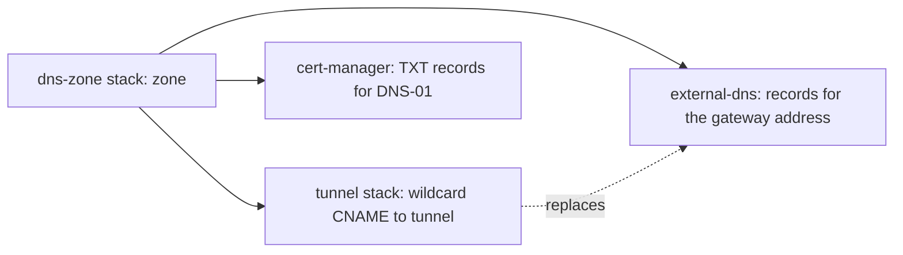

# ADR-0030: Cloudflare serves the public zone with the cloudflare driver

## Status

Proposed (2026-11-15). Builds on
[ADR-0001](0001-internal-external-gateways-and-dns.md) and
[ADR-0029](0029-tunnel-drivers.md), and follows the driver layout of
[ADR-0027](0027-powerdns-private-dns-driver.md). Implements
[core#3320](https://github.com/windsorcli/core/issues/3320). This ADR MUST
be accepted before or with the merge of the `cloudflare` driver PR. It
amends ADR-0029 sections 3, 4, and 5 (see section 8).

## Context

`dns.public_domain` provisions a public zone only on `aws`, `azure`, `gcp`,
and `hetzner`. The platform facet owns the zone, external-dns, and the
DNS-01 identity, and there is no `dns.public.driver` key. On every other
platform the cluster cannot write the public zone, so composition fails
outside dev unless the context supplies a certificate source
(`contexts/_template/facets/option-gateway.yaml`).

Cloudflare is where many users already host their zone, and it is the
vendor of the first tunnel driver. ADR-0029 section 3 rejects the
combination of `tunnel.driver: cloudflare` with a Cloudflare DNS driver
until an ADR defines how both write one zone. This ADR is that definition.

These facts decide the design:

- The Route53 path (`terraform/dns/zone/route53`) creates a zone named
  exactly `dns.public_domain`. The Hetzner path is the closer precedent
  for a vendor with a token: a zone module, the `hetzner-dns` Secret in
  `system-dns` and `system-pki`, an external-dns provider component, and
  a `public-issuer/acme/hetzner` ClusterIssuer component.
- external-dns `v0.23.0`, the version `core` pins, has an in-tree
  `cloudflare` provider. It reads `CF_API_TOKEN` and takes
  `--zone-id-filter` and `--cloudflare-proxied`. cert-manager has an
  in-tree Cloudflare DNS-01 solver that reads an API token from a Secret.
  Neither needs a webhook chart, so the driver adds no chart and no
  image to the registry mirror.
- On the Envoy gateway driver, the external gateway publishes names through
  one annotation. The catch-all route `default-404-external` carries
  `external-dns.alpha.kubernetes.io/hostname: <domain>,*.<domain>`, so
  external-dns writes the apex and one wildcard record against the gateway
  address (`kustomize/gateway/resources/envoy/default-404/external-dns`).
  Names under the wildcard resolve with no record of their own. The Cilium
  gateway driver has no catch-all route, so it publishes per-route records
  only.
- On non-cloud platforms, CoreDNS serves the public zone inside the cluster
  when `dns.public_domain` is set (`dns_private_effective.public_zone`).
- The tunnel module (`terraform/tunnel/cloudflare`) writes one proxied
  wildcard `CNAME` to `<tunnel id>.cfargotunnel.com` and looks up a zone
  that already exists. It takes a `zone_name` input for a domain that is
  not itself a zone.
- Cloudflare accepts a zone only at a registrable domain, except on the
  Enterprise plan, which supports subdomain zones. A Route53-style zone
  named `k8s.example.com` is therefore not available on most accounts. The
  zone is usually `example.com`, and `dns.public_domain` is a name inside
  it.
- A Cloudflare zone is account-level and usually exists before the
  cluster does. It often holds records the cluster does not own, such as
  mail and the root site.

## Decision

### 1. `dns.public.driver` with two values

`dns.public.driver` selects the server that holds the public zone. The
layout matches `dns.private.driver`.

```yaml
dns:
  public_domain: apps.example.com
  public:
    driver: cloudflare        # cloud | cloudflare; unset uses cloud on aws, azure, gcp, hetzner
    cloudflare:
      zone_name: example.com  # zone that holds public_domain; defaults to public_domain
      create_zone: false      # create the zone instead of looking it up
      account_id: ""          # required with create_zone
      api_token: ${secret...} # in-cluster token (section 5)
      proxied: false          # orange cloud on the records external-dns writes
```

- `cloud` means the zone service of the platform: Route53, Azure DNS,
  Cloud DNS, or Hetzner DNS. It is today's behavior and stays the default
  on those four platforms. A context that sets `cloud` on any other
  platform MUST fail composition.
- `cloudflare` works on every platform. Unset on any other platform means
  no public zone, as today.
- The key `cloudflare` appears only as a driver value and as the
  per-driver block, as the schema rule for vendor names requires.
- `dns.public_zone: false` keeps its meaning: the domain is a hostname
  label and no zone is managed. A context MUST NOT combine it with a
  `dns.public.driver`.

### 2. The zone module `terraform/dns/zone/cloudflare`

The module has one resource family and one data source.

| Input | Meaning |
| --- | --- |
| `domain_name` | Zone name, for example `example.com` |
| `create_zone` | `false` looks the zone up; `true` creates it |
| `account_id` | Account that owns a created zone; required when `create_zone` is true |
| `context_id` | Windsor context id, as in the other zone modules |

Outputs are `zone_id`, `name_servers`, `domain_name`, and `status`. Zone
lookup is the default, and creation is opt-in. This differs from Route53,
and the reason is the context above: the zone usually predates the
cluster and holds records the cluster does not own. A created zone is
deleted by `windsor destroy`, and a lookup zone is never touched. When
`create_zone` is true the zone stays `pending` until the user sets the
`name_servers` output at the registrar. The module does not wait for
activation.

The module MUST NOT manage zone settings such as the SSL mode, DNSSEC, or
Always Use HTTPS, because a looked-up zone belongs to the user. The
provider is `cloudflare/cloudflare` with an exact version pin, the same
version as the tunnel module.

The stack is named `dns-zone`, as on the other platforms, and it reads
its credential from `CLOUDFLARE_API_TOKEN` in the environment.

### 3. Records and external-dns

The Envoy driver publishes the apex and the wildcard through the catch-all
route. The Cilium driver publishes per-route records only, and this ADR
does not change that. A catch-all route for Cilium is a separate change to
the gateway facet.

A component `kustomize/dns/resources/external-dns/providers/cloudflare`
patches the shared HelmRelease:

- `provider.name: cloudflare` and `CF_API_TOKEN` from the Secret
  `cloudflare-dns` in `system-dns`.
- `--zone-id-filter` set to the `zone_id` output of the zone stack. The
  filter MUST be present, so that external-dns cannot write to another
  zone in the same account.
- `domainFilters` stays `dns.public_domain`. With a parent zone, the
  filter limits external-dns to the names under `dns.public_domain`.
- `policy: sync`, the TXT registry, and `txtOwnerId` set to the context
  id, as on the other providers. The TXT registry limits `sync` to records
  that external-dns created, so existing records in a shared zone are
  safe.
- `--cloudflare-proxied` when `dns.public.cloudflare.proxied` is true.

The facet adds the component to the same `dns` flux entry and the same
`public` resource that `hetzner` uses, and keeps the
`gateway-httproute` source.

### 4. DNS-01 for Let's Encrypt

A component `kustomize/pki/resources/public-issuer/acme/cloudflare`
defines the `public-acme` ClusterIssuer with a `dns01.cloudflare` solver.
The solver reads the token from the Secret `cloudflare-dns` in
`system-pki` and selects `dnsZones: [dns.public_domain]`. The component
has no HelmRelease, so it has no `chart-registry` variant.

`tls_effective.public_zone_writable` becomes true when the public driver
is `cloudflare`, on any platform. With it, `external_issuer` resolves to
`public-acme`, and the "no certificate source" rule in `option-gateway`
no longer fails. A cluster on `metal`, `proxmox`, or a workstation then
gets a Let's Encrypt certificate for the external gateway with DNS-01 and
no public address. The messages of those rules MUST name
`dns.public.driver` as a way to satisfy them.

On non-cloud platforms the `cloudflare` driver makes the external gateway
`public-acme` only. The internal gateway keeps the `private` issuer, even
when `dns.private_domain` is a subdomain of `dns.public_domain`, so private
names stay out of public certificate logs. A context opts in with
`gateway.internal.tls.issuer: acme`. The cloud platforms keep their
current rule, which issues the internal gateway from `public-acme` for a
private subdomain.

The solver never depends on proxy mode. DNS-01 writes a TXT record, which
Cloudflare does not proxy.

### 5. Credentials

Two Cloudflare API tokens exist, and only one reaches the cluster.

| Token | Used by | Permissions | Lives in | Reaches the cluster |
| --- | --- | --- | --- | --- |
| Provisioning token | Terraform at apply time | `Zone:Read`, plus `Zone:Edit` with `create_zone`, plus the tunnel permissions of ADR-0029 when a tunnel is set | `CLOUDFLARE_API_TOKEN` in the environment of the operator or CI | Never |
| DNS token | external-dns and cert-manager | `Zone:Read` and `DNS:Edit`, scoped to the one zone | `dns.public.cloudflare.api_token` | Yes, as the Secret `cloudflare-dns` in `system-dns` and in `system-pki` |

The DNS token reaches the cluster with the shipped `secrets:` mechanism of
ADR-0002, as `hetzner-dns` does. The value is a bare reference, and a
`when:`-guarded flux entry makes the Secret exist only with a real value.
When `secrets_store.enabled` is true and ADR-0005 ships, an
`ExternalSecret` replaces the placement and the Secret name stays the
same, the migration ADR-0029 section 7 describes.

A context MUST set `dns.public.cloudflare.api_token` with the `cloudflare`
driver. The `requires:` message names that key only.

**If the DNS token leaks,** the holder can change any record in the zone,
so the holder can point any hostname at another server. The holder can
also pass DNS-01 for any name in the zone and obtain a valid certificate
for it. The scope to one zone limits this to that zone. The response is to
roll the token in Cloudflare and apply again. The guide MUST say that the
token is scoped to the zone, and MUST NOT suggest an account-wide token.

### 6. Proxy mode

`dns.public.cloudflare.proxied` defaults to false. When true, external-dns
creates the records it owns with the proxy on, and Cloudflare terminates
the visitor connection.

- Proxy mode needs a public address, because a proxied `A` record points
  at an address Cloudflare can reach. It needs the gateway load balancer
  to have one. The facet cannot test that, so the guide MUST say it.
- The origin certificate MUST be valid for the SSL mode of the zone. The
  guide MUST tell the user to set the SSL mode to Full (strict) and MUST
  say that the driver does not set it (section 2). The `public-acme`
  issuer from section 4 satisfies strict mode.
- Proxy mode carries HTTP and HTTPS on the proxied ports only. A
  ListenerSet listener on another port (ADR-0022) is not reachable through
  the proxy. This is the same limit as ADR-0029 section 5 states for the
  tunnel.
- Universal SSL covers the apex and one label below it. The guide MUST
  say that a deeper name needs an Advanced Certificate.
- A route can override the setting with the external-dns annotation
  `external-dns.alpha.kubernetes.io/cloudflare-proxied`.
- `proxied: true` MUST be rejected together with `tunnel.driver`. The
  tunnel module sets its own record proxied, and external-dns writes no
  gateway record under a tunnel (section 7).

### 7. Coexistence with the cloudflare tunnel

The two features share a vendor, an account, and a zone. They write
different records. The rule is one writer for each record.



| Record | Writer without a tunnel | Writer with a tunnel |
| --- | --- | --- |
| `*.<public_domain>` | external-dns, from `default-404-external` | The `tunnel` stack, a proxied `CNAME` |
| `<public_domain>` (apex) | external-dns, from `default-404-external` | The `tunnel` stack, a proxied `CNAME` |
| Per-route hostnames | external-dns, optional, covered by the wildcard | None, covered by the wildcard |
| `_acme-challenge` TXT | cert-manager | cert-manager |

**The wildcard is enough.** The tunnel makes the external gateway
`ClusterIP`, so it has no address for external-dns to publish. The
catch-all annotation already works through one wildcard record, not one
record for each route. Several endpoints on subdomains, such as
`api.<domain>` and `app.<domain>`, resolve through the wildcard to the
tunnel, and the gateway chooses the route by hostname. A record for each
route would add nothing to routing.

With a tunnel, the facet therefore:

- omits the `envoy/default-404/external-dns` component from the external
  gateway, so no annotation asks external-dns for a record the tunnel owns;
- omits the `public` external-dns resource, because no Service or route
  has an address to publish;
- keeps the `dns-zone` stack and the DNS-01 solver, so a `public-acme`
  certificate still works (ADR-0029 section 6 left this to this ADR).

The tunnel module gains an apex `CNAME` and an apex ingress rule next to the wildcard, because the wildcard does not match the apex. The change amends the tunnel module of ADR-0029 and needs PR 3478 merged first.

The tunnel stack depends on `dns-zone`. Its `zone_name` input takes
`dns.public.cloudflare.zone_name`, so one key names the zone for both
stacks. A tunnel without the `cloudflare` DNS driver keeps its own
`tunnel.cloudflare.zone_name`, as ADR-0029 defines. The tunnel stack takes
`account_id` from `dns.public.cloudflare.account_id` when
`tunnel.cloudflare.account_id` is unset, so a user states each fact once.

The `dns-zone` stack never creates, changes, or deletes the wildcard
record. The `tunnel` stack never creates or deletes the zone. External-dns
removes only records that carry its TXT owner id, so it never removes the
tunnel record in a shared zone.

The rejection rule in `addon-tunnel.yaml` for `tunnel.driver: cloudflare`
with `dns.public.driver: cloudflare`, and its test case, are removed. The
rule that rejects `dns.public_zone: true` with a tunnel on a cloud
platform changes to reject only `dns.public.driver: cloud` (ADR-0029
section 4), because a cloud context that sets `dns.public.driver:
cloudflare` has no platform zone to conflict with.

CoreDNS keeps serving the public zone inside the cluster on non-cloud
platforms, as it does without a public driver. Inside the cluster the
names resolve to the internal address, and outside the cluster Cloudflare
answers. This is split-horizon DNS, and the driver does not change it.

### 8. Amendments to ADR-0029

- Section 3: the last sentence, which forbids the combination, is
  replaced by a reference to section 7 of this ADR.
- Section 4: the message "Set `dns.public_zone` to false" gains the
  option "or set `dns.public.driver` to `cloudflare`".
- Section 5 (External DNS): the sentence "The tunnel owns the wildcard
  record" is unchanged. This ADR adds that the facet omits the external
  gateway annotation and the `public` external-dns resource.

### 9. Facet layout

A new facet `addon-public-dns.yaml`, named like `addon-private-dns`, holds the driver, with
`when: dns_public_effective.driver == 'cloudflare'`. It provides the
`dns-zone` stack, the `dns` and `pki` flux entries with the
`cloudflare-dns` Secret, and the `pki_effective.issuer_component` value
`public-issuer/acme/cloudflare`.

`platform-base` computes `dns_public_effective.driver` from
`dns.public.driver` and the platform. The platform facets for `aws`,
`azure`, `gcp`, and `hetzner` gate their zone, external-dns, and DNS-01
entries on `dns_public_effective.driver == 'cloud'` instead of
`dns_zone_effective.enabled`. `dns_zone_effective.enabled` keeps its
meaning: a zone is provisioned.

### 10. Platform scope

Every platform MAY set `cloudflare`. The `cloud` driver works on
`aws`, `azure`, `gcp`, and `hetzner` only. On a cloud platform, the
`cloudflare` driver replaces the platform zone, external-dns, and the
DNS-01 identity of that platform. It does not remove the load balancer or
the private zone.

A cluster with a private load balancer address and the `cloudflare`
driver publishes a private address in a public zone by default. The guide
MUST say that the address becomes visible to anyone who queries the name.
A cluster that wants a certificate and no public record has no switch for
it in this ADR. A later ADR MAY add one when users ask.

### 11. Tests and docs

- Terraform: `terraform/dns/zone/cloudflare/test.tftest.hcl` with
  `mock_provider "cloudflare"`. Cases: lookup, create with `account_id`,
  create without `account_id` (fails), and an invalid domain.
- Facets: a test file for `addon-public-dns` and changes to
  `addon-tunnel`, `option-gateway`, and the four platform tests. Cases:
  `cloudflare` on `metal` and on `aws`; `proxied`; an internal gateway on
  `metal` that stays `private`; `cloudflare` with a
  tunnel (no annotation component, no `public` resource, `dns-zone`
  present); `proxied` with a tunnel (fails); `cloud` on `metal` (fails);
  `dns.public_zone: false` with a driver (fails); a missing `api_token`
  (fails).
- Docs: `terraform/dns/README.md`, `kustomize/dns/README.md`, and a
  Catalog guide for the driver that states the token scopes, the zone
  rule, proxy mode, and the tunnel split.
- CI: the driver adds no chart and no image, so `task charts:check` and
  the registry leg need no new entry.

## Consequences

- A cluster on any platform can have a Let's Encrypt certificate for the
  external gateway, which the "no certificate source" rule blocked.
- The tunnel and the DNS driver compose, and each record has one writer.
- A user with Cloudflare DNS and a cloud cluster no longer has to run two
  DNS vendors.
- The in-cluster token can edit every record in the zone. The scope to one
  zone is the only control.
- `dns_zone_effective` and the four platform facets change. The change is
  mechanical, and the existing platform tests MUST pass unchanged.
- The module does not wait for zone activation, so a created zone can fail
  DNS-01 until the user delegates it.

## Decisions from review

1. **Zone default.** Lookup is the default and creation is opt-in, unlike
   Route53.
2. **Tokens.** Two tokens: the provisioning token stays out of the
   cluster, and the DNS token is scoped to one zone.
3. **The apex under a tunnel.** The tunnel module serves the apex as well
   as the wildcard (section 7).
4. **external-dns under a tunnel.** The facet omits the `public`
   external-dns resource. A user manages any record for a non-gateway
   address outside the blueprint.
5. **Cilium wildcard.** Deferred to a separate change (section 3).
6. **Certificate-only mode.** Left out until users ask (section 10).
7. **Internal gateway certificates.** The internal gateway stays on the
   `private` issuer on non-cloud platforms (section 4).

The build MUST check three points that the docs reviewed do not settle:
external-dns `v0.23.0` writes a wildcard TXT ownership record on
Cloudflare, a proxied wildcard record is allowed on the plans the tunnel
targets, and the chart value for `CF_API_TOKEN` takes a `secretKeyRef`.

## Alternatives considered

- **A webhook provider for external-dns.** The Hetzner path needs one
  because external-dns has no Hetzner provider. Cloudflare has an in-tree
  provider, so a webhook adds an image for no gain.
- **A cert-manager webhook solver.** cert-manager has a Cloudflare solver
  in tree. A webhook adds a chart and a registry entry.
- **external-dns owns the wildcard under a tunnel.** The annotation would
  carry the tunnel target and the proxy flag. This makes the tunnel module
  and external-dns write one record, and it makes the DNS result depend on
  the order of two writers. One owner is simpler.
- **A record for each route under a tunnel.** The wildcard already routes
  every name. Per-route records would need a target annotation on each
  route and would add records with no effect.
- **Create the zone by default.** It matches Route53. It makes a
  `windsor destroy` delete a production domain, so it is opt-in.
- **Require a zone named exactly `dns.public_domain`.** It matches Route53
  and works only on the Enterprise plan, so `zone_name` exists.
