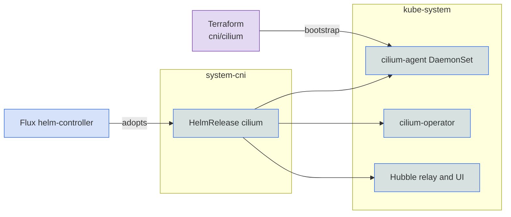

Cilium is the default [CNI](index.md) on Talos clusters. It replaces kube-proxy with eBPF, announces `LoadBalancer` addresses over L2, and provides Hubble for network visibility. With `gateway.driver: cilium` it also runs the [gateway](../gateway/cilium.md) that serves `my-app.example.com`. The [CNI overview](index.md) defines the terms this page assumes.

## Turn it on

Talos clusters already default to Cilium, so you set the driver only to make the choice explicit or to opt in on a platform that defaults to Flannel. This `values.yaml` selects it.

```yaml
cluster:
  cni:
    driver: cilium
```

With `cilium` set, Core turns off Talos's built-in Flannel and kube-proxy in the machine config. Cilium's pods run in `kube-system`, and the HelmRelease that manages them lives in `system-cni`.

EKS can opt in with the same setting, but that path is untested. Core then installs Cilium once the cluster exists and skips L2 announcements, because the AWS Load Balancer Controller owns `LoadBalancer` Services. AKS and GKE keep their managed CNIs. See [Defaults](index.md#defaults).

## Bootstrap

Flux needs pod networking to run, so Cilium has to exist before Flux does. Terraform installs it first through the Talos API. Flux then adopts the release through a HelmRelease with the same name and namespace, and later changes go through Git.

The two tools split the configuration. Terraform sets only the baseline: IPAM mode, kube-proxy replacement, operator replicas, and the Talos capabilities. Flux owns everything else, including Hubble, the gateway, and L2.

Cilium reaches the Kubernetes API through Talos *KubePrism*, a local load balancer at `localhost:7445` on every node that spreads requests across the control planes. Cilium therefore keeps working when one control plane is down, and it needs no fixed API address.

Operator replicas are the one value both tools must agree on. The operator runs two replicas, or one on a single-node cluster, where two would contend for the same host port. Terraform and Flux both read the count from `topology`.

This diagram shows the handoff from Terraform to Flux and the workloads the HelmRelease manages.



## Load balancer addresses

A `LoadBalancer` Service stays pending until something assigns it an address. Cilium LB IPAM does that with no other controller, and it announces each address over L2 on every network interface. For each address, one node at a time answers, whichever claimed it first.

Each [gateway](../gateway/index.md#service-exposure) gets a pool holding only its `gateway.<name>.ip`. A `LoadBalancer` Service for `my-app` that pins no address needs a range, as in this example.

```yaml
network:
  loadbalancer_ips:
    start: 10.5.1.20
    end: 10.5.1.40
```

Gateway addresses MUST sit outside the range. Cilium assigns only from a pool, so without a range no other `LoadBalancer` Service gets an address.

Cilium takes the place of MetalLB and kube-vip. On a Cilium cluster, `network.loadbalancer_driver` accepts only `cilium` or `none`, and `kube-vip` or `metallb` fails validation.

> [!NOTE]
> Hetzner's cloud network is not a flat L2 network. On Hetzner, Core leaves out the L2 component and the Hetzner cloud controller assigns addresses.

## Hubble

*Hubble* is Cilium's network visibility layer. It is always on, with its relay, UI, and flow metrics for DNS, drops, ports, TCP, ICMP, and HTTP. An in-cluster CronJob rotates its certificates, so Hubble does not depend on cert-manager.

The UI has no gateway route. Reach it with `kubectl port-forward` to the `hubble-ui` Service in `kube-system`.

## Monitoring

With `telemetry.metrics.enabled` (the default), Prometheus scrapes the Cilium agent, operator, and `cilium-envoy` pods and the Hubble metrics. Setting `observability.enabled` adds Grafana dashboards for the agent, the operator, and Hubble.

## Operations

Each item below pairs a symptom with its usual cause.

- If the Cilium pods crash-loop with `Operation not permitted` on Talos, the capabilities patch did not apply. Check that the `cilium/talos` component is in the `cni` Kustomization.
- If `cilium-operator` creates no Gateway controller, the Gateway API CRDs were missing when it started. Restart the operator once they exist.
- If the gateway Service has no address, check that the `cilium-gateway-lbipam-sharing` MutatingPolicy is `Ready` and that the `cilium-lbipam-config-<gateway>` ConfigMap exists in `system-gateway`.
- If the HelmRelease reports `no matches for kind CiliumLoadBalancerIPPool`, Flux reconciled before the chart installed its CRDs. Reconcile again.
- If `windsor apply` keeps changing the Cilium replica count, Terraform and Flux disagree about `operator_replicas`. Both come from `topology`.

## Security

On Talos the agent runs with an explicit capability set instead of privileged mode. The workloads run in `kube-system` with host networking.

> [!WARNING]
> Cilium replaces kube-proxy as part of the install, so removing the add-on does not bring kube-proxy back.

Cilium enforces `NetworkPolicy` and `CiliumNetworkPolicy`, but Core applies no default deny policy. Pod-to-pod traffic is unencrypted, and routing uses Cilium's default VXLAN tunnel. Cilium supports WireGuard encryption between nodes, which Core does not turn on yet.

With the Cilium gateway driver, Cilium copies the gateway's TLS Secret into the `cilium-secrets` namespace. The wildcard certificate's private key therefore exists in two namespaces.

## Configuration

The keys below are the ones that affect Cilium.

| Key | Type | Default | Description |
|-----|------|---------|-------------|
| `cluster.cni.driver` | string | `cilium` on Talos | Set to `cilium`. See [CNI](index.md#defaults). |
| `network.loadbalancer_driver` | string | `cilium` | `cilium` or `none` on a Cilium cluster. |
| `network.loadbalancer_ips.start` | string | none outside workstation contexts | First address for `LoadBalancer` Services that do not pin one. |
| `network.loadbalancer_ips.end` | string | none outside workstation contexts | Last address of that range. |
| `topology` | string | derived | `single-node` runs one operator, otherwise two. |
| `telemetry.metrics.enabled` | boolean | `true` | Scrape Cilium and Hubble metrics. |

## Reference

- [terraform/cni/cilium](../../../terraform/cni/cilium)
- [kustomize/cni](../../../kustomize/cni)
- [kustomize/gateway](../../../kustomize/gateway)
- [kustomize/policy](../../../kustomize/policy)
- [kustomize/telemetry](../../../kustomize/telemetry)
