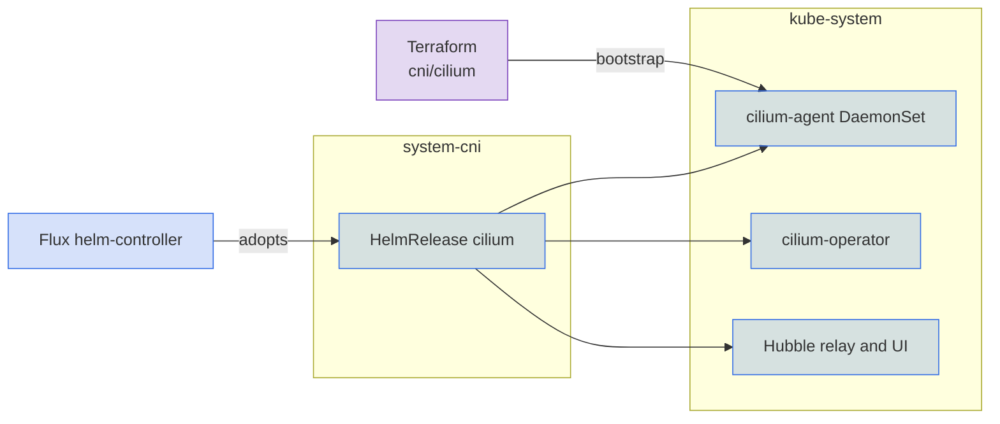

Cilium is the default [CNI](index.md) on Talos clusters. It replaces kube-proxy with eBPF and announces `LoadBalancer` addresses over L2. It encrypts pod traffic between nodes, and it provides Hubble for network visibility. With `gateway.driver: cilium`, Cilium also runs the [gateway](../gateway/cilium.md) that serves `my-app.example.com`. The [CNI overview](index.md) defines the terms that this page uses.

## Turn it on

Talos clusters use Cilium by default. Set the driver to make the choice explicit, or to use Cilium on a platform that defaults to Flannel. This `values.yaml` selects Cilium:

```yaml
cluster:
  cni:
    driver: cilium
```

With `cilium`, Core disables the Talos Flannel and kube-proxy in the machine config. The Cilium pods run in `kube-system`. The HelmRelease that manages them is in `system-cni`.

EKS accepts the same setting, but nobody tests that path. On EKS, Core installs Cilium after the cluster exists. Core skips L2 announcements there, because the AWS Load Balancer Controller owns `LoadBalancer` Services. AKS and GKE keep their managed CNIs. See [Defaults](index.md#defaults).

## Bootstrap

Flux cannot run without pod networking, so Cilium must exist before Flux. Terraform installs Cilium first, through the Talos API. Then Flux adopts the release through a HelmRelease with the same name and namespace. Later changes go through Git.

Terraform sets only the baseline values:

- the IPAM mode
- the kube-proxy replacement
- the operator replicas
- the Talos capabilities

Flux owns all other values, which include Hubble, the gateway, and L2.

Cilium connects to the Kubernetes API through Talos *KubePrism*. KubePrism is a local load balancer at `localhost:7445` on each node, and it sends requests to all the control planes. Cilium continues to work when one control plane is down, and it needs no fixed API address.

Terraform and Flux MUST agree on the number of operator replicas. The operator runs two replicas, or one on a single-node cluster. On a single node, two replicas compete for the same host port. Terraform and Flux both read the number from `topology`.

This diagram shows the handoff from Terraform to Flux, and the workloads that the HelmRelease manages.



## Load balancer addresses

A `LoadBalancer` Service stays pending until it gets an address. Cilium LB IPAM assigns the address, and no other controller is necessary. Cilium announces each address over L2 on all network interfaces. For each address, one node answers at a time: the node that claimed it first.

Each [gateway](../gateway/index.md#service-exposure) gets a pool that holds only its `gateway.<name>.ip`. A `LoadBalancer` Service for `my-app` that does not pin an address needs a range. This example sets a range:

```yaml
network:
  loadbalancer_ips:
    start: 10.5.1.20
    end: 10.5.1.40
```

Gateway addresses MUST be outside the range. Cilium assigns addresses only from a pool. Without a range, no other `LoadBalancer` Service gets an address.

Cilium replaces MetalLB and kube-vip. On a Cilium cluster, `network.loadbalancer_driver` accepts only `cilium` or `none`. Validation fails for `kube-vip` and `metallb`. [Load balancing](../load-balancing.md) compares the drivers.

> [!NOTE]
> The Hetzner cloud network is not a flat L2 network. On Hetzner, Core does not install the L2 component, and the Hetzner cloud controller assigns the addresses.

## Encryption

Without encryption, pod traffic between nodes crosses the site network in clear text. Outside workstation contexts, Core enables Cilium WireGuard *transparent encryption*. Cilium makes and distributes the key for each node. The encryption needs no certificates and no setting. Traffic between pods on the same node is not encrypted.

This `values.yaml` disables encryption:

```yaml
cluster:
  cni:
    encryption: false
```

WireGuard adds bytes to each packet, so Cilium decreases the pod MTU. Workstation contexts disable WireGuard by default. To enable it there, set `cluster.cni.encryption: true`.

## Hubble

*Hubble* is the network visibility layer of Cilium. Hubble is always on. It runs a relay, a UI, and flow metrics for DNS, drops, ports, TCP, ICMP, and HTTP. A CronJob in the cluster rotates the Hubble certificates, so Hubble does not use cert-manager.

The Hubble UI has no gateway route. To open it, run `kubectl port-forward` to the `hubble-ui` Service in `kube-system`.

## Monitoring

With `telemetry.metrics.enabled` (the default), Prometheus scrapes these targets:

- the Cilium agent pods
- the Cilium operator pods
- the `cilium-envoy` pods
- the Hubble metrics

With `observability.enabled`, Core adds Grafana dashboards for the agent, the operator, and Hubble.

## Operations

Each item gives a symptom and its usual cause.

- The Cilium pods crash-loop with `Operation not permitted` on Talos. The capabilities patch did not apply. Make sure that the `cni` Kustomization includes the `cilium/talos` component.
- `cilium-operator` makes no Gateway controller. The Gateway API CRDs did not exist when the operator started. Restart the operator after the CRDs exist.
- The gateway Service has no address. Make sure that the `cilium-gateway-lbipam-sharing` MutatingPolicy is `Ready`. Make sure that the `cilium-lbipam-config-<gateway>` ConfigMap exists in `system-gateway`.
- The HelmRelease reports `no matches for kind CiliumLoadBalancerIPPool`. Flux reconciled before the chart installed its CRDs. Reconcile again.
- `windsor apply` changes the Cilium replica count each time. Terraform and Flux do not agree about `operator_replicas`. Both read the value from `topology`.

## Security

On Talos, the agent runs with an explicit set of capabilities, not in privileged mode. The workloads run in `kube-system` with host networking.

> [!WARNING]
> Cilium replaces kube-proxy during the install. If you remove the add-on, kube-proxy does not come back.

Cilium enforces `NetworkPolicy` and `CiliumNetworkPolicy`. Core applies no default deny policy. Cilium routes traffic through its default VXLAN tunnel. Outside workstation contexts, [WireGuard](#encryption) encrypts the tunnel between nodes.

With the Cilium gateway driver, Cilium copies the gateway TLS Secret into the `cilium-secrets` namespace. The private key of the wildcard certificate then exists in two namespaces.

## Configuration

This table gives the keys that affect Cilium.

| Key | Type | Default | Description |
|-----|------|---------|-------------|
| `cluster.cni.driver` | string | `cilium` on Talos | Set to `cilium`. See [CNI](index.md#defaults). |
| `cluster.cni.encryption` | boolean | `true` outside workstation contexts | WireGuard between nodes. |
| `network.loadbalancer_driver` | string | `cilium` | `cilium` or `none` on a Cilium cluster. |
| `network.loadbalancer_ips.start` | string | none outside workstation contexts | First address for `LoadBalancer` Services that do not pin an address. |
| `network.loadbalancer_ips.end` | string | none outside workstation contexts | Last address of that range. |
| `topology` | string | derived | `single-node` runs one operator. All other values run two. |
| `telemetry.metrics.enabled` | boolean | `true` | Prometheus scrapes the Cilium and Hubble metrics. |

## Reference

- [terraform/cni/cilium](../../../terraform/cni/cilium)
- [kustomize/cni](../../../kustomize/cni)
- [kustomize/gateway](../../../kustomize/gateway)
- [kustomize/policy](../../../kustomize/policy)
- [kustomize/telemetry](../../../kustomize/telemetry)
