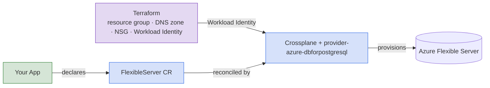

On Azure, you can give `my-app` a managed Postgres database by declaring an Azure Database for PostgreSQL Flexible Server as a resource in the cluster. Crossplane then creates the server in your subscription. Flexible Server is the default cloud driver when `platform: azure`. This page assumes the terms from the [Database](index.md) overview.

## Turn it on

You turn on cloud Postgres in `values.yaml`:

```yaml
database:
  postgres:
    cloud:
      enabled: true
```

`cloud.driver` defaults to `azuredb` on Azure, so you don't set it. When enabled, the Crossplane operator and `provider-azure-dbforpostgresql` are installed in the `system-provisioning` namespace.

## Launch a database

A database on Azure takes two resources. The *`FlexibleServer`* is the Postgres server itself. This [FlexibleServer](https://marketplace.upbound.io/providers/upbound/provider-azure-dbforpostgresql/v2.7.2/resources/dbforpostgresql.azure.upbound.io/FlexibleServer/v1beta1) manifest creates the `my-app-db` server:

```yaml
apiVersion: dbforpostgresql.azure.upbound.io/v1beta1
kind: FlexibleServer
metadata:
  name: my-app-db
spec:
  forProvider:
    location: eastus
    version: "16"
    skuName: B_Standard_B1ms
    storageMb: 32768
    administratorLogin: myapp
    autoGeneratePassword: true
    administratorPasswordSecretRef:
      name: my-app-db-admin-credentials
      namespace: system-database
      key: password
    publicNetworkAccessEnabled: false
    # Injected automatically at admission:
    # resourceGroupName: my-cluster-postgres
    # delegatedSubnetId: /subscriptions/<subscription-id>/resourceGroups/my-cluster/providers/Microsoft.Network/virtualNetworks/my-cluster/subnets/postgres
    # privateDnsZoneId: /subscriptions/<subscription-id>/resourceGroups/my-cluster-postgres/providers/Microsoft.Network/privateDnsZones/my-cluster.postgres.database.azure.com
    # tags:
    #   WindsorContextID: a1b2c3d4
```

`location` MUST match the region of the delegated subnet. `autoGeneratePassword` and `administratorPasswordSecretRef` have the provider generate the admin password and store it in `my-app-db-admin-credentials` in `system-database`.

The commented lines are fields you leave out. At admission, a Kyverno policy sets `resourceGroupName` to the context's Postgres resource group and fills in `delegatedSubnetId` and `privateDnsZoneId` if you leave them out. The Crossplane identity's role assignment is scoped to that resource group, so it can only manage servers inside it.

`FlexibleServer` has no database name field, so the second resource is a *`FlexibleServerDatabase`*. This [FlexibleServerDatabase](https://marketplace.upbound.io/providers/upbound/provider-azure-dbforpostgresql/v2.7.2/resources/dbforpostgresql.azure.upbound.io/FlexibleServerDatabase/v1beta1) manifest creates the `myapp` database on `my-app-db`:

```yaml
apiVersion: dbforpostgresql.azure.upbound.io/v1beta1
kind: FlexibleServerDatabase
metadata:
  name: myapp
spec:
  forProvider:
    serverIdRef:
      name: my-app-db
```

`serverIdRef.name` points the database at the `FlexibleServer` by its resource name.

## Application roles

To give an application its own database user, create an `AppRole` with `instanceName` set to the name of the `FlexibleServer` and `databaseName` set to a `FlexibleServerDatabase` on it. For the running example, that is `instanceName: my-app-db` and `databaseName: myapp`. See [Application roles](index.md#application-roles) for the full resource and the Secret it produces.

## Deletion

A `FlexibleServer` owns the server it created, and Crossplane's default `spec.deletionPolicy` is `Delete`. Set `deletionPolicy: Orphan` to leave the server in Azure when the resource is removed.

> [!WARNING]
> Deleting a `FlexibleServer` deletes the server and its databases unless `deletionPolicy` is `Orphan`.

`FlexibleServer` has no deletion protection field of its own, so `deletionPolicy` is the only safeguard in the manifest. Because deleting the server removes its databases as well, the demo sets `deletionPolicy: Orphan` on the `FlexibleServerDatabase`.

## Encryption at rest

Flexible Server storage is always encrypted, by default with the Azure platform-managed key. You may provide your own Key Vault key, or allow the blueprint to manage one for you, with the `encryption` keys shown here:

```yaml
database:
  postgres:
    cloud:
      encryption:
        managed: true   # create a dedicated Key Vault key
        # key_id: https://my-vault.vault.azure.net/keys/my-key/0123456789abcdef   # use an existing key; overrides managed
```

`managed: true` has the blueprint create a dedicated Key Vault key. `key_id` names an existing key and overrides `managed`. `managed` has no effect when the context sets `ephemeral: true`. With either option set, a second Kyverno policy fills in `identity` and `customerManagedKey` on any `FlexibleServer` that omits them.

## Monitoring

Monitoring works the same on every cloud driver. See [Monitoring](index.md#monitoring).

## Under the hood

Terraform creates the resource group, a private DNS zone, a network security group open only to the cluster's node subnets, the Key Vault key if `managed` is set, and the Workload Identity and role assignment for the Crossplane provider. Kustomize installs Crossplane and the provider. The provider then reconciles each `FlexibleServer` into an Azure server, as this diagram shows:



## Reference

- [terraform/database/azure-postgres](../../../terraform/database/azure-postgres)
- [terraform/provisioning/crossplane-identity/azure](../../../terraform/provisioning/crossplane-identity/azure)
- [kustomize/database](../../../kustomize/database)
- [kustomize/demo/resources/database/azuredb](../../../kustomize/demo/resources/database/azuredb)
- [kustomize/observability](../../../kustomize/observability)
- [kustomize/provisioning](../../../kustomize/provisioning)
- [kustomize/provisioning/crossplane/azure-postgres](../../../kustomize/provisioning/crossplane/azure-postgres)
