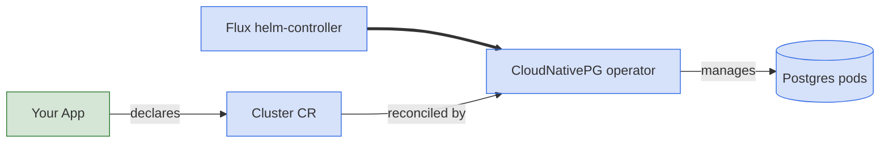

CloudNativePG runs Postgres inside the cluster. You use it when `my-app` needs a database and you don't want to depend on a cloud account, or when there is no cloud at all. It works on any platform, including AWS, Azure, and GCP. This page builds the `my-app-db` database from the [Database](index.md) overview.

## Turn it on

You turn on CloudNativePG with one key in `values.yaml`:

```yaml
database:
  postgres:
    enabled: true
```

With `database.postgres.enabled` set, the CloudNativePG *operator* is installed in the `system-database` namespace and watches every namespace. The operator is the controller that creates and manages Postgres pods for you. Core creates no application databases. Add-ons that need Postgres, such as Keycloak, create their own `Cluster`.

> [!NOTE]
> Dev mode turns `database.postgres.enabled` on unless it is set to `false`.

This setting is independent of `database.postgres.cloud`, so both can be enabled at once.

## Launch a database

The operator does nothing until you ask it for a database. You ask by creating a *`Cluster`*, the CloudNativePG resource that describes one Postgres database and its instances. This [Cluster](https://cloudnative-pg.io/documentation/current/cloudnative-pg.v1/#postgresql-cnpg-io-v1-Cluster) manifest creates `my-app-db` in the `my-app` namespace:

```yaml
apiVersion: postgresql.cnpg.io/v1
kind: Cluster
metadata:
  name: my-app-db
  namespace: my-app
spec:
  instances: 2
  bootstrap:
    initdb:
      database: myapp
  storage:
    size: 1Gi
  monitoring:
    enablePodMonitor: true
```

`spec.instances: 2` asks for two Postgres instances, and the operator replicates and fails over between them. `spec.bootstrap.initdb.database` creates the `myapp` database on first start. `spec.monitoring.enablePodMonitor` lets the telemetry stack scrape the instances, which the [alerts](#alerts) depend on. Core configures no backups; set them in the `Cluster` spec.

The operator also generates a `basic-auth` Secret named `<cluster name>-app`, which is `my-app-db-app` here, in the `Cluster`'s namespace. It holds the username, password, RW service hostname, port, database name, and ready-made connection URIs. The user it names owns the database. `my-app` reads this Secret to connect, in place of the `AppRole` the cloud drivers use. See [Secrets](https://cloudnative-pg.io/documentation/current/applications/#secrets) in the CloudNativePG docs.

## Topology

The context's `topology` setting changes how the operator itself runs. Two of its values change the operator's deployment:

- `ha` runs two operator replicas with pod anti-affinity across nodes and adds a PodDisruptionBudget so one replica stays up during node drains.
- `single-node` turns off the operator's leader election, which avoids constant lease writes to etcd on a one-node cluster.

`topology` does not affect your databases. The number of Postgres instances, and therefore whether a database fails over, comes from `spec.instances` on the `Cluster`. A `Cluster` with `instances: 1` is a single Postgres instance on any topology.

## Alerts

The telemetry add-on installs seven Prometheus alert rules for CloudNativePG, taken from the operator's own sample set. They are installed when `database.postgres.enabled`, `telemetry.metrics.enabled`, and `telemetry.alerts.enabled` are all true; the last two default to true. The rules read the operator's `cnpg_*` metrics, so a `Cluster` needs `monitoring.enablePodMonitor: true` for its instances to be scraped.

Every rule has severity `warning` and fires after its condition has held for one minute. The rules and their conditions are listed in this table:

| Alert | Fires when |
|---|---|
| `LongRunningTransaction` | A query has been running for more than 5 minutes. |
| `BackendsWaiting` | More than 300 backends are waiting on another query. |
| `PGDatabase` | Transaction ID age passes 300 million. |
| `PGReplication` | A standby is more than 5 minutes behind the primary. |
| `LastFailedArchiveTime` | WAL archiving failed more recently than it last succeeded. |
| `DatabaseDeadlockConflicts` | More than 10 deadlocks are recorded. |
| `ReplicaFailingReplication` | A replica is in recovery but its WAL receiver is not running. |

## Under the hood

Flux installs the operator through its Helm controller. From then on, your application declares a `Cluster`, and the operator reconciles it into Postgres pods, as this diagram shows:



## Reference

- [kustomize/database](../../../kustomize/database)
- [kustomize/demo/resources/database/cloudnativepg](../../../kustomize/demo/resources/database/cloudnativepg)
- [kustomize/observability](../../../kustomize/observability)
- [kustomize/telemetry](../../../kustomize/telemetry)
