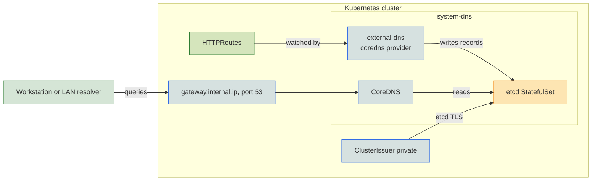

Grafana, the Flux web UI, and your internal services use the `internal` gateway. Their names must resolve only on your network. `dns.private_domain` gives the `internal` gateway its hostnames, such as `my-app.int.example.com`. external-dns publishes these names to a [private zone](index.md). The platform selects where that zone is.

## Where the zone lives

`dns.private.driver` names the server for the zone. When `dns.private_domain` is set, Core sets the default driver from the platform. This table gives each value and the platforms where it is the default. Each zone gets its own external-dns instance.

| `dns.private.driver` | Private zone | Default on |
|---|---|---|
| `cloud` | A zone in the DNS service of the cloud, attached to the VPC or virtual network. | AWS, Azure, GCP |
| `coredns` | CoreDNS in the cluster. CoreDNS serves the zone from etcd. | metal, vSphere, Hyper-V, Incus, Proxmox, docker |
| `none` | None. The DNS of the site answers for the zone. | Hetzner, and a `NodePort` `internal` gateway outside workstation contexts |

A value that you set replaces the default. For example, a cloud cluster can run `coredns` in place of a cloud zone. Windsor rejects `cloud` outside AWS, Azure, and GCP. The deprecated `dns.private.enabled: true` selects `coredns`.

## Cloud private zones

On a cloud platform, the private zone is in the same network as the cluster. This `values.yaml` puts `int.example.com` in a cloud private zone:

```yaml
dns:
  private_domain: int.example.com
```

The network Terraform component makes the zone and attaches it to the VPC or virtual network. Only hosts on that network can resolve the names. The `internal` gateway never publishes to the public zone. This table gives the private zone service and the external-dns provider for each cloud.

| `platform` | Zone | external-dns provider |
|---|---|---|
| `aws` | Route53 private hosted zone | `route53` |
| `azure` | Azure Private DNS zone | `azure-private-dns` |
| `gcp` | Cloud DNS private zone | `google` |

## CoreDNS

A platform without a cloud DNS service, such as a local cluster or metal, still needs a server for `int.example.com`. The `coredns` driver runs that DNS server in the cluster. It is the default on these platforms. This `values.yaml` selects it explicitly:

```yaml
dns:
  private_domain: int.example.com
  private:
    driver: coredns
```

Core installs CoreDNS and an etcd StatefulSet in `system-dns`. external-dns writes a record into etcd for each route. CoreDNS answers from these records. When `dns.public_domain` is also set, CoreDNS answers for that domain too. The cluster then resolves public hostnames to its own gateway addresses. Dev mode enables CoreDNS with the domain `test`.

> [!NOTE]
> external-dns only adds and updates records in CoreDNS. A record stays after you delete its route.

CoreDNS and external-dns connect to etcd over mutual TLS. The certificates come from the `private` [cluster issuer](../pki/index.md). With `topology: ha`, CoreDNS runs two replicas on different nodes.

This diagram shows two paths: a query from a resolver to CoreDNS, and a record from a route into etcd.



### Reach it

CoreDNS serves port 53 at `gateway.internal.ip`, the address of the `internal` gateway. Port 53 cannot be a node port. Windows DNS conditional forwarders also send only to port 53. Outside workstation contexts, the `coredns` driver thus needs a `LoadBalancer` `internal` gateway. The gateway driver selects how Core exposes port 53, as this table shows.

| `gateway.driver` | Port 53 exposed through |
|---|---|
| [`envoy`](../gateway/envoy.md#private-dns) | UDP and TCP routes on the `internal` Gateway. In a workstation context with a `NodePort` gateway, node port `30053`. |
| [`cilium`](../gateway/cilium.md#private-dns) | A `LoadBalancer` Service that shares the address of the `internal` gateway through LB IPAM. |

On a local cluster, the DNS container of the workstation forwards the private domain to that address. It also forwards the public domain when it is set. On metal and the other on-prem platforms, the address is on the LAN. Clients can send queries to it directly. Or, the resolver of the site can forward `*.<dns.private_domain>` to it with a conditional forwarder.

### Without private DNS

Some clusters have a `NodePort` `internal` gateway, for example Hyper-V behind its NAT switch. These clusters default to `dns.private.driver: none` and run no private DNS. Core publishes no records for that gateway, so the DNS of the site MUST resolve its hostnames. Use one wildcard record for `*.<dns.private_domain>` to cover all routes. Point it at the node address, or at the load balancer in front of the node ports.

## Reference

- [terraform/network](../../../terraform/network)
- [kustomize/dns](../../../kustomize/dns)
- [kustomize/gateway](../../../kustomize/gateway)
- [kustomize/pki](../../../kustomize/pki)
