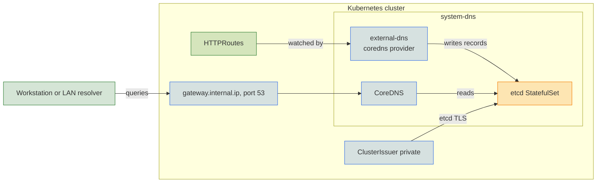

Grafana, the Flux web UI, and your own internal services sit on the `internal` gateway, and their names belong only on your own network. `dns.private_domain` gives the `internal` gateway its hostnames, such as `my-app.example.internal`, and external-dns publishes them to a [private zone](index.md). The platform decides where that zone lives.

## Where the zone lives

The table below lists where each platform keeps the private zone. Each zone gets its own external-dns instance.

| Platform | Private zone | Turned on by |
|---|---|---|
| AWS, Azure, GCP | A zone in the cloud's DNS service, attached to the VPC or virtual network. | `dns.private_domain` |
| metal, vSphere, Hyper-V, Incus, Proxmox, docker | CoreDNS in the cluster, serving the zone from etcd. | `dns.private.enabled: true`, on by default in dev mode |
| Hetzner | None. Hetzner gets no `internal` gateway. | |

## Cloud private zones

On a cloud platform, the private zone belongs in the same network as the cluster. This `values.yaml` puts `example.internal` in a cloud private zone:

```yaml
dns:
  private_domain: example.internal
```

The network Terraform component creates the zone and attaches it to the VPC or virtual network, so only hosts on that network can resolve the names. The `internal` gateway never publishes to the public zone. Each cloud uses its own private zone service and external-dns provider, listed below.

| `platform` | Zone | external-dns provider |
|---|---|---|
| `aws` | Route53 private hosted zone | `route53` |
| `azure` | Azure Private DNS zone | `azure-private-dns` |
| `gcp` | Cloud DNS private zone | `google` |

## CoreDNS

A platform with no cloud DNS service, such as a local cluster or metal, still needs something to answer for `example.internal`. `dns.private.enabled` runs that DNS server inside the cluster:

```yaml
dns:
  private_domain: example.internal
  private:
    enabled: true
```

Core installs CoreDNS and an etcd StatefulSet in `system-dns`. external-dns writes a record into etcd for each route, and CoreDNS answers from those records. When `dns.public_domain` is also set, CoreDNS answers for it too, so the cluster resolves public hostnames to its own gateway addresses. Dev mode turns it on with the domain `test`.

> [!NOTE]
> external-dns only adds and updates records in CoreDNS. A record stays after its route is deleted.

CoreDNS and external-dns reach etcd over mutual TLS, with certificates from the `private` [cluster issuer](../pki/index.md). With `topology: ha`, CoreDNS runs two replicas on separate nodes.

The diagram below traces a query from a resolver to CoreDNS and a record from a route into etcd.



### Reach it

CoreDNS serves port 53 at `gateway.internal.ip`, the `internal` gateway's address. Port 53 cannot be a node port, and Windows DNS conditional forwarders only send to port 53, so outside workstation contexts private DNS needs a `LoadBalancer` `internal` gateway. How the port gets exposed depends on the gateway driver, as the table below shows.

| `gateway.driver` | Port 53 exposed through |
|---|---|
| [`envoy`](../gateway/envoy.md#private-dns) | UDP and TCP routes on the `internal` Gateway. In a workstation context with a `NodePort` gateway, node port `30053`. |
| [`cilium`](../gateway/cilium.md#private-dns) | A `LoadBalancer` Service that shares the `internal` gateway's address through LB IPAM. |

On a local cluster, the workstation's DNS container forwards the private domain, and the public domain when set, to that address. On metal and the other on-prem platforms, the address is on the LAN. Clients can query it directly, or the site's resolver can forward `*.<dns.private_domain>` to it with a conditional forwarder.

### Without private DNS

A cluster whose `internal` gateway is a `NodePort`, such as Hyper-V behind its NAT switch, runs no private DNS. Core publishes no records for that gateway, so the site's own DNS MUST resolve its hostnames. A wildcard record for `*.<dns.private_domain>` that points at the node address, or at the load balancer in front of the node ports, covers every route with one entry.

## Reference

- [terraform/network](../../../terraform/network)
- [kustomize/dns](../../../kustomize/dns)
- [kustomize/gateway](../../../kustomize/gateway)
- [kustomize/pki](../../../kustomize/pki)
