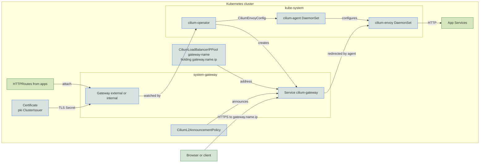

A cluster with the [Cilium CNI](../cni/cilium.md) already has an Envoy on each node and a Gateway API controller. The `cilium` driver uses these parts to serve the `external` and `internal` Gateways from the [Gateway](index.md) guide. Core installs no separate gateway controller and no proxy Deployment. The cilium-operator changes `Gateway` and `HTTPRoute` resources into Envoy configuration. The `cilium-envoy` pod on each node serves the traffic. [Choosing a driver](index.md#choosing-a-driver) compares this driver with [Envoy Gateway](envoy.md).

## Turn it on

The driver needs Cilium as the CNI. This `values.yaml` sets both keys:

```yaml
cluster:
  cni:
    driver: cilium   # required by the cilium gateway
gateway:
  driver: cilium
```

Where Cilium is the CNI, `gateway.driver` defaults to `cilium`, and you can omit both keys. On other clusters, it defaults to [`envoy`](envoy.md). AWS and docker-desktop always default to `envoy`. [CNI defaults](../cni/index.md#defaults) shows which clusters use Cilium.

With this driver, Core makes a `cilium` GatewayClass and the `external` and `internal` Gateways in `system-gateway`. The Cilium release belongs to the [CNI add-on](../cni/cilium.md). The CNI add-on enables Gateway API support when you select this driver. Core applies the Gateway API CRDs before the Cilium operator starts.

## Addresses

A Gateway with `service_type: LoadBalancer` gets a `LoadBalancer` Service. Without a cloud load balancer, that Service needs an address. Each Gateway sets its address in `gateway.<name>.ip`. Core gives Cilium *LB IPAM* a pool that holds only that address. Core pins the Service to the address with the `lbipam.cilium.io/ips` annotation. The address MUST be outside `network.loadbalancer_ips`, which is for other Services.

Clients find the address through L2 announcements. For each address, one node announces at a time: the node that claimed it first. The announcement load can be different on each node.

> [!IMPORTANT]
> L2 announcements do not work with `externalTrafficPolicy: Local`.

Services in all namespaces can share the address of a Gateway on other ports. The Gateway waits for the Cilium CNI install, so the sharing policy exists before the Service.

On Hetzner, the cloud controller gives the address to the Service of the `external` Gateway. Core does not add the LB IPAM annotations there.

The `cilium` driver does not support `gateway.<name>.node_ports`. To attach [ListenerSets](index.md#listenersets) to a `NodePort` Gateway, use the `envoy` driver.

## Private DNS

With `dns.private.driver: coredns`, clients send queries for the private zone to the address of the `internal` Gateway. CoreDNS gets its own `LoadBalancer` Service on port 53. That Service shares the address of the `internal` Gateway through LB IPAM. [Private zones](../dns/private.md#coredns) covers the zone.

## Monitoring

The `cilium` driver adds no monitors. With `telemetry.metrics.enabled` (the default), the [CNI add-on](../cni/cilium.md#monitoring) makes Prometheus scrape `cilium-envoy`, the agent, and the operator. With `observability.enabled`, the proxy panels of the Cilium dashboard show L7 redirects and response times. Only the [`envoy`](envoy.md#monitoring) driver installs the gateway alert rules and the Envoy Gateway dashboards.

## Under the hood

This diagram shows how a Gateway in `system-gateway` becomes Envoy configuration on the nodes. It also shows the path of a request to an app.



The cilium-operator changes each Gateway and its routes into a `CiliumEnvoyConfig`. The operator also makes a `LoadBalancer` Service for the Gateway. Traffic to the Service address goes to the node that announces it. The cilium-agent on that node sends the traffic to the local `cilium-envoy`. Envoy ends TLS with a certificate from one of the [cluster issuers](../pki/index.md). The Gateway waits for the `pki` resources tier, so the issuer exists before Core requests the certificate.

## Reference

- [kustomize/gateway/install/cilium](../../../kustomize/gateway/install/cilium)
- [kustomize/gateway/resources/cilium](../../../kustomize/gateway/resources/cilium)
- [kustomize/cni](../../../kustomize/cni)
- [kustomize/crds](../../../kustomize/crds)
- [kustomize/pki](../../../kustomize/pki)
