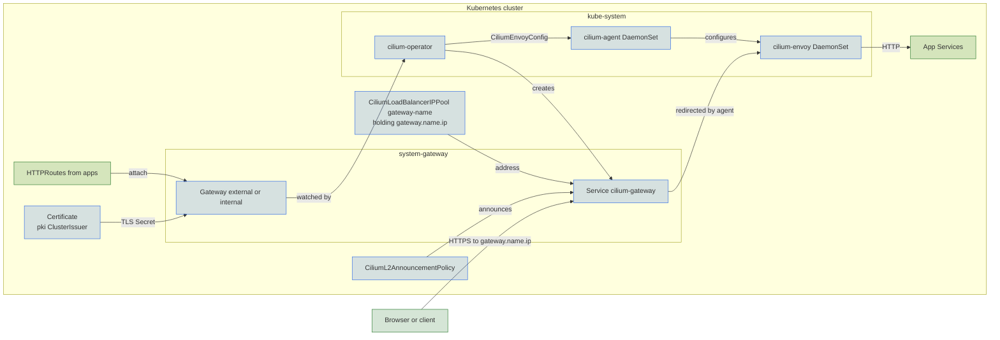

A cluster that already runs the [Cilium CNI](../cni/cilium.md) has an Envoy on every node and a Gateway API controller built in. The `cilium` driver serves the `external` and `internal` Gateways from the [Gateway](index.md) guide with those parts, so Core installs no separate gateway controller or proxy Deployment. The cilium-operator turns `Gateway` and `HTTPRoute` resources into Envoy configuration, and the `cilium-envoy` pod that Cilium runs on every node serves the traffic. [Choosing a driver](index.md#choosing-a-driver) compares this driver with [Envoy Gateway](envoy.md).

## Turn it on

The driver needs Cilium as the CNI, so a `values.yaml` that selects it sets both keys:

```yaml
cluster:
  cni:
    driver: cilium   # required by the cilium gateway
gateway:
  driver: cilium
```

`cluster.cni.driver: cilium` is the requirement. Where Cilium is already the CNI, `gateway.driver` defaults to `cilium` and you can leave both keys out. On other clusters it defaults to [`envoy`](envoy.md), and AWS and docker-desktop always default to `envoy`. See [CNI defaults](../cni/index.md#defaults) for which clusters use Cilium.

With the driver selected, Core creates a `cilium` GatewayClass and the `external` and `internal` Gateways in `system-gateway`, each when its domain is set. The Cilium release belongs to the [CNI add-on](../cni/cilium.md), which turns on Gateway API support when this driver is selected. The Gateway API CRDs are applied before the Cilium operator starts.

## Addresses

Each Gateway gets a `LoadBalancer` Service, and on clusters without a cloud load balancer that Service needs an address. Each Gateway names its own in `gateway.<name>.ip`. Core gives Cilium's *LB IPAM* a pool holding only that address and pins the Service to it through the `lbipam.cilium.io/ips` annotation. The address MUST sit outside `network.loadbalancer_ips`, which serves other Services.

Clients find the address through L2 announcements. One node at a time announces each address, whichever claimed it first, so announcement load can be uneven across nodes.

> [!IMPORTANT]
> L2 announcements do not work with `externalTrafficPolicy: Local`.

Services in any namespace can share a Gateway's address on other ports. The Gateway waits for the Cilium CNI install, so the sharing policy exists before the Service does.

On Hetzner the cloud controller fills the Service of the `external` Gateway instead, and the LB IPAM annotations are left off.

## Private DNS

With `dns.private.enabled`, clients query the private zone on the same address as the `internal` Gateway. CoreDNS gets its own `LoadBalancer` Service on port 53, which shares the `internal` gateway's address through LB IPAM. [Private zones](../dns/private.md#coredns) covers the zone itself.

## Monitoring

The `cilium` driver adds no monitors of its own. With `telemetry.metrics.enabled` (the default), the [CNI add-on](../cni/cilium.md#monitoring) has Prometheus scrape `cilium-envoy` along with the agent and operator. With `observability.enabled`, the Cilium dashboard's proxy panels show L7 redirects and response times. The gateway alert rules and Envoy Gateway dashboards install only for the [`envoy`](envoy.md#monitoring) driver.

## Under the hood

The diagram below shows how a Gateway in `system-gateway` becomes Envoy configuration on the nodes, and the path a request takes to an app.



The cilium-operator translates each Gateway and its routes into a `CiliumEnvoyConfig` and creates a `LoadBalancer` Service for the Gateway. Traffic to that Service's address arrives at whichever node announces it, and the cilium-agent there redirects it to the node's `cilium-envoy`. TLS ends at Envoy, using a certificate from one of the [cluster issuers](../pki/index.md). The Gateway waits for the `pki` resources tier so the issuer exists when the certificate is requested.

## Reference

- [kustomize/gateway/install/cilium](../../../kustomize/gateway/install/cilium)
- [kustomize/gateway/resources/cilium](../../../kustomize/gateway/resources/cilium)
- [kustomize/cni](../../../kustomize/cni)
- [kustomize/crds](../../../kustomize/crds)
- [kustomize/pki](../../../kustomize/pki)
