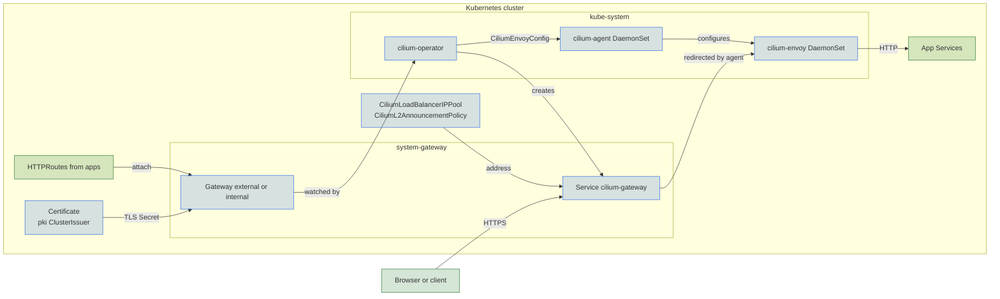

The `cilium` driver uses the Gateway API controller built into Cilium, so it needs the [Cilium CNI](../cni/cilium.md) (`cluster.cni.driver: cilium`). The cilium-operator turns `Gateway` and `HTTPRoute` resources into Envoy configuration, and the `cilium-envoy` pod that Cilium runs on every node serves the traffic. Core installs no separate gateway controller or proxy Deployment. [Choosing a driver](index.md#choosing-a-driver) compares it with [Envoy Gateway](envoy.md).

## Turn it on

```yaml
cluster:
  cni:
    driver: cilium   # required by the cilium gateway
gateway:
  driver: cilium
```

`gateway.driver` defaults to `cilium` when Cilium is the CNI and to [`envoy`](envoy.md) otherwise. AWS and docker-desktop always default to `envoy`. See [CNI defaults](../cni/index.md#defaults) for which clusters use Cilium.

Core creates a `cilium` GatewayClass and the `external` and `internal` Gateways in `system-gateway`, each when its domain is set. The Cilium release belongs to the [CNI add-on](../cni/cilium.md), which turns on Gateway API support when this driver is selected. The Gateway API CRDs are applied before the Cilium operator starts.

## Addresses

Cilium's LB IPAM gives the `internal` Gateway's Service the first address in `network.loadbalancer_ips` and the `external` Gateway the next one. A single Gateway takes the first. One node at a time announces each address over L2, whichever claimed it first, so announcement load can be uneven. L2 announcements do not work with `externalTrafficPolicy: Local`. Services in any namespace can share a Gateway's address on other ports. The Gateway waits for the Cilium CNI install, so the sharing policy exists before the Service does.

On Hetzner the cloud controller fills the Service of the `external` Gateway instead, and the LB IPAM annotations are left off.

## Private DNS

`dns.private.enabled` gives CoreDNS its own `LoadBalancer` Service on port 53, which shares the `internal` gateway's address through LB IPAM. The zone itself is covered under [Private zones](../dns/private.md).

## Monitoring

The gateway adds no monitors of its own. With `telemetry.metrics.enabled` (the default), the [CNI add-on](../cni/cilium.md#monitoring) has Prometheus scrape `cilium-envoy` along with the agent and operator. With `observability.enabled`, the Cilium dashboard's proxy panels show L7 redirects and response times. The gateway alert rules and Envoy Gateway dashboards install only for the [`envoy`](envoy.md#monitoring) driver.

## Under the hood



The cilium-operator translates each Gateway and its routes into a `CiliumEnvoyConfig` and creates a `LoadBalancer` Service for the Gateway. Traffic to that Service's address arrives at whichever node announces it, and the cilium-agent there redirects it to the node's `cilium-envoy`. TLS ends at Envoy, using a certificate from one of the [cluster issuers](../pki/index.md). The Gateway waits for the `pki` resources tier so the issuer exists when the certificate is requested.

## Reference

- [kustomize/gateway/install/cilium](../../../kustomize/gateway/install/cilium)
- [kustomize/gateway/resources/cilium](../../../kustomize/gateway/resources/cilium)
- [kustomize/cni](../../../kustomize/cni)
- [kustomize/crds](../../../kustomize/crds)
- [kustomize/pki](../../../kustomize/pki)
