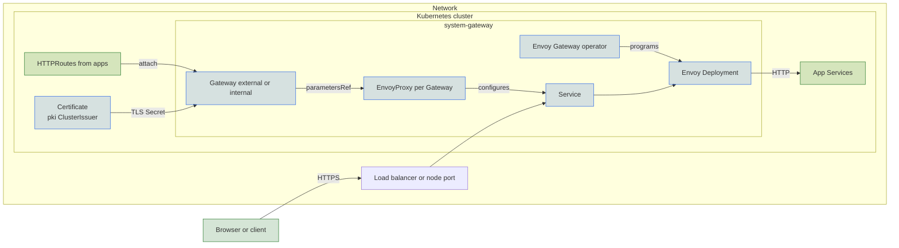

Envoy Gateway is the default driver on AWS, on docker-desktop, and on any cluster without the [Cilium CNI](../cni/cilium.md). It runs its own controller and an Envoy proxy per Gateway, so it works on any cluster regardless of the CNI. This page assumes the `external` and `internal` Gateways and the `my-app` route from the [Gateway](index.md) guide. [Choosing a driver](index.md#choosing-a-driver) compares Envoy Gateway with the [Cilium](cilium.md) driver.

## Turn it on

Where Envoy Gateway is not already the default, select it in `values.yaml`:

```yaml
gateway:
  driver: envoy
```

Core installs the Envoy Gateway operator in `system-gateway`. It adds an `external` Gateway when `dns.public_domain` is set and an `internal` Gateway when `dns.private_domain` is set, both using the `envoy` GatewayClass. For each Gateway the operator creates an Envoy Deployment and a Service. The Gateway API and Envoy Gateway CRDs come from the vendored CRD layer.

## Unmatched requests

A request for a hostname that no route claims, such as `typo.example.com`, still reaches the gateway. Envoy Gateway answers any such HTTPS request with a `404` page from the proxy. The page is sent with `Cache-Control: no-store`, so browsers do not cache it after the hostname gets a real route. Only HTTPS requests reach this point, because the HTTP listener redirects plain HTTP to HTTPS first.

Such a hostname resolves because external-dns publishes the apex and a wildcard record (`example.com` and `*.example.com`) for each Gateway's own zone, pointing at that Gateway. A hostname with no route therefore lands on the 404.

## Data plane Service

Each Gateway references an `EnvoyProxy` of the same name, and that resource configures the Gateway's proxy, including the Service in front of the Envoy pods. The Service type follows the Gateway's `gateway.<name>.service_type`, and Core adds platform-specific settings to it. The table below lists what each environment gets.

| Environment | Service | Added |
|---|---|---|
| AWS | `LoadBalancer` | NLB annotations with `target-type: ip`, which send traffic straight to the Envoy pods with the client address preserved, plus cross-zone balancing. The scheme is `internet-facing` for `external` and `internal` for `internal`. |
| Azure, `internal` | `LoadBalancer` | The internal load balancer annotation. |
| GCP, `internal` | `LoadBalancer` | The internal load balancer annotation (`networking.gke.io/load-balancer-type: Internal`). |
| Hetzner, `external` | `LoadBalancer` | Annotations for a Hetzner Cloud load balancer in `hetzner.location` (default `ash`) that targets the nodes' private IPs. |
| metal, vSphere, Hyper-V, Incus, or Proxmox with kube-vip or MetalLB | `LoadBalancer` | The Gateway's `gateway.<name>.ip`, pinned through `kube-vip.io/loadbalancerIPs` or `metallb.io/loadBalancerIPs`. |
| The same platforms with the Cilium CNI | `LoadBalancer` | The Gateway's `gateway.<name>.ip`, pinned through `lbipam.cilium.io/ips`. |
| Azure or GCP, `external` | `LoadBalancer` | None. The cloud controller assigns an address. |
| docker-desktop, or `gateway.<name>.service_type: NodePort` | `NodePort` | Extra node ports, listed below. |

On `NodePort` the `internal` Service listens on `30080` for HTTP and `gateway.internal.node_port` (default `30443`) for HTTPS, and the `external` Service on `30081` and `gateway.external.node_port` (default `30444`). The `internal` Service can carry two more ports. With private DNS in a workstation context it exposes UDP and TCP port 53 on `30053`, and with `gitops.mode: push` (the default) it exposes the Flux webhook on `30292`. `gateway.publish_ports` maps host ports to these node ports.

docker-desktop publishes `internal` on host ports `8443` and `8080`, and `external` on `8444` and `8081`. The Service carries matching ports without node ports, so a pod can reach a hostname on the same port a browser uses.

## Private DNS

With `dns.private.enabled`, the private zone is served by CoreDNS in the cluster. Core adds UDP and TCP listeners on port 53 to the `internal` Gateway and routes them to CoreDNS, so the zone answers at `gateway.internal.ip`. On docker-desktop, pods reach `internal` hostnames on the same ports a browser uses, such as `https://grafana.test:8443`. [Private zones](../dns/private.md#coredns) covers the zone itself.

## Monitoring

With `telemetry.metrics.enabled`, Prometheus scrapes the proxies through a PodMonitor and the operator through a ServiceMonitor, and the operator installs after the telemetry stack. Alert rules fire on proxy liveness, empty or unhealthy upstreams, 5xx error rates, TLS errors and certificate expiry, and failed config pushes from the operator. When the `internal` Gateway exists, `observability.enabled` adds the Envoy Gateway and Envoy proxy dashboards to Grafana.

## Under the hood

The diagram below shows the resources in `system-gateway` and the path a request takes from the load balancer to an app.



The Gateway points at its `EnvoyProxy` through `parametersRef`, and the operator programs the Envoy Deployment. TLS ends at Envoy, using a certificate from one of the [cluster issuers](../pki/index.md). The Gateway waits for the `pki` resources tier so the issuer exists when the certificate is requested.

## Reference

- [kustomize/gateway/install/envoy](../../../kustomize/gateway/install/envoy)
- [kustomize/gateway/resources/envoy](../../../kustomize/gateway/resources/envoy)
- [kustomize/crds](../../../kustomize/crds)
- [kustomize/lb](../../../kustomize/lb)
- [kustomize/pki](../../../kustomize/pki)
