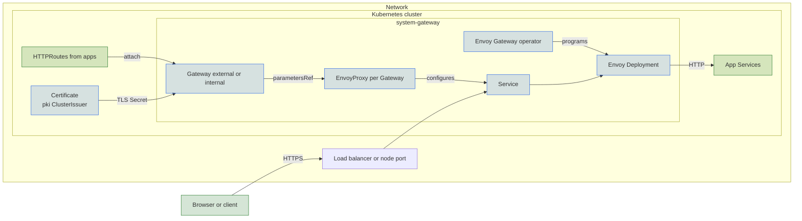

Envoy Gateway is the default driver on AWS and docker-desktop. It is also the default on all clusters without the [Cilium CNI](../cni/cilium.md). Envoy Gateway runs its own controller and one Envoy proxy for each Gateway, so it works with any CNI. This page uses the `external` and `internal` Gateways and the `my-app` route from the [Gateway](index.md) guide. [Choosing a driver](index.md#choosing-a-driver) compares Envoy Gateway with the [Cilium](cilium.md) driver.

## Turn it on

Where Envoy Gateway is not the default, select it in `values.yaml`:

```yaml
gateway:
  driver: envoy
```

Core installs the Envoy Gateway operator in `system-gateway`. Core adds the `external` and `internal` Gateways with the `envoy` GatewayClass. For each Gateway, the operator makes an Envoy Deployment and a Service. The Gateway API and Envoy Gateway CRDs come from the vendored CRD layer.

## Unmatched requests

A request for a hostname that no route claims, such as `typo.example.com`, still gets to the gateway. external-dns publishes an apex record and a wildcard record for the zone of each Gateway, `example.com` and `*.example.com`. Both records point at that Gateway.

Envoy Gateway answers such an HTTPS request with a `404` page from the proxy. The page has `Cache-Control: no-store`. Browsers do not keep it after the hostname gets a real route. Only HTTPS requests get the `404`, because the HTTP listener first redirects plain HTTP to HTTPS. A Gateway with `gateway.<name>.https: false` has no HTTPS listener and no `404` route.

## Data plane Service

Each Gateway refers to an `EnvoyProxy` with the same name. The `EnvoyProxy` configures the proxy of that Gateway, and the Service in front of the Envoy pods. The Service type is the value of `gateway.<name>.service_type`. Core adds settings for each platform, as this table shows.

| Environment | Service | Added |
|---|---|---|
| AWS | `LoadBalancer` | NLB annotations with `target-type: ip` and cross-zone balancing. The NLB sends traffic directly to the Envoy pods and keeps the client address. The scheme is `internet-facing` for `external` and `internal` for `internal`. |
| Azure, `internal` | `LoadBalancer` | The internal load balancer annotation. |
| GCP, `internal` | `LoadBalancer` | The internal load balancer annotation (`networking.gke.io/load-balancer-type: Internal`). |
| Hetzner, `external` | `LoadBalancer` | Annotations for a Hetzner Cloud load balancer in `hetzner.location` (default `ash`). The load balancer targets the private IPs of the nodes. |
| metal, vSphere, Hyper-V, Incus, or Proxmox with kube-vip or MetalLB | `LoadBalancer` | The `gateway.<name>.ip` of the Gateway, pinned through `kube-vip.io/loadbalancerIPs` or `metallb.io/loadBalancerIPs`. |
| The same platforms with the Cilium CNI | `LoadBalancer` | The `gateway.<name>.ip` of the Gateway, pinned through `lbipam.cilium.io/ips`. |
| Azure or GCP, `external` | `LoadBalancer` | None. The cloud controller assigns an address. |
| docker-desktop, or `gateway.<name>.service_type: NodePort` | `NodePort` | More node ports, given below. |

This table gives the node ports of each Service with `NodePort`.

| Gateway | HTTP | HTTPS |
|---|---|---|
| `internal` | `30080` | `gateway.internal.node_port`, default `30443` |
| `external` | `30081` | `gateway.external.node_port`, default `30444` |

The `internal` Service can have two more ports:

- With private DNS in a workstation context, UDP and TCP port 53 on node port `30053`.
- With `gitops.mode: push` (the default), the Flux webhook on node port `30292`.

`gateway.publish_ports` maps host ports to these node ports on Hyper-V.

docker-desktop publishes `internal` on host ports `8443` and `8080`. It publishes `external` on host ports `8444` and `8081`. The Service also has these ports without node ports. A pod can then use the same port as a browser to get to a hostname.

### ListenerSet ports

`gateway.<name>.node_ports` gives the node port for each [ListenerSet](index.md#listenersets) port on a `NodePort` Gateway. Only the `envoy` driver supports this key. For each entry, Core adds one TCP port to a second NodePort Service, `<name>-listeners`. That Service selects the same Envoy pods as the main Service.

Envoy Gateway moves a listener port below 1024 to a container port 10000 higher. The Service sends traffic for such a port to the listener port plus 10000. For a listener port of 1024 or more, the Service sends traffic to the same port.

## Private DNS

With `dns.private.driver: coredns`, CoreDNS in the cluster serves the private zone. Core adds UDP and TCP listeners on port 53 to the `internal` Gateway, and routes them to CoreDNS. The zone then answers at `gateway.internal.ip`. On docker-desktop, pods use the same ports as a browser for `internal` hostnames, for example `https://grafana.test:8443`. [Private zones](../dns/private.md#coredns) covers the zone.

## Monitoring

With `telemetry.metrics.enabled`, Prometheus scrapes the proxies through a PodMonitor and the operator through a ServiceMonitor. The operator installs after the telemetry stack. Alert rules fire on these conditions:

- a proxy is not live
- upstreams are empty or not healthy
- the rate of 5xx errors is high
- TLS errors occur, or a certificate is near expiry
- the operator fails to push config

When the `internal` Gateway exists, `observability.enabled` adds the Envoy Gateway and Envoy proxy dashboards to Grafana.

## Under the hood

This diagram shows the resources in `system-gateway`, and the path of a request from the load balancer to an app.



The Gateway points to its `EnvoyProxy` through `parametersRef`. The operator programs the Envoy Deployment. Envoy ends TLS with a certificate from one of the [cluster issuers](../pki/index.md). The Gateway waits for the `pki` resources tier, so the issuer exists before Core requests the certificate.

## Reference

- [kustomize/gateway/install/envoy](../../../kustomize/gateway/install/envoy)
- [kustomize/gateway/resources/envoy](../../../kustomize/gateway/resources/envoy)
- [kustomize/crds](../../../kustomize/crds)
- [kustomize/lb](../../../kustomize/lb)
- [kustomize/pki](../../../kustomize/pki)
