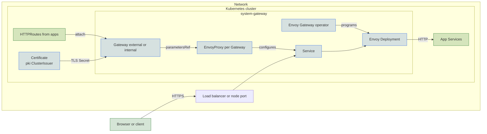

Envoy Gateway is the default driver on AWS, on docker-desktop, and on any cluster without the [Cilium CNI](../cni/cilium.md). It runs its own controller and an Envoy proxy per Gateway. [Choosing a driver](index.md#choosing-a-driver) compares it with the [Cilium](cilium.md) driver.

## Turn it on

```yaml
gateway:
  driver: envoy
```

Core installs the Envoy Gateway operator in `system-gateway`, along with an `external` Gateway when `dns.public_domain` is set and an `internal` Gateway when `dns.private_domain` is set. Both use the `envoy` GatewayClass. The operator creates an Envoy Deployment and a Service for each. The Gateway API and Envoy Gateway CRDs come from the vendored CRD layer.

## Unmatched requests

Any HTTPS request that matches no `HTTPRoute` gets a `404` page from the proxy, sent with `Cache-Control: no-store` so browsers do not cache it after the hostname gets a real route. Plain HTTP never gets this far, because the HTTP listener redirects it to HTTPS.

external-dns also publishes the apex and a wildcard record (`example.com` and `*.example.com`) for each Gateway's own zone, pointing at that Gateway. A hostname with no route therefore resolves and lands on the 404.

## Data plane Service

Each Gateway references an `EnvoyProxy` of the same name that configures its proxy. The Service type follows `gateway.service_type`:

| Environment | Service | Added |
|---|---|---|
| AWS | `LoadBalancer` | NLB annotations with `target-type: ip`, which send traffic straight to the Envoy pods with the client address preserved, plus cross-zone balancing. The scheme is `internet-facing` for `external` and `internal` for `internal`. |
| Azure, `internal` | `LoadBalancer` | The internal load balancer annotation. |
| GCP, `internal` | `LoadBalancer` | The internal load balancer annotation (`networking.gke.io/load-balancer-type: Internal`). |
| Hetzner, `external` | `LoadBalancer` | Annotations for a Hetzner Cloud load balancer in `hetzner.location` (default `ash`) that targets the nodes' private IPs. |
| Local with MetalLB or kube-vip | `LoadBalancer` | A fixed address from `network.loadbalancer_ips`: `start` for `internal`, the next address for `external` when both exist. |
| Local with the Cilium CNI | `LoadBalancer` | The same addresses, requested from Cilium LB IPAM through the `lbipam.cilium.io/ips` annotation. |
| Azure or GCP, `external` | `LoadBalancer` | None. The cloud controller assigns an address. |
| docker-desktop, or `service_type: NodePort` | `NodePort` | Extra node ports, listed below. |

On `NodePort` the `internal` Service listens on `30080` for HTTP and `30443` for HTTPS, and the `external` Service on `30081` and `30444`. With `dns.private.enabled` the `internal` Service also exposes UDP and TCP port 53 on `30053`, and with `gitops.mode: push` (the default) the Flux webhook on `30292`. `gateway.publish_ports` maps host ports to these node ports.

docker-desktop publishes `internal` on host ports `8443` and `8080`, and `external` on `8444` and `8081`. The Service carries matching ports without node ports. A pod can then reach a hostname on the same port a browser uses.

## Private DNS

`dns.private.enabled` adds UDP and TCP listeners on port 53 to the `internal` Gateway and routes them to CoreDNS. On docker-desktop, pods reach `internal` hostnames on the same ports a browser uses, such as `https://grafana.test:8443`. The zone itself is covered under [Private zones](../dns/private.md).

## Monitoring

With `telemetry.metrics.enabled`, Prometheus scrapes the proxies through a PodMonitor and the operator through a ServiceMonitor, and the operator installs after the telemetry stack. Alert rules fire on proxy liveness, empty or unhealthy upstreams, 5xx error rates, TLS errors and certificate expiry, and failed config pushes from the operator. When the `internal` Gateway exists, `observability.enabled` adds the Envoy Gateway and Envoy proxy dashboards to Grafana.

## Under the hood



TLS ends at Envoy, using a certificate from one of the [cluster issuers](../pki/index.md). The Gateway waits for the `pki` resources tier so the issuer exists when the certificate is requested.

## Reference

- [kustomize/gateway/install/envoy](../../../kustomize/gateway/install/envoy)
- [kustomize/gateway/resources/envoy](../../../kustomize/gateway/resources/envoy)
- [kustomize/crds](../../../kustomize/crds)
- [kustomize/lb](../../../kustomize/lb)
- [kustomize/pki](../../../kustomize/pki)
