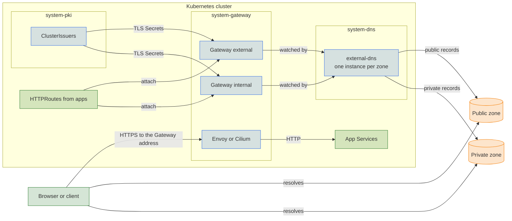

Without a gateway, a Service is reachable only inside the cluster or through `kubectl port-forward`. To serve `my-app` from the `my-app` namespace at `https://my-app.example.com`, something at the edge of the cluster has to accept the connection, end TLS, and pass the request to the right Service. The core blueprint does this with the Kubernetes [Gateway API](https://gateway-api.sigs.k8s.io/), and it turns the gateway on by default.

The smallest setup that gives you both a public and a private entrypoint sets two domains in a context's `values.yaml`:

```yaml
gateway:
  enabled: true
  driver: envoy          # envoy or cilium
dns:
  public_domain: example.com          # provisions the external gateway
  private_domain: example.internal    # provisions the internal gateway
```

Each domain provisions one *Gateway*, a Gateway API resource that accepts traffic for the routes attached to it. An application gets a hostname by attaching an *HTTPRoute* to a Gateway. `gateway.driver` picks the software that runs the Gateways, covered under [Choosing a driver](#choosing-a-driver).

## Gateways and domains

This table lists what each domain provisions.

| Domain set           | Gateway    | Serves              | DNS zone                          | Certificate issuer                                              |
| -------------------- | ---------- | ------------------- | --------------------------------- | --------------------------------------------------------------- |
| `dns.public_domain`  | `external` | The public internet | [Public zone](../dns/public.md)   | [`public-acme` or `public-selfsigned`](../pki/index.md#issuers) |
| `dns.private_domain` | `internal` | Your network        | [Private zone](../dns/private.md) | `private`                                                       |

Both Gateways live in the `system-gateway` namespace. A Gateway exists only when its domain is set, so public exposure is opt-in: a cluster with no `dns.public_domain` has no `external` Gateway.

The two domains MUST differ. Windsor fills in `dns.private_domain` for some contexts that leave it unset. A context named `local` or `local-*` runs in *dev mode* unless it sets `dev: false`, and dev mode defaults `dns.private_domain` to `test`, so a dev cluster gets an `internal` Gateway without any DNS settings. Outside dev mode, Hyper-V and vSphere default it to `<id>.local`.

Core treats Hetzner as public only. A Hetzner private network is reachable only from servers inside it, so Core provisions only `external` there and rejects `dns.private_domain` outside dev mode. Grafana, Kibana, and the Flux web UI then have no route, and you reach them with `kubectl port-forward`.

## Choosing a driver

Both drivers serve the same `external` and `internal` Gateways in `system-gateway`. They differ in what Core installs to run them, which the table below lists for each driver.

| `gateway.driver`      | What Core does                                                                                       |
| --------------------- | ---------------------------------------------------------------------------------------------------- |
| [`envoy`](envoy.md)   | Installs the Envoy Gateway operator and runs an Envoy data plane per Gateway in `system-gateway`.    |
| [`cilium`](cilium.md) | Uses the Gateway API controller built into the [Cilium CNI](../cni/cilium.md), served by the Envoy that Cilium runs on each node. |

`gateway.driver` defaults to `envoy` on AWS and docker-desktop. Elsewhere it follows the [CNI](../cni/index.md#defaults): `cilium` when Cilium is the CNI, `envoy` otherwise.

Envoy Gateway runs on any cluster. The `cilium` driver needs the Cilium CNI, which is the default only when running Talos. EKS, AKS, and GKE keep their own CNIs, and the local workstations often run Flannel, so those clusters use `envoy`.

Where Cilium is the CNI, it already runs an Envoy on every node and includes its own Gateway API controller. The `cilium` driver uses them, so the cluster needs no second proxy stack.

Envoy Gateway still makes sense on a Cilium cluster when the gateway needs more than routing. It adds rate limiting, retries, external authorization, and JWT or OIDC checks at the edge. Each Gateway gets its own proxies, and Envoy Gateway upgrades separately from the CNI. In Core it also ships a catch-all `404`, gateway alerts, and Envoy dashboards, which the `cilium` driver currently lacks.

## Hostnames

To publish `my-app` at `my-app.example.com`, create an `HTTPRoute` in the app's namespace that names the Gateway and the hostname. This route attaches to the `external` Gateway and sends every request to port 80 of the `my-app` Service:

```yaml
apiVersion: gateway.networking.k8s.io/v1
kind: HTTPRoute
metadata:
  name: my-app
  namespace: my-app
spec:
  parentRefs:
    - name: external
      namespace: system-gateway
  hostnames:
    - my-app.example.com
  rules:
    - backendRefs:
        - name: my-app
          port: 80
```

`parentRefs` selects the Gateway by name and namespace. A route may list both `external` and `internal` to serve the same app on both. Each Gateway has an HTTPS listener and an HTTP listener that redirects to HTTPS.

Each Gateway's certificate covers `<domain>` and `*.<domain>` for its own domain. A new subdomain needs no new certificate, so `my-app.example.com` is served under the `external` Gateway's existing one.

Core's own add-ons attach routes to the same Gateways. Most stay on `internal`, and a few fall back to whichever Gateway exists. The table below lists the Gateway each add-on uses.

| Route                                                         | Gateway                                         |
| ------------------------------------------------------------- | ----------------------------------------------- |
| Grafana, Kibana, the Flux web UI and webhook, CoreDNS port 53 | `internal`                                      |
| Bookinfo demo                                                 | `internal` when it exists, otherwise `external` |
| Keycloak login                                                | `external` when it exists, otherwise `internal` |
| Keycloak admin console                                        | `internal` only                                 |

With only a public domain there are no `internal` routes, so you must reach private services with `kubectl port-forward`. On docker-desktop the URLs carry a host port: `:8443` for `internal` and `:8444` for `external`.

## Service exposure

A Gateway still needs an address that clients can reach. Each Gateway sets how traffic gets to its proxy with `gateway.<name>.service_type`, where `<name>` is `external` or `internal`, and each type takes one setting of its own. This example puts `external` on a fixed address and leaves `internal` on a node port behind a load balancer the site already runs:

```yaml
gateway:
  external:
    service_type: LoadBalancer
    ip: 10.30.0.20
  internal:
    service_type: NodePort
    node_port: 30443
```

The table below lists what each type needs.

| `service_type` | Platforms | Setting | Reached through |
| -------------- | --------- | ------- | --------------- |
| `LoadBalancer` | AWS, Azure, GCP, Hetzner | none | A cloud load balancer. |
| `LoadBalancer` | metal, vSphere, Hyper-V, Incus, Proxmox | `ip`, required | `gateway.<name>.ip`, announced on the nodes' network. |
| `NodePort` | any | `node_port`, optional | A node port in the 30000-32767 range. |

`service_type` defaults to `LoadBalancer` everywhere except docker-desktop, which uses `NodePort`. On the platforms without a cloud load balancer there is no default address, so a `LoadBalancer` Gateway MUST set `ip`. Workstation contexts are the exception: Windsor creates their network and assigns both Gateway addresses itself.

The older `gateway.service_type` still applies to both Gateways when neither sets its own, but it is deprecated.

### Load balancers

On clouds each Gateway gets its own load balancer. The table below lists the load balancer per platform.

| Platform | `internal`                 | `external`                        |
| -------- | -------------------------- | --------------------------------- |
| AWS      | NLB with scheme `internal` | NLB with scheme `internet-facing` |
| Azure    | Internal load balancer     | Public load balancer              |
| GCP      | Internal load balancer     | Public load balancer              |
| Hetzner  | Not provisioned            | Hetzner Cloud load balancer       |

Elsewhere an in-cluster load balancer pins each Gateway to its `ip` and announces it over L2. The [CNI](../cni/index.md#what-depends-on-the-driver) picks which one: Cilium LB IPAM on Cilium clusters, and kube-vip otherwise. `network.loadbalancer_driver: metallb` swaps kube-vip for MetalLB.

`network.loadbalancer_ips` is a separate, optional range for other `LoadBalancer` Services. Gateway addresses MUST sit outside it, and Windsor rejects a configuration where they overlap.

### Node ports

With `NodePort`, each Gateway gets its own ports. `node_port` sets the HTTPS port, and the HTTP port is fixed. The table below lists them, along with the host ports docker-desktop forwards.

|            | HTTP    | HTTPS (default) | docker-desktop host ports |
| ---------- | ------- | --------------- | ------------------------- |
| `internal` | `30080` | `30443`         | `8080`, `8443`            |
| `external` | `30081` | `30444`         | `8081`, `8444`            |

The Flux webhook port (`30292`) belongs to `internal` only.

On Hyper-V with both Gateways on `NodePort`, the VMs sit behind a NAT switch and the host forwards the Kubernetes API (`6443`), the Talos APIs, and each Gateway's node ports on the same port numbers. With the `envoy` driver that covers the HTTP and HTTPS ports of each Gateway whose domain is set. The Flux webhook port is forwarded with `gitops.mode: push`.

Those forwards keep the node port numbers. `gateway.publish_ports` adds more forwards so a Gateway can also answer on `80` and `443`. This setting maps the standard ports to the `internal` Gateway:

```yaml
gateway:
  external:
    service_type: NodePort
  internal:
    service_type: NodePort
  publish_ports:
    "80": 30080
    "443": 30443
```

Keys are host ports, and values are node ports from the node port table. A key that reuses an already forwarded host port is rejected. No platform other than Hyper-V reads this setting.

## DNS and certificates

A hostname needs a DNS record that points at its Gateway and a certificate that the client trusts. Core derives both from the domain settings.

Setting `dns.public_domain` creates a public zone at your cloud provider and issues Let's Encrypt certificates for `external`. See [Public zones](../dns/public.md) and [ACME](../pki/acme.md). Setting `dns.private_domain` publishes `internal` records to a private zone. That zone is VPC-attached on AWS, Azure, and GCP. Elsewhere it is CoreDNS in the cluster, turned on with `dns.private.enabled`. See [Private zones](../dns/private.md).

An `external` Gateway gets its certificate from a self-signed issuer in two cases: when there is no cloud DNS zone, as on a local cluster, or when `pki.public_issuer` is `selfsigned`.

> [!NOTE]
>
> Browsers warn about a self-signed certificate.

Some names cannot be delegated to a zone Core controls. Setting `dns.public_zone: false` keeps `dns.public_domain` as the Gateway's hostname without creating a zone. The `internal` certificate comes from the `private` issuer, which signs with the [cluster CA](../pki/private-ca.md). The [PKI](../pki/index.md#issuers) page lists the issuer for each configuration.

## Requirements

Windsor rejects these combinations when it validates the configuration:

- Observability needs `dns.public_domain` or `dns.private_domain` for its Grafana and Kibana hostnames.
- `dns.public_domain` and `dns.private_domain` are rejected when they match.
- `dns.private_domain` is rejected on Hetzner outside dev mode.
- `pki.public_issuer: acme` is rejected with `dns.public_zone: false`, since DNS-01 writes into the zone.
- On metal, vSphere, Hyper-V, Incus, and Proxmox, a `LoadBalancer` Gateway needs `gateway.<name>.ip`, outside `network.loadbalancer_ips`.
- `gateway.<name>.ip` is rejected on AWS, Azure, GCP, and Hetzner, and with `NodePort`. `gateway.<name>.node_port` is rejected with `LoadBalancer`.
- The two Gateways need different addresses and different node ports.
- [Private DNS](../dns/private.md#coredns) needs a `LoadBalancer` `internal` Gateway outside workstation contexts.
- Grafana SSO and kubectl OIDC with the hosted Keycloak need the gateway enabled. See [Identity](../identity/index.md#requirements).

A disabled gateway leaves services reachable only inside the cluster or through `kubectl port-forward`.

## Under the hood

The diagram below shows how a request reaches an app, and how routes, issuers, and external-dns feed the two Gateways.



Either Gateway can be absent, depending on which domains are set. TLS ends at the proxy, which forwards plain HTTP to the app's Service. Each Gateway waits for the `pki` resources tier so its issuer exists when the certificate is requested.

## Configuration

The table below lists every key this guide covers.

| Key                     | Type    | Default       | Description                                                                         |
| ----------------------- | ------- | ------------- | ----------------------------------------------------------------------------------- |
| `gateway.enabled`       | boolean | `true`        | Enable the cluster entrypoint.                                                      |
| `gateway.driver`        | string  | by platform   | `envoy` or `cilium`.                                                                |
| `dns.public_domain`     | string  | none          | Provisions the `external` Gateway.                                                  |
| `dns.private_domain`    | string  | `test` in dev | Provisions the `internal` Gateway. `<id>.local` on Hyper-V and vSphere outside dev. |
| `dns.public_zone`       | boolean | `true`        | When `false`, keeps `dns.public_domain` as a hostname with no zone.                 |
| `pki.public_issuer`     | string  | by platform   | `acme` or `selfsigned` for the `external` certificate.                              |
| `gateway.<name>.service_type` | string | by platform | `LoadBalancer` or `NodePort` for the `external` or `internal` Gateway.           |
| `gateway.<name>.ip`     | string  | none          | Address of a `LoadBalancer` Gateway. Required on metal, vSphere, Hyper-V, Incus, and Proxmox. |
| `gateway.<name>.node_port` | integer | `30443` / `30444` | HTTPS node port of a `NodePort` Gateway.                                    |
| `gateway.service_type`  | string  | none          | Deprecated. Applies to both Gateways when neither sets its own.                     |
| `gateway.publish_ports` | map     | none          | Host port to node port. Read only on Hyper-V with `NodePort`.                       |

## Reference

- [kustomize/gateway](../../../kustomize/gateway)
- [kustomize/crds](../../../kustomize/crds)
- [kustomize/lb](../../../kustomize/lb)
- [kustomize/dns](../../../kustomize/dns)
- [kustomize/pki](../../../kustomize/pki)
