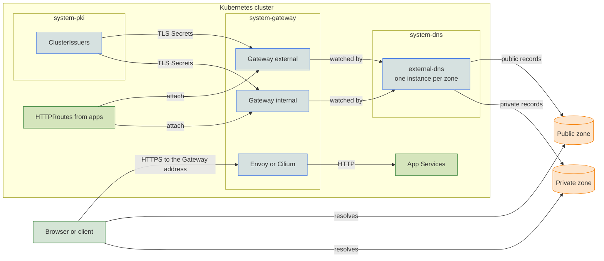

Without a gateway, clients reach a Service only from inside the cluster or through `kubectl port-forward`. Suppose that you want to serve `my-app` at `https://my-app.example.com`. A component at the edge of the cluster must accept the connection and end TLS. Then it must send the request to the correct Service. Core does this with the Kubernetes [Gateway API](https://gateway-api.sigs.k8s.io/), and the gateway is on by default.

This `values.yaml` sets two domains. It gives the cluster a public entrypoint and a private entrypoint:

```yaml
gateway:
  enabled: true
  driver: envoy          # envoy or cilium
dns:
  public_domain: example.com        # provisions the external gateway
  private_domain: int.example.com   # provisions the internal gateway
```

Each domain provisions one *Gateway*. A Gateway is a Gateway API resource that accepts traffic for the routes attached to it. An application gets a hostname when it attaches an *HTTPRoute* to a Gateway. `gateway.driver` selects the software that runs the Gateways. See [Choosing a driver](#choosing-a-driver).

## Gateways and domains

This table shows the Gateway that each domain provisions.

| Domain set           | Gateway    | Serves              | DNS zone                          |
| -------------------- | ---------- | ------------------- | --------------------------------- |
| `dns.public_domain`  | `external` | The public internet | [Public zone](../dns/public.md)   |
| `dns.private_domain` | `internal` | Your network        | [Private zone](../dns/private.md) |

Both Gateways are in the `system-gateway` namespace. A Gateway without a domain does not exist, unless you enable it for [ListenerSets](#listenersets). Public exposure is therefore opt-in. A cluster without `dns.public_domain` has no `external` Gateway.

The two domains MUST be different. The private domain SHOULD be a subdomain of the public domain, as `int.example.com` is of `example.com`. Then the zones stay separate without split-horizon DNS. The `internal` Gateway can also get a Let's Encrypt certificate. [DNS and certificates](#dns-and-certificates) gives the reason.

Windsor sets `dns.private_domain` for some contexts that do not set it:

- A context named `local` or `local-*` runs in *dev mode*, unless it sets `dev: false`. Dev mode sets `dns.private_domain` to `test`. A dev cluster thus gets an `internal` Gateway without DNS settings.
- Outside dev mode, Hyper-V, vSphere, and Proxmox set it to `<id>.local`.

On Hetzner, Core provisions only the `external` Gateway. A Hetzner private network is reachable only from servers in that network. Outside dev mode, Windsor rejects `dns.private_domain` on Hetzner. Grafana, Kibana, and the Flux web UI then have no route. To open them, use `kubectl port-forward`.

## Choosing a driver

Both drivers serve the same `external` and `internal` Gateways in `system-gateway`. They install different components, as this table shows.

| `gateway.driver`      | What Core does                                                                                       |
| --------------------- | ---------------------------------------------------------------------------------------------------- |
| [`envoy`](envoy.md)   | Installs the Envoy Gateway operator. Runs one Envoy data plane for each Gateway in `system-gateway`. |
| [`cilium`](cilium.md) | Uses the Gateway API controller of the [Cilium CNI](../cni/cilium.md). The Envoy that Cilium runs on each node serves the traffic. |

`gateway.driver` defaults to `envoy` on AWS and docker-desktop. On other platforms, it follows the [CNI](../cni/index.md#defaults): `cilium` when Cilium is the CNI, and `envoy` when it is not.

Envoy Gateway runs on all clusters. The `cilium` driver needs the Cilium CNI, which is the default only on Talos. EKS, AKS, and GKE keep their own CNIs. Local workstations often run Flannel. These clusters use `envoy`.

Cilium already runs an Envoy on each node and has its own Gateway API controller. On a Cilium cluster, the `cilium` driver uses these parts, and the cluster needs no second proxy stack.

On a Cilium cluster, use Envoy Gateway when the gateway must do more than routing. Envoy Gateway adds these features at the edge:

- rate limits and retries
- external authorization
- JWT and OIDC checks

Each Gateway gets its own proxies, and Envoy Gateway upgrades separately from the CNI. In Core, Envoy Gateway also has a catch-all `404`, gateway alerts, and Envoy dashboards. The `cilium` driver does not have these yet. Only the `envoy` driver supports [`node_ports`](#listenersets).

## Hostnames

To publish `my-app` at `my-app.example.com`, make an `HTTPRoute` in the namespace of the app. The route names the Gateway and the hostname. This route attaches to the `external` Gateway, and it sends all requests to port 80 of the `my-app` Service:

```yaml
apiVersion: gateway.networking.k8s.io/v1
kind: HTTPRoute
metadata:
  name: my-app
  namespace: my-app
spec:
  parentRefs:
    - name: external
      namespace: system-gateway
  hostnames:
    - my-app.example.com
  rules:
    - backendRefs:
        - name: my-app
          port: 80
```

`parentRefs` selects the Gateway by name and namespace. To serve the app on both Gateways, list `external` and `internal`. Each Gateway has an HTTPS listener on port 443, `web-https`. Each Gateway also has an HTTP listener that redirects to HTTPS.

The certificate of each Gateway covers `<domain>` and `*.<domain>`. A new subdomain needs no new certificate. The `external` Gateway serves `my-app.example.com` with its current certificate.

The add-ons of Core attach routes to the same Gateways. Most use `internal`. Some use the Gateway that exists. This table shows the Gateway that each add-on uses.

| Route                                                         | Gateway                                         |
| ------------------------------------------------------------- | ----------------------------------------------- |
| Grafana, Kibana, the Flux web UI and webhook, CoreDNS port 53 | `internal`                                      |
| Bookinfo demo                                                 | `internal` when it exists, otherwise `external` |
| Keycloak login                                                | `external` when it exists, otherwise `internal` |
| Keycloak admin console                                        | `internal` only                                 |

With only a public domain, there are no `internal` routes. To reach private services, use `kubectl port-forward`. On docker-desktop, the URLs include a host port: `:8443` for `internal` and `:8444` for `external`.

## Service exposure

A Gateway needs an address that clients can reach. `gateway.<name>.service_type` sets how traffic gets to the proxy of each Gateway. `<name>` is `external` or `internal`. Each type has one setting of its own.

In this example, `external` has a fixed address. `internal` uses a node port behind a load balancer that the site already runs.

```yaml
gateway:
  external:
    service_type: LoadBalancer
    ip: 10.30.0.20
  internal:
    service_type: NodePort
    node_port: 30443
```

This table shows what each type needs.

| `service_type` | Platforms | Setting | Reached through |
| -------------- | --------- | ------- | --------------- |
| `LoadBalancer` | AWS, Azure, GCP, Hetzner | none | A cloud load balancer. |
| `LoadBalancer` | metal, vSphere, Hyper-V, Incus, Proxmox | `ip`, required | `gateway.<name>.ip`, announced on the node network. |
| `NodePort` | any | `node_port`, optional | A node port in the range 30000-32767. |

`service_type` defaults to `LoadBalancer`, except on docker-desktop, which uses `NodePort`. Platforms without a cloud load balancer have no default address. On these platforms, a `LoadBalancer` Gateway MUST set `ip`. Workstation contexts are the exception. Windsor makes their network and assigns both Gateway addresses.

`gateway.service_type` is deprecated. It applies to both Gateways when neither Gateway sets its own type.

### Load balancers

On clouds, each Gateway gets its own load balancer. This table shows the load balancer for each platform.

| Platform | `internal`                 | `external`                        |
| -------- | -------------------------- | --------------------------------- |
| AWS      | NLB with scheme `internal` | NLB with scheme `internet-facing` |
| Azure    | Internal load balancer     | Public load balancer              |
| GCP      | Internal load balancer     | Public load balancer              |
| Hetzner  | Not provisioned            | Hetzner Cloud load balancer       |

On other platforms, a load balancer in the cluster pins each Gateway to its `ip` and announces the address over L2. The [CNI](../cni/index.md#what-depends-on-the-driver) selects the load balancer. Cilium clusters use Cilium LB IPAM, and other clusters use kube-vip. `network.loadbalancer_driver: metallb` replaces kube-vip with MetalLB. [Load balancing](../load-balancing.md) covers the drivers.

`network.loadbalancer_ips` is a separate, optional range for other `LoadBalancer` Services. Gateway addresses MUST be outside this range. Windsor rejects a configuration where they overlap.

### Node ports

With `NodePort`, each Gateway gets its own ports. `node_port` sets the HTTPS port. The HTTP port is fixed. This table gives the ports, and the host ports that docker-desktop forwards.

|            | HTTP    | HTTPS (default) | docker-desktop host ports |
| ---------- | ------- | --------------- | ------------------------- |
| `internal` | `30080` | `30443`         | `8080`, `8443`            |
| `external` | `30081` | `30444`         | `8081`, `8444`            |

Only `internal` has the Flux webhook port, `30292`.

On Hyper-V with both Gateways on `NodePort`, the VMs are behind a NAT switch. The host forwards these ports to the VMs on the same port numbers:

- the Kubernetes API, `6443`
- the Talos APIs
- the HTTP and HTTPS node ports of each Gateway that has a domain, with the `envoy` driver
- the Flux webhook port, with `gitops.mode: push`

`gateway.publish_ports` adds more forwards. With it, a Gateway can also answer on `80` and `443`. This setting maps the standard ports to the `internal` Gateway:

```yaml
gateway:
  external:
    service_type: NodePort
  internal:
    service_type: NodePort
  publish_ports:
    "80": 30080
    "443": 30443
```

The keys are host ports, and the values are node ports from the node port table. Windsor rejects a key that is already a forwarded host port. Only Hyper-V reads this setting.

## ListenerSets

Some applications need a port other than 443, for example a TCP service on port 3010. A *ListenerSet* is a Gateway API resource that adds listeners to a Gateway from another namespace. The listeners use the address of that Gateway. This ListenerSet adds TCP port 3010 to the `internal` Gateway:

```yaml
apiVersion: gateway.networking.k8s.io/v1
kind: ListenerSet
metadata:
  name: my-app
  namespace: my-app
spec:
  parentRef:
    kind: Gateway
    name: internal
    namespace: system-gateway
  listeners:
    - name: my-app-3010
      protocol: TCP
      port: 3010
```

A Gateway accepts a ListenerSet only from a namespace with the label `gateway.windsorcli.dev/<name>: "true"`. For the example above, label the `my-app` namespace with `gateway.windsorcli.dev/internal: "true"`. A route then attaches to the listener through the ListenerSet.

A `LoadBalancer` Gateway accepts ListenerSets with no other setting. A `NodePort` Gateway needs a node port for each listener port. `gateway.<name>.node_ports` maps each listener port to a node port:

```yaml
gateway:
  internal:
    service_type: NodePort
    node_ports:
      "3010": 30310
```

Without `node_ports`, a `NodePort` Gateway does not accept ListenerSets. On docker-desktop, Windsor also publishes each listener port as a host port. These rules apply to `node_ports`:

- It needs `service_type: NodePort` and `gateway.driver: envoy`.
- A key MUST NOT be a port that the Gateway already serves. These ports are 80 and 443, and also 53 and 9292 on `internal`.
- A value MUST NOT be a node port that Core assigns: 30080, 30081, 30053, 30292, or the `node_port` of either Gateway.
- Each node port MUST be unique across both Gateways.
- On docker-desktop, each listener port MUST be unique across both Gateways. It MUST NOT be 8080, 8081, 8443, or 8444.

### Port 443

A ListenerSet can use port 443 only when the Gateway does not. `gateway.<name>.https: false` removes the `web-https` listener of the Gateway. The HTTP listener and its redirect stay. Without `web-https`, the Gateway has no certificate, and the `tls` keys do not apply.

```yaml
gateway:
  external:
    https: false
```

### A Gateway without a domain

A ListenerSet can need a Gateway that serves no hostnames. `gateway.<name>.enabled: true` provisions the Gateway without its domain. That Gateway publishes no DNS records. It MUST have one of these settings:

- `gateway.<name>.tls.cert`, a [supplied certificate](../pki/supplied.md) for `web-https`
- `gateway.<name>.https: false`

A Gateway with a domain always exists. Windsor rejects `gateway.<name>.enabled: false` on such a Gateway. Hetzner has no `internal` Gateway, and Windsor rejects `gateway.internal.enabled` there.

## DNS and certificates

A hostname needs a DNS record that points at its Gateway. It also needs a certificate that the client trusts. Core makes both from the domain settings. In the usual case, you name no issuer.

On AWS, Azure, GCP, and Hetzner, `dns.public_domain` makes a public zone. external-dns writes the `external` records into that zone. See [Public zones](../dns/public.md).

`dns.private_domain` publishes the `internal` records to a private zone. `dns.private.driver` selects where that zone is. On AWS, Azure, and GCP, it is a cloud zone attached to the VPC. On other platforms, it is CoreDNS in the cluster. See [Private zones](../dns/private.md).

Core selects the issuer of each Gateway certificate from what the site supplies. Take the example from the top of this page on AWS. Both Gateways get Let's Encrypt certificates:

- `external`, because Core writes the `example.com` zone.
- `internal`, because `int.example.com` is under that zone.

On metal, Core writes no public zone. There, `internal` gets a certificate from the cluster CA, and `external` needs its own source. [Gateway certificates](../pki/index.md#gateway-certificates) gives all the rules, and the order of preference for an on-prem site.

Two settings change the result for one Gateway:

- `gateway.<name>.tls.issuer` replaces the selected issuer. The values are `ca` for the cluster CA, `acme`, and `selfsigned` for tests.
- `gateway.<name>.tls.cert` and `.key` serve a certificate from the PKI team of the site. See [Supplied certificates](../pki/supplied.md).

A supplied certificate MUST cover `<domain>` and `*.<domain>`. The listener serves all routes under the domain.

Outside dev mode, an `external` Gateway needs a certificate source. Without a zone that Core can write, it has no source, and Windsor rejects it. To give it a source, set `pki.acme.server`, `gateway.external.tls.cert`, or `gateway.external.tls.issuer`.

> [!NOTE]
> Browsers show a warning for a certificate from the `selfsigned` issuer.

Some names cannot go to a zone that Core controls. `dns.public_zone: false` keeps `dns.public_domain` as the hostname of the Gateway, and Core makes no zone. That Gateway then needs one of the certificate sources above.

## Requirements

Windsor rejects these configurations during validation:

- Observability without `dns.public_domain` or `dns.private_domain`. Grafana and Kibana need a hostname.
- `dns.public_domain` and `dns.private_domain` with the same value.
- `dns.private_domain` on Hetzner outside dev mode.
- An `external` Gateway without a certificate source, outside dev mode. A source is one of these: a public zone that Core writes on AWS, Azure, GCP, or Hetzner, `pki.acme.server`, `gateway.external.tls.cert`, or `gateway.external.tls.issuer`.
- `gateway.external.tls.issuer: acme` without `pki.acme.server` or a public zone that Core writes. On `internal`, it needs `pki.acme.server`, or a `dns.private_domain` under such a zone.
- Only one of `gateway.<name>.tls.cert` and `gateway.<name>.tls.key`.
- `gateway.<name>.tls` with `gateway.<name>.https: false`.
- A Gateway without a domain that has no `tls.cert` and serves `web-https`.
- A `LoadBalancer` Gateway without `gateway.<name>.ip` on metal, vSphere, Hyper-V, Incus, and Proxmox. The address MUST be outside `network.loadbalancer_ips`.
- `gateway.<name>.ip` on AWS, Azure, GCP, and Hetzner, or with `NodePort`.
- `gateway.<name>.node_port` or `gateway.<name>.node_ports` with `LoadBalancer`.
- Two Gateways with the same address or the same node ports.
- [Private DNS](../dns/private.md#coredns) with `dns.private.driver: coredns` and no `LoadBalancer` `internal` Gateway, outside workstation contexts.
- Grafana SSO and kubectl OIDC with the hosted Keycloak, when the gateway is disabled. See [Identity](../identity/index.md#requirements).

With the gateway disabled, clients reach services only from inside the cluster or through `kubectl port-forward`.

## Under the hood

This diagram shows how a request gets to an app. It also shows how routes, issuers, and external-dns connect to the two Gateways.



Each Gateway exists only with its domain or with `gateway.<name>.enabled`. The proxy ends TLS and sends plain HTTP to the Service of the app. Each Gateway waits for the `pki` resources tier, so its issuer exists before Core requests the certificate.

## Configuration

This table gives all the keys that this guide covers.

| Key                     | Type    | Default       | Description                                                                         |
| ----------------------- | ------- | ------------- | ----------------------------------------------------------------------------------- |
| `gateway.enabled`       | boolean | `true`        | Enables the cluster entrypoint.                                                     |
| `gateway.driver`        | string  | by platform   | `envoy` or `cilium`.                                                                |
| `dns.public_domain`     | string  | none          | Provisions the `external` Gateway.                                                  |
| `dns.private_domain`    | string  | `test` in dev | Provisions the `internal` Gateway. `<id>.local` on Hyper-V, vSphere, and Proxmox outside dev. |
| `dns.public_zone`       | boolean | `true`        | When `false`, keeps `dns.public_domain` as a hostname with no zone.                 |
| `gateway.<name>.enabled` | boolean | none         | Provisions the Gateway without its domain, for ListenerSets.                        |
| `gateway.<name>.https`  | boolean | `true`        | Serves `web-https` on port 443. `false` leaves port 443 to a ListenerSet.           |
| `gateway.<name>.tls.issuer` | string | inferred | `ca`, `acme`, or `selfsigned`. Replaces the selected issuer.                      |
| `gateway.<name>.tls.cert` | string | none        | PEM certificate chain, leaf first. Served in place of an issued certificate.      |
| `gateway.<name>.tls.key` | string  | none        | PEM private key for `tls.cert`.                                                     |
| `gateway.<name>.service_type` | string | by platform | `LoadBalancer` or `NodePort`.                                                  |
| `gateway.<name>.ip`     | string  | none          | Address of a `LoadBalancer` Gateway. Required on metal, vSphere, Hyper-V, Incus, and Proxmox. |
| `gateway.<name>.node_port` | integer | `30443` / `30444` | HTTPS node port of a `NodePort` Gateway.                                    |
| `gateway.<name>.node_ports` | map  | none          | ListenerSet listener port to node port. Lets a `NodePort` Gateway accept ListenerSets. |
| `gateway.service_type`  | string  | none          | Deprecated. Applies to both Gateways when neither sets its own type.                |
| `pki.public_issuer`     | string  | none          | Deprecated. `selfsigned` has the same effect as `gateway.external.tls.issuer: selfsigned`. |
| `gateway.publish_ports` | map     | none          | Host port to node port. Read only on Hyper-V with `NodePort`.                       |

## Reference

- [kustomize/gateway](../../../kustomize/gateway)
- [kustomize/crds](../../../kustomize/crds)
- [kustomize/lb](../../../kustomize/lb)
- [kustomize/dns](../../../kustomize/dns)
- [kustomize/pki](../../../kustomize/pki)
