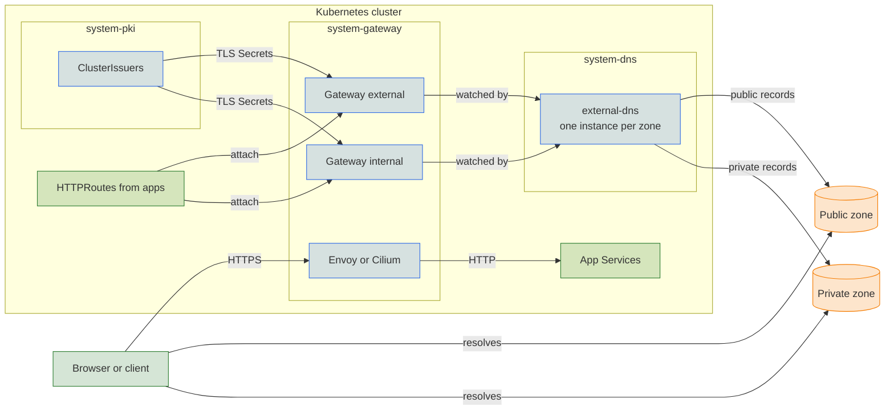

The core blueprint exposes cluster services through up to two Gateways built on the Kubernetes [Gateway API](https://gateway-api.sigs.k8s.io/). `external` serves the public internet and `internal` serves your network. An application gets a hostname by attaching an `HTTPRoute` to one of them, and the [DNS](../dns/index.md) records and [TLS certificate](../pki/index.md) for that hostname come from the `dns` and `pki` settings. The gateway is on by default. The following config can be placed in a context's `values.yaml` file:

```yaml
gateway:
  enabled: true
  driver: envoy          # envoy or cilium
dns:
  public_domain: example.com          # provisions the external gateway
  private_domain: example.internal    # provisions the internal gateway
```

A Gateway exists only when its domain is set, so public exposure is opt-in. Dev mode defaults `dns.private_domain` to `test`, so a dev cluster gets an `internal` Gateway. Outside dev mode, Hyper-V and vSphere default it to `<id>.local`. A context named `local` or `local-*` is in dev mode unless it sets `dev: false`.

| Domain set           | Gateway    | Zone                              | Certificate issuer                                              |
| -------------------- | ---------- | --------------------------------- | --------------------------------------------------------------- |
| `dns.public_domain`  | `external` | [Public zone](../dns/public.md)   | [`public-acme` or `public-selfsigned`](../pki/index.md#issuers) |
| `dns.private_domain` | `internal` | [Private zone](../dns/private.md) | `private`                                                       |

The two domains MUST differ. Hetzner has no private networking for a gateway to sit behind, so it provisions only `external` and rejects `dns.private_domain` outside dev mode.

`gateway.driver` defaults to `envoy` on AWS and docker-desktop. Elsewhere it follows the [CNI](../cni/index.md#defaults): `cilium` when Cilium is the CNI, `envoy` otherwise.

| `gateway.driver`      | What Core does                                                                                       |
| --------------------- | ---------------------------------------------------------------------------------------------------- |
| [`envoy`](envoy.md)   | Installs the Envoy Gateway operator and runs an Envoy data plane per Gateway in `system-gateway`.    |
| [`cilium`](cilium.md) | Uses the Gateway API controller built into the [Cilium CNI](../cni/cilium.md), served by the Envoy that Cilium runs on each node. |

## Choosing a driver

Envoy Gateway runs on any cluster. The `cilium` driver needs the Cilium CNI, the default only when running Talos. EKS, AKS, and GKE keep their own CNIs, and the local workstations often run Flannel, so those clusters use `envoy`.

Where Cilium is the CNI, it already runs an Envoy on every node and includes its own Gateway API controller. The `cilium` driver uses them, so the cluster needs no second proxy stack.

Envoy Gateway still makes sense there when the gateway needs more than routing. It adds rate limiting, retries, external authorization, and JWT or OIDC checks at the edge. Each Gateway gets its own proxies, and it upgrades separately from the CNI. In Core it also ships a catch-all `404`, gateway alerts, and Envoy dashboards, which the `cilium` driver currently lacks.

## Hostnames

Each Gateway has an HTTPS listener and an HTTP listener that redirects to HTTPS. A route references the Gateway it needs in `parentRefs`, and may name both:

```yaml
apiVersion: gateway.networking.k8s.io/v1
kind: HTTPRoute
metadata:
  name: my-app
  namespace: my-app
spec:
  parentRefs:
    - name: external
      namespace: system-gateway
  hostnames:
    - my-app.example.com
  rules:
    - backendRefs:
        - name: my-app
          port: 80
```

Core's own add-ons attach to these Gateways:

| Route                                                                    | Gateway                                         |
| ------------------------------------------------------------------------ | ----------------------------------------------- |
| Grafana, Kibana, the Flux web UI and webhook, CoreDNS port 53            | `internal`                                      |
| Bookinfo demo                                                            | `internal` when it exists, otherwise `external` |
| Keycloak login                                                           | `external` when it exists, otherwise `internal` |
| Keycloak admin console                                                   | `internal` only                                 |

Each Gateway's certificate covers `<domain>` and `*.<domain>` for its own domain, so a new subdomain needs no new certificate. With only a public domain there are no `internal` routes, so you must reach private services with `kubectl port-forward`. On docker-desktop the URLs carry a host port: `:8443` for `internal` and `:8444` for `external`.

## Service exposure

`gateway.service_type` sets how traffic reaches the proxy, with a default per platform.

| `gateway.service_type` | Default on                            | Reached through                                                                                      |
| ---------------------- | ------------------------------------- | ---------------------------------------------------------------------------------------------------- |
| `LoadBalancer`         | Every platform except docker-desktop. | A cloud load balancer, or an address from `network.loadbalancer_ips`.                                |
| `NodePort`             | docker-desktop.                       | A node port in the 30000-32767 range. Set it elsewhere to skip the load balancer, as on single-node Talos VMs. |

On clouds each Gateway gets its own load balancer.

| Platform | `internal`                 | `external`                        |
| -------- | -------------------------- | --------------------------------- |
| AWS      | NLB with scheme `internal` | NLB with scheme `internet-facing` |
| Azure    | Internal load balancer     | Public load balancer              |
| GCP      | Internal load balancer     | Public load balancer              |
| Hetzner  | Not provisioned            | Hetzner Cloud load balancer       |

Pool-based load balancers (MetalLB, kube-vip, or Cilium LB IPAM) give `internal` the address `network.loadbalancer_ips.start`. When both Gateways exist, `external` takes the next address. A single Gateway always takes `start`.

NodePort clusters give each Gateway its own ports.

|            | HTTP    | HTTPS   | docker-desktop host ports |
| ---------- | ------- | ------- | ------------------------- |
| `internal` | `30080` | `30443` | `8080`, `8443`            |
| `external` | `30081` | `30444` | `8081`, `8444`            |

The private DNS port (`30053`) and the Flux webhook port (`30292`) belong to `internal` only.

On Hyper-V with `NodePort`, the host forwards the Kubernetes API (`6443`), the Talos APIs, and each Gateway's node ports on the same port numbers. With the `envoy` driver that covers `30080` and `30443` for `internal` and `30081` and `30444` for `external`. The private DNS and Flux webhook ports are forwarded when enabled.

`gateway.publish_ports` adds more forwards, so a Gateway can also answer on `80` and `443`. Keys are host ports, and values are node ports from the table above. A key that reuses an already forwarded host port is rejected. No other platform reads this setting.

```yaml
gateway:
  service_type: NodePort
  publish_ports:
    "80": 30080
    "443": 30443
```

## DNS and certificates

Setting `dns.public_domain` creates a public zone at your cloud provider and issues Let's Encrypt certificates for `external`. See [Public zones](../dns/public.md) and [ACME](../pki/acme.md). Setting `dns.private_domain` publishes `internal` records to a private zone: a VPC-attached zone on AWS, Azure, and GCP, or CoreDNS when `dns.private.enabled` is on. See [Private zones](../dns/private.md).

An `external` Gateway gets its certificate from a self-signed issuer when there is no cloud DNS zone, as on a local cluster, or when `pki.public_issuer` is `selfsigned`. Browsers warn about it. Setting `dns.public_zone: false` keeps `dns.public_domain` as the Gateway's hostname without creating a zone, which suits a name that cannot be delegated. The `internal` certificate comes from the `private` issuer, which is the [private CA](../pki/private-ca.md) when `pki.enabled` is set. The [PKI](../pki/index.md#issuers) page lists the issuer for each configuration.

## Requirements

Windsor rejects these combinations when it validates the configuration:

- Observability needs `dns.public_domain` or `dns.private_domain` for its Grafana and Kibana hostnames.
- `dns.private_domain` is rejected on Hetzner outside dev mode.
- `pki.public_issuer: acme` is rejected with `dns.public_zone: false`, since DNS-01 writes into the zone.
- Grafana SSO and kubectl OIDC with the hosted Keycloak need the gateway enabled. See [Identity](../identity/index.md#requirements).

A disabled gateway leaves services reachable only inside the cluster or through `kubectl port-forward`.

## Under the hood



The diagram shows both Gateways, though either can be absent. TLS ends at the proxy. Each Gateway waits for the `pki` resources tier so its issuer exists when the certificate is requested.

## Configuration

| Key                     | Type    | Default       | Description                                                   |
| ----------------------- | ------- | ------------- | ------------------------------------------------------------- |
| `gateway.enabled`       | boolean | `true`        | Enable the cluster entrypoint.                                |
| `gateway.driver`        | string  | by platform   | `envoy` or `cilium`.                                          |
| `dns.public_domain`     | string  | none          | Provisions the `external` Gateway.                            |
| `dns.private_domain`    | string  | `test` in dev | Provisions the `internal` Gateway. `<id>.local` on Hyper-V and vSphere outside dev. |
| `dns.public_zone`       | boolean | `true`        | When `false`, keeps `dns.public_domain` as a hostname with no zone. |
| `pki.public_issuer`     | string  | by platform   | `acme` or `selfsigned` for the `external` certificate.        |
| `gateway.service_type`  | string  | by platform   | `LoadBalancer` or `NodePort`.                                 |
| `gateway.publish_ports` | map     | none          | Host port to node port. Read only on Hyper-V with `NodePort`. |

## Reference

- [kustomize/gateway](../../../kustomize/gateway)
- [kustomize/crds](../../../kustomize/crds)
- [kustomize/lb](../../../kustomize/lb)
- [kustomize/dns](../../../kustomize/dns)
- [kustomize/pki](../../../kustomize/pki)
