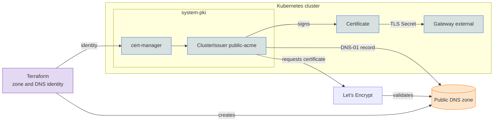

A browser that opens `https://my-app.example.com` trusts the certificate only if a public CA signed it. With `dns.public_domain` set, Windsor gets that certificate for the `external` gateway from Let's Encrypt on AWS, Azure, GCP, and Hetzner. This page assumes the issuer terms from [PKI](index.md).

## Turn it on

This `values.yaml` requests the certificate for the running example.

```yaml
dns:
  public_domain: example.com
email: ops@example.com
```

`dns.public_domain` makes Core create the `public-acme` issuer and issue the `external` gateway certificate from it. `email` is the ACME account contact.

> [!IMPORTANT]
> Let's Encrypt can validate only after `example.com` is [delegated](../dns/public.md#delegate-the-domain) to the public zone.

The certificate is a wildcard, and Let's Encrypt issues wildcards only through *DNS-01*. In a DNS-01 challenge, cert-manager proves it owns the domain by writing a challenge record into the [public zone](../dns/public.md), and Let's Encrypt looks the record up there. No inbound port 80 is needed.

## Solvers

cert-manager writes the challenge record through a *solver* that speaks the platform's DNS API, with a credential that grants it access to the zone. This table lists the solver and credential per platform.

| `platform` | Solver | Credential |
|---|---|---|
| `aws` | Route53 | IAM role through Pod Identity |
| `azure` | Azure DNS | Workload identity |
| `gcp` | Cloud DNS | Workload identity |
| `hetzner` | Hetzner DNS | Hetzner Cloud API token, through a webhook solver |

On AWS, Azure, and GCP the cluster Terraform component creates the identity, with write access to the zone only.

## Staging and production

Let's Encrypt runs two servers, and the context decides which one cert-manager uses. Dev mode uses the staging server, which has higher rate limits. Every other context uses production.

> [!NOTE]
> Browsers do not trust certificates from the Let's Encrypt staging server.

## Keep the zone, skip the certificate

Sometimes you want the public zone and external-dns for `example.com` without a Let's Encrypt certificate. This `values.yaml` sets `pki.public_issuer` to `selfsigned` to get that.

```yaml
dns:
  public_domain: example.com
pki:
  public_issuer: selfsigned
```

Core still creates the public zone and external-dns, but requests no Let's Encrypt certificate. The `external` gateway uses `public-selfsigned` instead, and no `email` is required.

Leaving `pki.public_issuer` unset keeps ACME whenever `dns.public_domain` is set, unless [`dns.public_zone`](../dns/public.md#use-a-domain-without-a-zone) is `false`.

## Internal gateway

The `internal` gateway for `example.internal` uses the `private` issuer even when `dns.public_domain` is set. DNS-01 cannot validate a zone that exists only inside a VPC. The full selection is under [Issuers](index.md#issuers).

## Under the hood

This diagram shows how Terraform, cert-manager, and Let's Encrypt combine to put a signed certificate on the `external` Gateway.



Terraform creates the public zone and the identity cert-manager uses to write to it. The `public-acme` issuer requests the certificate from Let's Encrypt and writes the DNS-01 record into the zone, and Let's Encrypt validates against that record. The signed certificate lands in the TLS Secret the `external` Gateway reads.

## Reference

- [kustomize/pki/resources/public-issuer/acme](../../../kustomize/pki/resources/public-issuer/acme)
- [terraform/dns/zone/route53](../../../terraform/dns/zone/route53)
- [terraform/dns/zone/azure-dns](../../../terraform/dns/zone/azure-dns)
- [terraform/dns/zone/gcp-dns](../../../terraform/dns/zone/gcp-dns)
- [terraform/dns/zone/hetzner](../../../terraform/dns/zone/hetzner)
- [kustomize/pki](../../../kustomize/pki)
