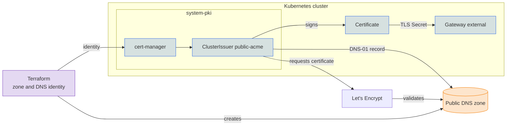

A browser that opens `https://my-app.example.com` trusts the certificate only if a CA it already knows signed it. *ACME* is the protocol cert-manager uses to request and renew such certificates automatically. Windsor speaks it to two kinds of server: Let's Encrypt, for any gateway whose domain sits in a public zone Core writes, and an ACME server the site runs itself. This page assumes the issuer terms from [PKI](index.md).

## Turn it on

This `values.yaml` requests the certificate for the running example.

```yaml
dns:
  public_domain: example.com
email: ops@example.com
```

On AWS, Azure, GCP, and Hetzner, `dns.public_domain` makes Core create the public zone, the `public-acme` issuer, and the `external` gateway certificate from it. `email` is the ACME account contact.

> [!IMPORTANT]
> Let's Encrypt can validate only after `example.com` is [delegated](../dns/public.md#delegate-the-domain) to the public zone.

The certificate is a wildcard, and Let's Encrypt issues wildcards only through *DNS-01*. In a DNS-01 challenge, cert-manager proves it owns the domain by writing a challenge record into the [public zone](../dns/public.md), and Let's Encrypt looks the record up there. No inbound port 80 is needed.

## Solvers

cert-manager writes the challenge record through a *solver* that speaks the platform's DNS API, with a credential that grants it access to the zone. This table lists the solver and credential per platform.

| `platform` | Solver | Credential |
|---|---|---|
| `aws` | Route53 | IAM role through Pod Identity |
| `azure` | Azure DNS | Workload identity |
| `gcp` | Cloud DNS | Workload identity |
| `hetzner` | Hetzner DNS | Hetzner Cloud API token, through a webhook solver |

On AWS, Azure, and GCP the cluster Terraform component creates the identity, with write access to the zone only.

## Staging and production

Let's Encrypt runs two servers, and the context decides which one cert-manager uses. Dev mode uses the staging server, which has higher rate limits. Every other context uses production.

> [!NOTE]
> Browsers do not trust certificates from the Let's Encrypt staging server.

## Internal gateway

The `internal` gateway can use Let's Encrypt too, when its domain sits under the public one. This `values.yaml` makes `int.example.com` a subdomain of `example.com`, as the running example does:

```yaml
dns:
  public_domain: example.com
  private_domain: int.example.com
email: ops@example.com
```

The certificate for `int.example.com` and `*.int.example.com` validates through a challenge record under `example.com`, in the public zone Core already writes. Clients trust the result without a private root. The hostnames themselves still resolve only through the [private zone](../dns/private.md).

cert-manager checks that a challenge record has propagated before it asks Let's Encrypt to validate. The in-cluster resolver answers authoritatively for `int.example.com` and never sees the public record, so Core points those checks at public resolvers whenever the `internal` gateway uses `public-acme`.

A private domain outside the public zone, such as `example.internal`, has no public zone for the challenge, and its gateway falls back to the [cluster CA](private-ca.md). A site that keeps internal hostnames out of Certificate Transparency logs sets `gateway.internal.tls.issuer: ca` to get the same result on a subdomain.

## Internal ACME server

Some sites buy certificates from a CA that serves them over ACME, such as DigiCert or Sectigo ACME. Its root is already in the site's trust stores, so a certificate it issues is trusted on every managed device. This `values.yaml` points Windsor at one:

```yaml
pki:
  acme:
    server: https://acme.ca.example.com/directory
    ca_bundle: ${secret("vault", "corp-root", "cert")}
    eab:
      key_id: windsor-prod
      hmac_key: ${secret("vault", "acme-eab", "hmac")}
email: ops@example.com
```

`pki.acme.server` is the ACME directory URL. With it set, Core creates the `private-acme` issuer, and both gateways use it unless Core writes a public zone for `external`. `ca_bundle` is the PEM CA that signs the server's own TLS certificate, needed when the system roots do not include it. `eab` holds the *external account binding*, the key ID and HMAC key that some servers require before they open an account, and you MUST set both halves or neither.

The `private-acme` issuer carries no challenge solver. `pki.acme` works only with a server that pre-authorizes the gateway domains for the EAB account and issues without a challenge, as DigiCert and Sectigo ACME do.

> [!WARNING]
> A server that challenges each order, such as step-ca or the ACME engine in Vault or OpenBao, issues no certificate. Composition reports no error, and the gateway's `Certificate` stays not ready. See [core#3318](https://github.com/windsorcli/core/issues/3318).

## Under the hood

This diagram shows how Terraform, cert-manager, and Let's Encrypt combine to put a signed certificate on the `external` Gateway. The `internal` Gateway follows the same path when it uses `public-acme`.



Terraform creates the public zone and the identity cert-manager uses to write to it. The `public-acme` issuer requests the certificate from Let's Encrypt and writes the DNS-01 record into the zone, and Let's Encrypt validates against that record. The signed certificate lands in the TLS Secret the `external` Gateway reads.

## Reference

- [kustomize/pki/resources/public-issuer/acme](../../../kustomize/pki/resources/public-issuer/acme)
- [kustomize/pki/resources/private-issuer/acme](../../../kustomize/pki/resources/private-issuer/acme)
- [terraform/dns/zone/route53](../../../terraform/dns/zone/route53)
- [terraform/dns/zone/azure-dns](../../../terraform/dns/zone/azure-dns)
- [terraform/dns/zone/gcp-dns](../../../terraform/dns/zone/gcp-dns)
- [terraform/dns/zone/hetzner](../../../terraform/dns/zone/hetzner)
- [kustomize/pki](../../../kustomize/pki)
