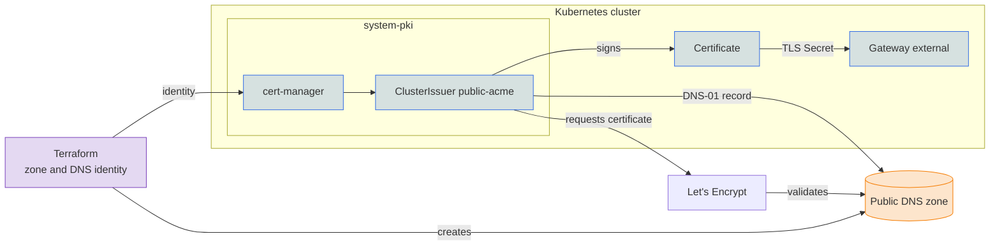

A browser opens `https://my-app.example.com`. It trusts the certificate only when a CA that it knows signed the certificate. *ACME* is the protocol that cert-manager uses to request and renew such certificates automatically. Windsor uses ACME with two types of server:

- Let's Encrypt, for a gateway whose domain is in a public zone that Core writes.
- An ACME server that the site runs.

This page uses the issuer terms from [PKI](index.md).

## Turn it on

This `values.yaml` requests the certificate for the example from [PKI](index.md):

```yaml
dns:
  public_domain: example.com
email: ops@example.com
```

On AWS, Azure, GCP, and Hetzner, `dns.public_domain` makes Core create the public zone and the `public-acme` issuer. The `external` gateway gets its certificate from that issuer. `email` is the ACME account contact.

> [!IMPORTANT]
> Let's Encrypt can validate only after you [delegate](../dns/public.md#delegate-the-domain) `example.com` to the public zone.

The certificate is a wildcard. Let's Encrypt issues wildcards only through *DNS-01*. In a DNS-01 challenge, cert-manager writes a challenge record into the [public zone](../dns/public.md). Let's Encrypt reads the record there, and this proves that cert-manager controls the domain. The challenge needs no inbound port 80.

## Solvers

cert-manager writes the challenge record through a *solver*. The solver uses the DNS API of the platform, with a credential that gives access to the zone. This table gives the solver and the credential for each platform.

| `platform` | Solver | Credential |
|---|---|---|
| `aws` | Route53 | IAM role through Pod Identity |
| `azure` | Azure DNS | Workload identity |
| `gcp` | Cloud DNS | Workload identity |
| `hetzner` | Hetzner DNS | Hetzner Cloud API token, through a webhook solver |

On AWS, Azure, and GCP, the cluster Terraform component makes the identity. The identity can write only to the zone.

## Staging and production

Let's Encrypt has two servers. The context selects the server that cert-manager uses. Dev mode uses the staging server, which has higher rate limits. All other contexts use production.

> [!NOTE]
> Browsers do not trust certificates from the Let's Encrypt staging server.

## Internal gateway

The `internal` gateway can also use Let's Encrypt, when its domain is under the public domain. This `values.yaml` makes `int.example.com` a subdomain of `example.com`:

```yaml
dns:
  public_domain: example.com
  private_domain: int.example.com
email: ops@example.com
```

The certificate covers `int.example.com` and `*.int.example.com`. It validates through a challenge record under `example.com`, in the public zone that Core writes. Clients trust the certificate without a private root. The hostnames still resolve only through the [private zone](../dns/private.md).

Before cert-manager asks Let's Encrypt to validate, it checks that the challenge record has propagated. The resolver in the cluster is authoritative for `int.example.com`, so it never sees the public record. When the `internal` gateway uses `public-acme`, Core sends these checks to public resolvers.

A private domain outside the public zone, such as `example.internal`, has no public zone for the challenge. Its gateway uses the [cluster CA](private-ca.md). Some sites keep internal hostnames out of Certificate Transparency logs. Such a site sets `gateway.internal.tls.issuer: ca` to use the cluster CA on a subdomain.

## Internal ACME server

Some sites buy certificates from a CA that serves them over ACME, such as DigiCert or Sectigo ACME. The root of that CA is already in the trust stores of the site. All managed devices trust a certificate that it issues. This `values.yaml` points Windsor at such a server:

```yaml
pki:
  acme:
    server: https://acme.ca.example.com/directory
    ca_bundle: ${secret("vault", "corp-root", "cert")}
    eab:
      key_id: windsor-prod
      hmac_key: ${secret("vault", "acme-eab", "hmac")}
email: ops@example.com
```

`pki.acme.server` is the ACME directory URL. When you set it, Core makes the `private-acme` issuer. Both gateways use that issuer, unless Core writes a public zone for `external`. The other keys are optional:

- `ca_bundle` is the PEM CA that signs the TLS certificate of the server. Set it when the system roots do not include that CA. It accepts a `secret()` value.
- `eab` holds the *external account binding*. This is the key ID and HMAC key that some servers require before they open an account. You MUST set both values, or neither.

The `private-acme` issuer has no challenge solver. `pki.acme` works only with a server that pre-authorizes the gateway domains for the EAB account. The server must issue without a challenge, as DigiCert and Sectigo ACME do.

> [!WARNING]
> A server that challenges each order issues no certificate. Examples are step-ca and the ACME engine in Vault or OpenBao. Composition reports no error, and the `Certificate` of the gateway is not ready. See [core#3318](https://github.com/windsorcli/core/issues/3318).

## Under the hood

This diagram shows how Terraform, cert-manager, and Let's Encrypt put a signed certificate on the `external` Gateway. The `internal` Gateway uses the same path when it uses `public-acme`.



Terraform makes the public zone, and the identity that cert-manager uses to write to it. The `public-acme` issuer requests the certificate from Let's Encrypt. The issuer also writes the DNS-01 record into the zone, and Let's Encrypt validates against that record. The signed certificate goes into the TLS Secret that the `external` Gateway reads.

## Reference

- [kustomize/pki/resources/public-issuer/acme](../../../kustomize/pki/resources/public-issuer/acme)
- [kustomize/pki/resources/private-issuer/acme](../../../kustomize/pki/resources/private-issuer/acme)
- [terraform/dns/zone/route53](../../../terraform/dns/zone/route53)
- [terraform/dns/zone/azure-dns](../../../terraform/dns/zone/azure-dns)
- [terraform/dns/zone/gcp-dns](../../../terraform/dns/zone/gcp-dns)
- [terraform/dns/zone/hetzner](../../../terraform/dns/zone/hetzner)
- [kustomize/pki](../../../kustomize/pki)
