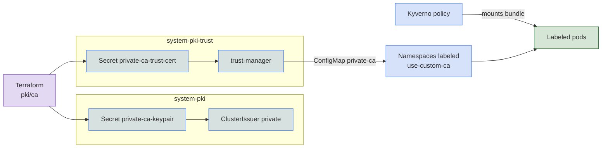

Each cluster runs a CA behind the `private` issuer. This CA is the *cluster CA*. All certificates that the `private` issuer signs chain to it. Examples are the certificates between CoreDNS and its etcd. Another example is the `internal` gateway certificate for `my-app.int.example.com` when no other source applies. A client that trusts the cluster CA trusts all these certificates.

By default, the cluster CA is a root that Core generates. The PKI team of a site can sign it as a subordinate of the corporate root. This page uses the issuer terms from [PKI](index.md).

## How it starts

The cluster CA needs no setting. Before Core builds the cluster, a Terraform component generates an ECDSA P-256 root named `Private CA`. The root is valid for 10 years. Core loads it into the cluster as two Secrets. The key exists only in `system-pki`. This table gives the two Secrets.

| Secret | Namespace | Holds |
|---|---|---|
| `private-ca-keypair` | `system-pki` | Certificate and key. The `private` issuer signs with it. |
| `private-ca-trust-cert` | `system-pki-trust` | Certificate only. trust-manager reads it. |

## Sign the cluster CA

With a generated root, each client must add the root to its trust store. On a managed fleet, this is a change request to the team that owns Group Policy. When a PKI team signs a subordinate CA, this step is not necessary.

The `pki/ca` component always outputs `csr`. This is a certificate signing request made from the key of the cluster CA. The PKI team signs it. Then you set the signed chain in `values.yaml`:

```yaml
pki:
  ca:
    cert: ${secret("vault", "cluster-ca", "chain")}
```

`pki.ca.cert` holds the chain. The signed cluster CA certificate is first. When you set `cert` and do not set `key`, Terraform keeps the key that it generated and replaces only the certificate. The next `windsor apply` moves the cluster CA under the corporate root. cert-manager then issues new certificates from `private`. Clients that trust the corporate root trust these certificates. You use the same `values.yaml` before and after the PKI team signs the CSR.

Terraform rejects a chain when its first certificate does not have the generated public key. This finds a certificate that the PKI team signed for the wrong CSR. The CSR has no name constraint. To limit the subordinate to `dns.private_domain`, the PKI team MUST add the constraint when it signs. A site with an offline root uses the same procedure, and the root key never goes to the cluster.

## Bring your own CA

Some organizations supply a full CA, with its key. The `private` issuer can sign with that CA. This `values.yaml` reads the certificate and the key from a secret store:

```yaml
pki:
  ca:
    cert: ${secret("vault", "root-ca", "cert")}
    key: ${secret("vault", "root-ca", "key")}
```

`pki.ca.key` holds the private key of the CA, and it requires `pki.ca.cert`. Windsor rejects a key without its certificate. The deprecated `pki.private_ca` still works when `pki.ca` is not set.

> [!IMPORTANT]
> The key of the cluster CA is in Terraform state. This is true for a generated key and for a key that you supply.

## Rotation

A generated root is valid for 10 years, and it does not renew. To replace it, change `validity_period_hours` on the `pki/ca` component in your blueprint. Then run `windsor apply`. A signed or supplied CA follows the rotation procedure of its signer. The [expiry alerts](index.md#monitoring) monitor the cluster CA in all cases.

## Trust the CA in workloads

A pod in `my-app` can call a service with a certificate from the cluster CA. The pod must find that CA in its trust store. trust-manager supplies it.

trust-manager builds a *`Bundle`* named `private-ca` from these roots:

- the system trust roots
- the cluster CA
- the roots in [`pki.trusted_cas`](supplied.md#trust-the-corporate-root)

trust-manager writes the bundle to a ConfigMap in each namespace with the label `use-custom-ca: "true"`. Other namespaces do not get it. A pod gets the bundle when it has the same label. This manifest labels the `my-app` namespace and a pod in it:

```yaml
apiVersion: v1
kind: Namespace
metadata:
  name: my-app
  labels:
    use-custom-ca: "true"
---
apiVersion: v1
kind: Pod
metadata:
  name: my-app
  namespace: my-app
  labels:
    use-custom-ca: "true"
```

The namespace label makes trust-manager write the `private-ca` ConfigMap into `my-app`. The Kyverno policy selects pods by the pod label. When `policies.enabled` is true (the default), the policy does these things in each container of a labeled pod:

- It mounts the bundle at `/usr/local/share/ca-certificates/ca.crt`.
- It sets `SSL_CERT_FILE` and `REQUESTS_CA_BUNDLE`.

Label the namespace and the pod. A labeled pod in a namespace without the label has no ConfigMap to mount. It stays in `ContainerCreating`.

> [!WARNING]
> The policy fails closed. While Kyverno is not available, Kubernetes rejects labeled pods.

## Trust the CA on a workstation

Browsers reject certificates from the cluster CA until its root is in the system trust store. This command reads the root from the cluster. Add the output to the trust store.

```sh
windsor exec -- kubectl -n system-pki-trust get secret private-ca-trust-cert \
  -o jsonpath='{.data.tls\.crt}' | base64 -d
```

## Talos API server

With `cluster.oidc.enabled`, the Talos API server also trusts this CA. It uses the CA to verify tokens from a Keycloak that serves a private certificate. See [kubectl single sign-on](../identity/keycloak.md#kubectl-single-sign-on). Core generates the CA before the cluster exists, so the API server trusts it at first boot.

## Under the hood

This diagram shows where the root from Terraform goes, and how it gets to labeled pods.



## Reference

- [terraform/pki/ca](../../../terraform/pki/ca)
- [kustomize/pki](../../../kustomize/pki)
- [kustomize/pki/resources/private-issuer/ca](../../../kustomize/pki/resources/private-issuer/ca)
- [kustomize/policy](../../../kustomize/policy)
