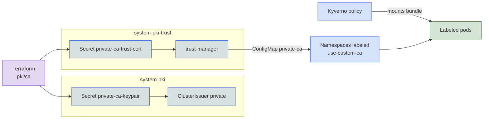

Every cluster runs a root CA behind the `private` issuer. Everything that issuer signs, such as the `internal` gateway certificate for `my-app.example.internal` and the certificates between CoreDNS and its etcd, chains to that one root, so a client trusts it once. [ACME](acme.md) certificates are unaffected. This page assumes the issuer terms from [PKI](index.md).

## How it starts

The cluster CA needs no setting. Before the cluster is built, a Terraform component generates an ECDSA P-256 root named `Private CA`, valid for 10 years. Core loads it into the cluster as two Secrets, split so that the key exists only in `system-pki`. This table lists both.

| Secret | Namespace | Holds |
|---|---|---|
| `private-ca-keypair` | `system-pki` | Certificate and key. The `private` issuer signs with it. |
| `private-ca-trust-cert` | `system-pki-trust` | Certificate only. trust-manager reads it. |

## Bring your own CA

An organization that already runs a root can have the `private` issuer sign with it. This `values.yaml` reads both halves of an existing root from a secret store.

```yaml
pki:
  ca:
    cert: ${secret("MyVault", "root-ca", "cert")}
    key: ${secret("MyVault", "root-ca", "key")}
```

`pki.ca.cert` holds the PEM CA certificate and `pki.ca.key` holds its private key. You MUST set both; Windsor rejects a configuration with only one of them. The deprecated `pki.private_ca` still works when `pki.ca` is unset.

## Rotation

A generated root is valid for 10 years and does not renew. To replace it, change `validity_period_hours` on the `pki/ca` component in your blueprint and run `windsor apply`. A root you supply follows your own rotation process.

## Trust the CA in workloads

A pod in `my-app` that calls a service signed by the cluster CA has to find that CA in its trust store. trust-manager provides it. It builds a *`Bundle`* named `private-ca` from the system trust roots plus the cluster CA, and writes it to a ConfigMap in each namespace labeled `use-custom-ca: "true"` and in no other. A pod gets the bundle when it carries the same label.

This manifest labels both the `my-app` namespace and a pod in it.

```yaml
apiVersion: v1
kind: Namespace
metadata:
  name: my-app
  labels:
    use-custom-ca: "true"
---
apiVersion: v1
kind: Pod
metadata:
  name: my-app
  namespace: my-app
  labels:
    use-custom-ca: "true"
```

The namespace label makes trust-manager write the `private-ca` ConfigMap into `my-app`. The pod label is what the Kyverno policy matches. When `policies.enabled` is true (the default), that policy mounts the bundle at `/usr/local/share/ca-certificates/ca.crt` and sets `SSL_CERT_FILE` and `REQUESTS_CA_BUNDLE` in each container of a labeled pod.

Label both the namespace and the pod. A labeled pod in an unlabeled namespace has no ConfigMap to mount and stays in `ContainerCreating`.

> [!WARNING]
> The policy fails closed. Kubernetes rejects labeled pods while Kyverno is unavailable.

## Trust the CA on a workstation

Browsers reject certificates from the cluster CA until its root is in the system trust store. This command reads the root from the cluster so you can add it there.

```sh
windsor exec -- kubectl -n system-pki-trust get secret private-ca-trust-cert \
  -o jsonpath='{.data.tls\.crt}' | base64 -d
```

## Talos API server

With `cluster.oidc.enabled`, the Talos API server also trusts this CA when it verifies tokens from a Keycloak that serves a private certificate. See [kubectl single sign-on](../identity/keycloak.md#kubectl-single-sign-on). Because the CA is generated before the cluster exists, the trust is there at first boot.

## Under the hood

This diagram shows where the Terraform-generated root goes and how it reaches labeled pods.



## Reference

- [terraform/pki/ca](../../../terraform/pki/ca)
- [kustomize/pki](../../../kustomize/pki)
- [kustomize/pki/resources/private-issuer/ca](../../../kustomize/pki/resources/private-issuer/ca)
- [kustomize/policy](../../../kustomize/policy)
