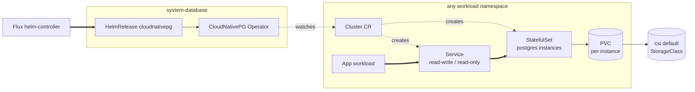

# Database

In-cluster PostgreSQL via the CloudNativePG operator, plus the per-driver
Crossplane `ProviderConfig` and Kyverno policies for a cloud-managed
instance. The add-on creates no database. A consuming chart creates a
`postgresql.cnpg.io/v1` `Cluster` or a cloud instance CR (see the demo
add-on for worked examples).

`clusterWide: true` means the single operator instance reconciles
`Cluster` CRs in any namespace, so application teams don't need their own
operator per workload namespace.

## Architecture



Cluster CRs and their StatefulSets live in whatever namespace consumes the
database. The demo add-on places one in `demo-database`. The cloud driver
resources under `crossplane/postgres/*` act on cloud instance CRs at
admission; see Components.

## Recipes

### Single-node

```yaml
flux:
  - name: database
    dependsOn: [csi]
    install:
      components:
        - cloudnativepg
        - cloudnativepg/single-node
      timeout: 15m
```

### HA cluster

```yaml
flux:
  - name: database
    dependsOn: [csi]
    install:
      components:
        - cloudnativepg
        - cloudnativepg/ha
      timeout: 15m
```

### With Prometheus monitoring

```yaml
flux:
  - name: database
    dependsOn: [csi]
    install:
      components:
        - cloudnativepg
        - cloudnativepg/prometheus
        - cloudnativepg/ha
      timeout: 15m
```

The `cloudnativepg/prometheus` component adds
`dependsOn: kube-prometheus-stack` to the operator HelmRelease, so the
operator installs after Prometheus is ready.


## Components

### `cloudnativepg`

_Enabled when `database.postgres.enabled == true`._

Helm release of CloudNativePG in `system-database`. `clusterWide: true` so the operator reconciles `Cluster` CRs in any namespace. Mutating and validating webhooks default to `failurePolicy: Fail` so misconfigured Clusters are rejected at admission.

### `cloudnativepg/prometheus`

_Enabled when `database.postgres.enabled == true`._

Patches the operator HelmRelease to depend on `kube-prometheus-stack` (system-telemetry) and enable `monitoring.podMonitorEnabled: true` with `release: kube-prometheus-stack` discovery labels.

### `cloudnativepg/ha`

_Enabled when `database.postgres.enabled == true` AND `topology == 'ha'`._

Patches the operator HelmRelease for HA: `replicaCount: 2`, hostname-key pod anti-affinity, rolling update `maxUnavailable: 1`. Adds a `PodDisruptionBudget` (`minAvailable: 1`) selecting the operator pods.

### `cloudnativepg/single-node`

_Enabled when `database.postgres.enabled == true` AND `topology == 'single-node'`._

Patches the operator HelmRelease to append `--leader-elect=false` via `additionalArgs`. The chart unconditionally passes `--leader-elect`; Go's flag parser is last-wins so the override wins.

### `crossplane/postgres/aws-rds`

_Enabled when `database.postgres.cloud.enabled == true` AND the cloud driver is `rds`. The cloud driver is `database.postgres.cloud.driver`, which defaults from the platform._

RDS's `default` `ProviderConfig` (credentials source `PodIdentity`, so a consuming `Instance` CR needs no `providerConfigRef`) and two Kyverno `MutatingPolicy` resources acting on every `Instance`. `crossplane-instance-tag` force-sets the `windsorcli.dev/cluster` and `WindsorContextID` tags. `crossplane-instance-network` defaults `dbSubnetGroupName`, `kmsKeyId`, and `vpcSecurityGroupIds` when the `Instance` leaves them unset. Applies after `provisioning-resources`, which is Ready once the `Provider` reports Healthy and Installed.

### `crossplane/postgres/azure-postgres`

_Enabled when `database.postgres.cloud.enabled == true` AND the cloud driver is `azuredb`._

Azure twin of `crossplane/postgres/aws-rds`. The `default` `ProviderConfig` (credentials source `OIDCTokenFile`, so a consuming `FlexibleServer` CR needs no `providerConfigRef`) and three Kyverno `MutatingPolicy` resources acting on every `FlexibleServer`. `crossplane-azuredb-rg` force-sets `resourceGroupName` to the context's dedicated postgres resource group. `crossplane-instance-tag` force-sets the `WindsorContextID` tag. `crossplane-azuredb-network` defaults `delegatedSubnetId` and `privateDnsZoneId` on create when unset.

### `crossplane/postgres/gcp-cloudsql`

_Enabled when `database.postgres.cloud.enabled == true` AND the cloud driver is `cloudsql`._

GCP twin of `crossplane/postgres/aws-rds`. The `default` `ProviderConfig` (credentials source `InjectedIdentity`, so a consuming `DatabaseInstance` CR needs no `providerConfigRef`) and three Kyverno `MutatingPolicy` resources acting on every `DatabaseInstance`. `crossplane-cloudsql-project` force-sets `project` to the context's GCP project. `crossplane-instance-tag` force-sets the `windsor_context_id` label. `crossplane-cloudsql-network` defaults `settings.ipConfiguration.privateNetwork` when unset.

### `crossplane/postgres/azure-postgres/encryption-key`

_Enabled when `database.postgres.cloud.enabled == true` AND the cloud driver is `azuredb` AND (`database.postgres.cloud.encryption.managed: true` with `ephemeral != true`, OR `database.postgres.cloud.encryption.key_id` set)._

A Kyverno `MutatingPolicy` that defaults `identity` and `customerManagedKey` to this context's key on every new `FlexibleServer` that leaves them unset.

### `crossplane/postgres/gcp-cloudsql/encryption-key`

_Enabled when `database.postgres.cloud.enabled == true` AND the cloud driver is `cloudsql` AND (`database.postgres.cloud.encryption.managed: true` with `ephemeral != true`, OR `database.postgres.cloud.encryption.key_id` set)._

GCP twin of `crossplane/postgres/azure-postgres/encryption-key`, defaulting `encryptionKeyName` on every new `DatabaseInstance`.

## Dependencies

| Add-on | Required when | Reason |
|---|---|---|
| `csi` | `database.postgres.enabled == true` | PostgreSQL `Cluster` CRs request PVCs for data storage; the default StorageClass must exist before the operator can bring a Cluster up. |
| `telemetry` | `database.postgres.enabled == true` AND `telemetry.metrics.enabled` or `telemetry.logs.enabled` | The operator HelmRelease depends on `kube-prometheus-stack`. |
| `provisioning` | `database.postgres.cloud.enabled == true` | The `ProviderConfig` and Kyverno policies need the CRDs the Crossplane `Provider` installs. |


## See also

- [contexts/_template/facets/addon-database.yaml](../../contexts/_template/facets/addon-database.yaml) for the canonical wiring and Grafana dashboard patch.
- [contexts/_template/facets/option-single-node.yaml](../../contexts/_template/facets/option-single-node.yaml) for the `cloudnativepg/single-node` patch wiring.
- [kustomize/demo/resources/database/](../demo/resources/database/) for a worked example (a `Cluster` CR named `demo-cluster`).
- Related add-ons: [csi](../csi/), [observability](../observability/) (`grafana/dashboards/cloudnativepg`), [telemetry](../telemetry/).
