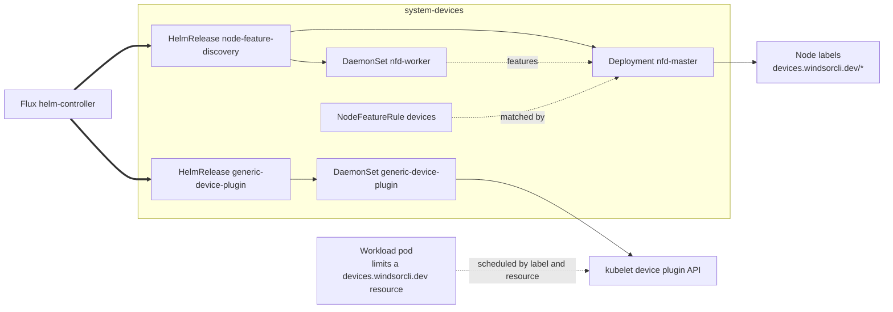

Node Feature Discovery labels each node that has a USB serial device or a GPU, and device plugins advertise those devices as extended resources. A pod requests a resource in `resources.limits` and selects a node by label, with no `hostPath` volume or privileged container.

## Architecture



nfd-worker reports each node's PCI devices and loaded kernel modules, and nfd-master turns the `devices` NodeFeatureRule into labels. generic-device-plugin matches host device files by glob and registers them with the kubelet under the `devices.windsorcli.dev` domain. A GPU gets a label only when its Talos extension has loaded the kernel driver.

## Recipes

### Serial devices only

```yaml
flux:
  - name: devices
    install:
      components:
        - node-feature-discovery
        - generic-device-plugin
    resources:
      - components:
          - node-feature-rules
```

### NVIDIA GPU

```yaml
flux:
  - name: devices
    install:
      components:
        - node-feature-discovery
        - generic-device-plugin
        - nvidia-device-plugin
    resources:
      - components:
          - node-feature-rules
```

A pod that requests `nvidia.com/gpu` sets `runtimeClassName: nvidia`.

## Operations

- If a USB serial device gets no resource, list `/dev/serial/by-id/` on the node and check that a glob in its `devices.serial` entry matches the name.
- If a GPU node has no `gpu-*` label, check that the Talos extension for `devices.gpu.drivers` is installed and its module is loaded.
- If a non-root pod cannot open its device, check that the node carries the containerd `device_ownership_from_security_context` patch.
- The `usb-serial` label stays after the dongle is unplugged, until the node reboots.

## Security

- `system-devices` runs at the `privileged` Pod Security level, because nfd-worker and both device plugins mount host paths and the plugins run privileged.
- A pod that requests a device resource passes the `baseline` level. The plugin mounts the device node, so the pod needs no extra capability.
- generic-device-plugin runs with no service account token.

## Substitutions

| Name | Required when | Effect |
|---|---|---|
| `generic_device_plugin_devices` | `generic-device-plugin` is enabled | JSON list of `--device` specs: one per `devices.serial` name with its globs, plus `dri` when `devices.gpu.drivers` has `intel` or `amd`. |

## Components

### `node-feature-discovery`

_Enabled when `devices.enabled: true`._

Helm release of Node Feature Discovery with nfd-master, nfd-worker on every node, and nfd-gc. The topology updater is off. The `NodeFeatureRule` CRD comes from the `crds:` layer, so the release skips the chart's CRDs.

### `generic-device-plugin`

_Enabled when `devices.enabled: true` and `devices.serial` has an entry or `devices.gpu.drivers` has `intel` or `amd`._

Helm release of generic-device-plugin with `--domain devices.windsorcli.dev`. It exposes each `devices.serial` name at `/dev/<name>`, and `dri` as render nodes under `/dev/dri/` with 10 shares per node.

### `nvidia-device-plugin`

_Enabled when `devices.gpu.drivers` has `nvidia`._

Helm release of the NVIDIA device plugin with `runtimeClassName: nvidia` and time-slicing at 10 replicas per GPU, on nodes labeled `devices.windsorcli.dev/gpu-nvidia`. Ships the `nvidia` RuntimeClass.

### `nvidia-device-plugin/chart-registry`

_Enabled when `devices.gpu.drivers` has `nvidia` and `charts.registry` is set._

Replaces the NVIDIA HelmRepository with an OCIRepository at `${chart_registry}/nvidia-device-plugin`.

### `node-feature-rules`

_Enabled when `devices.enabled: true`._

The `devices` NodeFeatureRule. It sets `devices.windsorcli.dev/usb-serial`, `gpu-intel`, `gpu-amd`, `gpu-nvidia`, `video-encode`, and `video-decode` to `"true"`.

## Dependencies

| Add-on | Required when | Reason |
|---|---|---|
| `crds` | always | Supplies the `NodeFeatureRule` and `NodeFeature` CRDs before the resources tier applies. |

## See also

- [contexts/_template/facets/addon-devices.yaml](../../contexts/_template/facets/addon-devices.yaml) for the wiring and `requires:` rules.
- [contexts/_template/facets/config-talos.yaml](../../contexts/_template/facets/config-talos.yaml) for the GPU extensions and machine config patches.
- [terraform/cluster/talos/extensions](../../terraform/cluster/talos/extensions/) for the extension installer.
