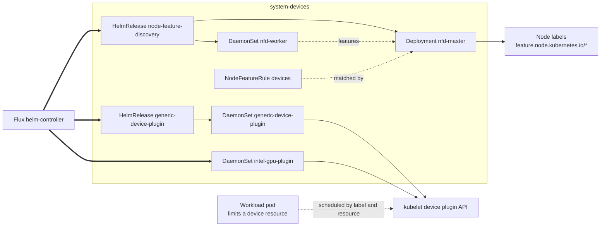

Node Feature Discovery labels each node that has a USB serial device or an Intel GPU, and device plugins advertise those devices as extended resources. A pod requests a resource in `resources.limits` and selects a node by label, with no `hostPath` volume or privileged container.

## Architecture



nfd-worker reports each node's PCI devices and loaded kernel modules, and nfd-master turns the `devices` NodeFeatureRule into labels. generic-device-plugin matches serial device files by glob and registers them with the kubelet under the `devices.windsorcli.dev` domain. intel-gpu-plugin registers each Intel GPU as `gpu.intel.com/i915` or `gpu.intel.com/xe`, by the kernel driver that bound it. A GPU gets a label only when its Talos extension has loaded the kernel driver.

## Recipes

### Serial devices only

```yaml
flux:
  - name: devices
    install:
      components:
        - node-feature-discovery
        - generic-device-plugin
    resources:
      - components:
          - node-feature-rules
```

### Intel GPU

```yaml
flux:
  - name: devices
    install:
      components:
        - node-feature-discovery
        - intel-gpu-plugin
    resources:
      - components:
          - node-feature-rules
```

## Operations

- If a USB serial device gets no resource, list `/dev/serial/by-id/` on the node and check that a glob in its `devices.serial` entry matches the name.
- If a GPU node has no `gpu-intel` label, check that the i915 or xe Talos extension is installed and its module is loaded.
- If a pod waits on `gpu.intel.com/i915`, check whether the node advertises `gpu.intel.com/xe` instead. Lunar Lake, Battlemage, and newer GPUs bind xe.
- If a non-root pod cannot open its device, check that the node carries the containerd `device_ownership_from_security_context` patch.
- The `usb-serial` label stays after the dongle is unplugged, until the node reboots.

## Security

- `system-devices` runs at the `privileged` Pod Security level, because nfd-worker and both device plugins mount host paths and generic-device-plugin runs privileged.
- A pod that requests a device resource passes the `baseline` level. The plugin mounts the device node, so the pod needs no extra capability.
- Neither device plugin mounts a service account token.

## Substitutions

| Name | Required when | Effect |
|---|---|---|
| `generic_device_plugin_devices` | `generic-device-plugin` is enabled | JSON list of `--device` specs, one per `devices.serial` name with its globs. |

## Components

### `node-feature-discovery`

_Enabled when `devices.enabled: true`._

Helm release of Node Feature Discovery with nfd-master, nfd-worker on every node, and nfd-gc. The topology updater is off. The `NodeFeatureRule` CRD comes from the `crds:` layer, so the release skips the chart's CRDs.

### `generic-device-plugin`

_Enabled when `devices.enabled: true` and `devices.serial` has an entry._

Helm release of generic-device-plugin with `--domain devices.windsorcli.dev`. It exposes each `devices.serial` name at `/dev/<name>`.

### `intel-gpu-plugin`

_Enabled when `devices.gpu.drivers` has `intel`._

Intel's GPU device plugin DaemonSet, vendored from its upstream deployment, with `-shared-dev-num=10` on nodes labeled `feature.node.kubernetes.io/gpu-intel`. A pod gets the card and render nodes under `/dev/dri/`.

### `node-feature-rules`

_Enabled when `devices.enabled: true`._

The `devices` NodeFeatureRule. It sets `feature.node.kubernetes.io/usb-serial`, `gpu-intel`, `video-encode`, and `video-decode` to `"true"`.

## Dependencies

| Add-on | Required when | Reason |
|---|---|---|
| `crds` | always | Supplies the `NodeFeatureRule` and `NodeFeature` CRDs before the resources tier applies. |

## See also

- [contexts/_template/facets/addon-devices.yaml](../../contexts/_template/facets/addon-devices.yaml) for the wiring and `requires:` rules.
- [contexts/_template/facets/config-talos.yaml](../../contexts/_template/facets/config-talos.yaml) for the GPU extensions and machine config patches.
- [terraform/cluster/talos/extensions](../../terraform/cluster/talos/extensions/) for the extension installer.
