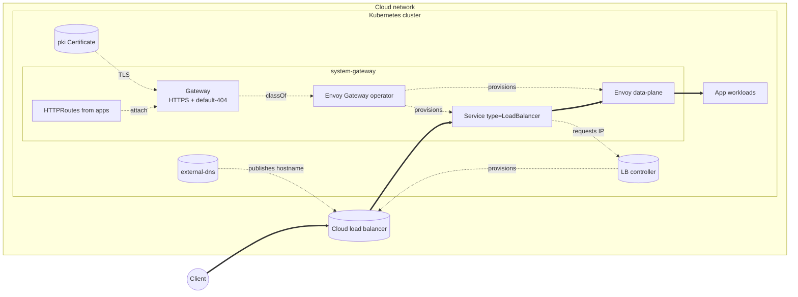
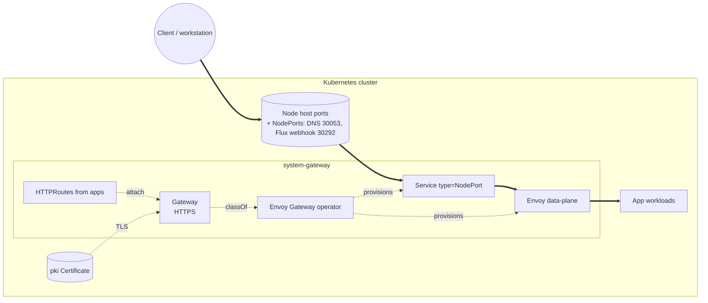
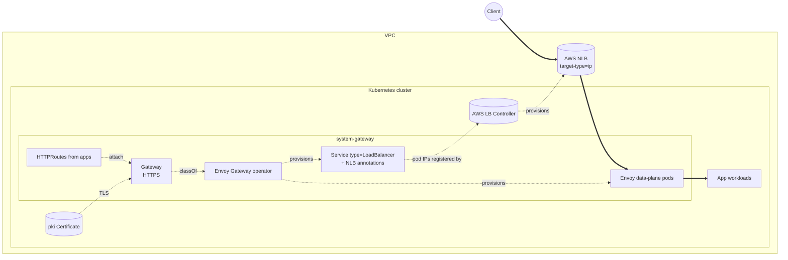
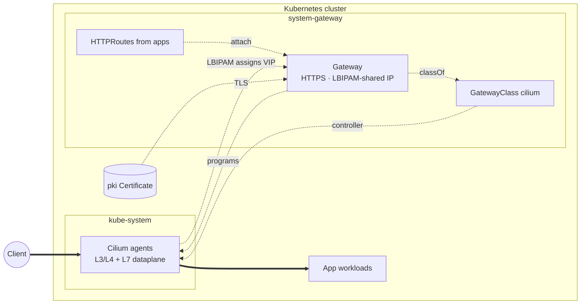

The cluster's traffic entrypoints, via the Kubernetes Gateway API. Two
Gateways can exist: `external`, provisioned when `dns.public_domain` is
set, and `internal`, provisioned when `dns.private_domain` is set
(workstation and dev mode default it to `test`). Two driver options.

The default driver is `cilium` whenever Cilium is the CNI, and `envoy`
on AWS, on docker-desktop, and everywhere else. Envoy Gateway is a
dedicated control-plane and data-plane Envoy stack installed by Helm. It
is heavier than Cilium's built-in path and supports L7 features Cilium
lacks, such as `HTTPRouteFilter`, ext_authz, and response header and
body rewrites. The catch-all 404 uses `HTTPRouteFilter`.

The `cilium` driver uses Cilium's built-in Gateway API implementation. A
single dataplane handles L3/L4 and L7, and LoadBalancer Services share
IPs via Cilium LBIPAM. No separate Helm release: the install tier
installs only the GatewayClass, the Cilium operator (owned by the `cni`
add-on) is the controller, and the resources tier patches the Gateway
with Cilium's LBIPAM annotations so multiple Gateways can share one IP.

The add-on is a `flux:` system entry (`gateway`) so Flux installs the
controller before the `Gateway` CR that targets it. The Gateway API
CRDs, and Envoy Gateway's CRDs on the envoy driver, ship from the
facet's `crds:` layer ahead of both tiers. `install` ships the Envoy
Gateway Helm release and its Prometheus monitors (envoy), or only the
GatewayClass (cilium). `resources` ships one named variant per Gateway
(`gateway-resources-external`, `gateway-resources-internal`), each
rendering the `Gateway`, its certificate, and its `EnvoyProxy` from the
same files through the `${gateway_name}` substitution, plus per-feature
patches (LB mode, catch-all 404, DNS listeners, fixed LB address, Flux
webhook). Utility surfaces (CoreDNS listeners, the Flux webhook) bind
to `internal` only. The tier
implicitly depends on `install` (compiled name: `gateway-install`).

## Recipes

Each Gateway listens on HTTPS (and HTTP for redirect) with a cert
issued by one of the pki add-on's ClusterIssuers: the public issuer for
`external`, `private` for `internal`. external-dns publishes its
hostname, and for the LoadBalancer modes the LB controller assigns its
IP. The diagrams show one Gateway.

### Envoy + LoadBalancer (cloud default)



Bold path is the request flow; dotted is the control wiring that sets
it up. The operator turns the Gateway + HTTPRoutes into a running Envoy
data-plane behind a LoadBalancer Service; the LB controller provisions
the cloud LB and external-dns publishes its hostname.

```yaml
flux:
  - name: gateway
    install:
      components: [envoy, envoy/prometheus]
    resources:
      - name: internal
        dependsOn: [pki-resources, lb-install]
        components:
          - envoy/base
          - envoy/loadbalancer
          - envoy/loadbalancer/kube-vip-ip
          - envoy/parameters
          - envoy/default-404
          - lb-address
          - flux-webhook
        substitutions:
          gateway_name: internal
          gateway_class_name: envoy
          gateway_domain: example.internal
          gateway_cert_issuer: private
          gateway_loadbalancer_ip: 10.5.1.10
          gateway_dns_target: 10.5.1.10
```

The data-plane Service is exposed through the LB controller.

### Envoy + NodePort (local dev / single-host)



```yaml
flux:
  - name: gateway
    install:
      components: [envoy, envoy/prometheus]
    resources:
      - name: internal
        dependsOn: [pki-resources]
        components:
          - envoy/base
          - envoy/nodeport
          - envoy/nodeport/dns
          - envoy/nodeport/flux-webhook
          - envoy/parameters
```

NodePort skips the LB controller and forwards via host ports. The
`/dns` and `/flux-webhook` sub-overlays open the additional NodePort
slots needed for in-cluster DNS and Flux push-mode webhooks.

### Envoy on AWS (NLB)



```yaml
flux:
  - name: gateway
    install:
      components: [envoy, envoy/prometheus]
    resources:
      - name: external
        dependsOn: [pki-resources, lb-install]
        components:
          - envoy/base
          - envoy/loadbalancer
          - envoy/loadbalancer/aws-nlb
          - envoy/parameters
```

The aws-nlb overlay adds AWS LB Controller annotations so the
data-plane Service provisions an NLB with `target-type=ip`, sending
traffic straight to the Envoy pods with source IP preserved.

### Cilium driver



Cilium is the CNI, so its agents terminate and route Gateway traffic
directly. There is no Envoy Service in the path.

```yaml
flux:
  - name: gateway
    install:
      components: [cilium]
    resources:
      - name: internal
        dependsOn: [pki-resources, cni-install]
        components: [cilium, cilium/fixed-ip]
        substitutions:
          gateway_name: internal
          gateway_class_name: cilium
          gateway_loadbalancer_ip: 10.5.1.10
```


## Substitutions

| Name | Required when | Effect |
|---|---|---|
| `gateway_name` | `gateway-resources-external` or `gateway-resources-internal` is composed | `external` or `internal`. Names the Gateway, EnvoyProxy, and Certificate this resources variant renders. |
| `gateway_class_name` | always | Name of the `GatewayClass` the cluster Gateway references. Sourced from `gateway.driver` (`envoy` or `cilium`). |
| `gateway_domain` | `gateway-resources-external` or `gateway-resources-internal` is composed | Cert SAN and DNS target domain for this gateway. `dns.public_domain` for external, `dns.private_domain` for internal. |
| `gateway_cert_issuer` | `gateway-resources-external` or `gateway-resources-internal` is composed | TLS `ClusterIssuer` name. External: `public-acme` on aws, azure, gcp, and hetzner unless `pki.public_issuer` is `selfsigned`, `public-selfsigned` otherwise. Internal: always `private`. |
| `gateway_dns_target` | `dns` is enabled and gateway-resources/dns is composed | Hostname/IP that external-dns publishes as this gateway's target. Resolves to `gateway.<name>.ip` when kube-vip or MetalLB runs, `10.96.0.53` for the internal gateway with `dns/docker-desktop`, and empty otherwise. |
| `gateway_loadbalancer_ip` | `lb-address` or `cilium/fixed-ip` is composed | Fixed IP this gateway advertises. Used in the cilium variant's `lbipam.cilium.io/ips` annotation, the `cilium-pool` block, and the envoy variant's `spec.addresses` patch. Sourced from `gateway.<name>.ip`. |
| `gateway_lb_scheme` | AWS platform, `envoy/loadbalancer/aws-nlb` is composed | `internet-facing` for external, `internal` for internal. |
| `gateway_redirect_port` | `gateway-resources-external` or `gateway-resources-internal` is composed | HTTPS port the `https-redirect` route's 301 targets. `443` for cloud/LB; docker-desktop's NodePort host-forward otherwise (`8443` internal, `8444` external). |
| `gateway_nodeport_http / gateway_nodeport_https` | this gateway's service type is `NodePort` | NodePort numbers for this gateway's data-plane Service. Internal: 30080 and `gateway.internal.node_port` (default 30443). External: 30081 and `gateway.external.node_port` (default 30444). |

## Components — `gateway-install`

### `envoy`

_Enabled when `gateway.driver == 'envoy'`._

Helm release of `envoy-gateway` in `system-gateway`. Installs the Envoy Gateway operator only (chart CRD install is skipped). Per-gateway data-plane config (`EnvoyProxy`, LB and NodePort annotations) is in the resources tier, one variant per gateway.

### `envoy/prometheus`

_Enabled when envoy driver._

Adds a PodMonitor for the Envoy data-plane pods and a ServiceMonitor for the Envoy Gateway operator. The `envoy-gateway` HelmRelease waits for `kube-prometheus-stack`.

### `install/cilium`

_Enabled when `gateway.driver == 'cilium'`._

Installs a `GatewayClass` referencing the `cilium` controller. The Cilium HelmRelease itself is owned by the `cni` add-on (see option-cni's `cilium/gateway` component). Operator references this as `components: [cilium]` under `gateway-install`.

## Components — `gateway-resources`

### `envoy/base`

_Enabled when envoy driver._

Named so it sorts ahead of every other `envoy/*` component, which patch the `EnvoyProxy` it creates and apply in sorted order when several facets contribute to one gateway. The self-contained `EnvoyProxy` resource (`${gateway_name}`) referenced from the Gateway via `spec.infrastructure.parametersRef` (see `envoy/parameters`). The loadbalancer and nodeport components layer the envoyService Service config in. The EnvoyGateway helm config keeps no default proxy patch, so this resource is authoritative.

### `envoy/loadbalancer`

_Enabled when envoy driver AND this gateway's service type is `LoadBalancer`._

Patches this gateway's `EnvoyProxy` so the data-plane Service is `type: LoadBalancer`, with no fixed IP, so a cloud LB controller assigns one. Cloud-specific annotation patches (aws-nlb / azure) and the address-pinning components merge on top.

### `envoy/loadbalancer/kube-vip-ip` and `envoy/loadbalancer/metallb-ip`

_Enabled when envoy driver AND this gateway's service type is `LoadBalancer` AND kube-vip or MetalLB runs AND `gateway.<name>.ip` is set._

Pins this gateway's data-plane Service to its address with the driver's annotation, `kube-vip.io/loadbalancerIPs` or `metallb.io/loadBalancerIPs`. The address is `gateway.<name>.ip`, else the pool address. Cloud platforms never apply these, since their LB controller assigns the address.

### `envoy/loadbalancer/cilium-ip`

_Enabled when envoy driver AND this gateway's service type is `LoadBalancer` AND Cilium provides the pool addresses._

Pins this gateway's data-plane Service to `gateway.<name>.ip` with the `lbipam.cilium.io/ips` annotation.

### `envoy/loadbalancer/aws-nlb`

_Enabled when envoy driver AND platform is AWS AND `lb_effective.mode == 'loadbalancer'`._

Adds NLB annotations onto the Envoy data-plane Service so the AWS Load Balancer Controller provisions an NLB with target-type=ip. Traffic reaches Envoy pods directly, source IP preserved. Scheme comes from `gateway_lb_scheme`.

### `envoy/loadbalancer/azure`

_Enabled when envoy driver AND platform is Azure AND the internal gateway._

Adds Azure ILB annotations so the Envoy data-plane Service provisions an internal load balancer (subnet-bound, no public IP). Applied to the internal gateway only. The external gateway gets AKS's default public load balancer.

### `envoy/loadbalancer/gcp`

_Enabled when envoy driver AND platform is GCP AND the internal gateway._

Adds the GKE internal load balancer annotation (`networking.gke.io/load-balancer-type: Internal`) so the Envoy data-plane Service gets an internal load balancer. Applied only to the internal gateway, since GKE's CCM gives the external gateway a public one by default.

### `envoy/loadbalancer/hcloud-lb`

_Enabled when envoy driver AND platform is Hetzner._

Hetzner-specific annotations so hcloud cloud-controller-manager provisions a Hetzner Cloud Load Balancer for the type=LoadBalancer Service.

### `cilium/loadbalancer/hcloud-lb`

_Enabled when cilium driver AND platform is Hetzner._

Sets the hcloud cloud-controller-manager annotations on the Gateway's `spec.infrastructure`, so the Service Cilium creates gets a Hetzner Cloud Load Balancer.

### `envoy/nodeport`

_Enabled when envoy driver AND this gateway's service type is `NodePort`._

Patches this gateway's `EnvoyProxy` so the data-plane Service is `type: NodePort` on the ports from `gateway_nodeport_http` and `gateway_nodeport_https`. Used on single-node clusters, behind an upstream load balancer, and on local clusters with no LoadBalancer provider.

### `envoy/nodeport/docker-desktop`

_Enabled when envoy/nodeport AND `workstation.runtime == 'docker-desktop'`._

Adds ClusterIP-reachable entries for this gateway's host-published ports (`gateway_host_https_port` and `gateway_host_http_port`: 8443/8080 internal, 8444/8081 external) to the data-plane Service. Lets in-cluster callers reach workstation-domain hostnames at the same port a browser would.

### `envoy/nodeport/dns`

_Enabled when envoy/nodeport AND internal gateway AND `dns.private.enabled` (default `true` in dev mode)._

Opens NodePort 30053 for the cluster's private DNS resolver (UDP/TCP 53). Lets a workstation point at the host's IP for `*.<dns.private_domain>` resolution. Internal-only, since DNS is a utility surface.

### `envoy/nodeport/flux-webhook`

_Enabled when envoy/nodeport AND internal gateway AND `gitops.mode == 'push'`._

Opens NodePort 30292 for the Flux notification-controller webhook (port 9292). Internal-only, since the webhook receiver is a utility surface.

### `resources/cilium`

_Enabled when `gateway.driver == 'cilium'` AND no cloud LB controller owns the IP._

Patches this Gateway with the `lbipam.cilium.io/sharing-key: ${gateway_name}` and sharing-cross-namespace annotations. Operator references this as `components: [cilium]` under `gateway-resources`.

### `cilium/fixed-ip`

_Enabled when cilium driver AND `gateway.<name>.ip` is set._

Adds `lbipam.cilium.io/ips: ${gateway_loadbalancer_ip}` to pin the gateway's address.

### `cilium-pool`

_Enabled when Cilium provides the LoadBalancer addresses AND this gateway is a LoadBalancer with `gateway.<name>.ip`._

Cluster-scoped `CiliumLoadBalancerIPPool` (`gateway-${gateway_name}`) holding only `${gateway_loadbalancer_ip}/32`.

### `envoy/parameters`

_Enabled when envoy driver._

Patches this Gateway's `spec.infrastructure.parametersRef` to point at its own `EnvoyProxy` (`${gateway_name}`), so the data-plane Service is configured per gateway rather than through the controller-global EnvoyGateway default. Cilium gateways don't use the `EnvoyProxy` resource.

### `envoy/default-404`

_Enabled when envoy driver._

Catch-all `HTTPRoute` (`default-404-${gateway_name}`) returning a 404 directResponse for any request that doesn't match a real app's HTTPRoute, via a shared `HTTPRouteFilter` referenced by both gateways. Cilium clusters don't ship this (the Envoy-specific CRD isn't available there).

### `envoy/default-404/external-dns`

_Enabled when envoy driver._

Adds the `external-dns.alpha.kubernetes.io/hostname` annotation to the 404 catch-all route so external-dns publishes the gateway hostname for the bare domain (not just per-app HTTPRoutes).

### `dns`

_Enabled when envoy driver AND internal gateway AND `dns.private.enabled` (default `true` in dev mode)._

Patches the internal Gateway with `external-dns.alpha.kubernetes.io/target: ${gateway_dns_target}` and adds UDP and TCP listeners on port 53 that accept `UDPRoute` and `TCPRoute` attachments for CoreDNS. CoreDNS is a utility surface, so only the internal gateway carries it.

### `dns/docker-desktop`

_Enabled when envoy driver AND internal gateway AND `workstation.runtime == 'docker-desktop'` AND `dns.private.enabled`._

Adds a ClusterIP Service named `gateway` at the fixed address `10.96.0.53` that selects the internal gateway's Envoy pods on ports 80, 443, 8080, and 8443. The facet sets `gateway_dns_target` to that address, so external-dns publishes the internal gateway's hostnames as `A` records pointing at it. In-cluster callers then reach those hostnames on the same ports a browser uses. The target is a literal IP because CoreDNS's etcd backend cannot follow a CNAME into another zone. The address MUST fall inside the cluster's service CIDR, which is the Talos default `10.96.0.0/12`. The workstation resolves these hostnames through its own Corefile and does not use this record.

### `lb-address`

_Enabled when kube-vip or MetalLB runs AND `gateway.<name>.ip` is set._

Patches this Gateway's `spec.addresses` to pin a fixed IPAddress (`${gateway_loadbalancer_ip}`). Skipped when no LB is enabled (NodePort mode picks node IP at apply time).

### `flux-webhook`

_Enabled when internal gateway AND `gitops.mode == 'push'`._

Adds an HTTP listener on port 9292 to the internal Gateway for the Flux notification-controller webhook. Paired with `envoy/nodeport/flux-webhook` on nodeport-mode clusters. Applied to the internal gateway only.

## Dependencies

| Add-on | Required when | Reason |
|---|---|---|
| `pki-resources` | always | Each Gateway's `Certificate` needs its ClusterIssuer. |
| `telemetry-install` | envoy driver AND `telemetry.metrics.enabled` | `gateway-install` waits for the Prometheus Operator CRDs its monitors use. |
| `lb-install` | AWS with envoy driver, or Hetzner's external gateway | The cloud LB controller finalizes the data-plane Service and tears down after it. |
| `cni-install` | `gateway.driver == 'cilium'` (declared by option-cni) | Each resources variant waits for Cilium and its LBIPAM sharing policy. |


## See also

- [contexts/_template/facets/option-gateway.yaml](../../contexts/_template/facets/option-gateway.yaml) for the canonical wiring.
- [contexts/_template/facets/platform-aws.yaml](../../contexts/_template/facets/platform-aws.yaml) for the NLB merge on the AWS path.
- [contexts/_template/facets/platform-azure.yaml](../../contexts/_template/facets/platform-azure.yaml) for the Azure ILB merge on the private-access path.
- Related add-ons: [pki](../pki/) (gateway certificate), [lb](../lb/) (data-plane Service LB), [dns](../dns/) (external-dns publication), [cni](../cni/) (cilium driver).
