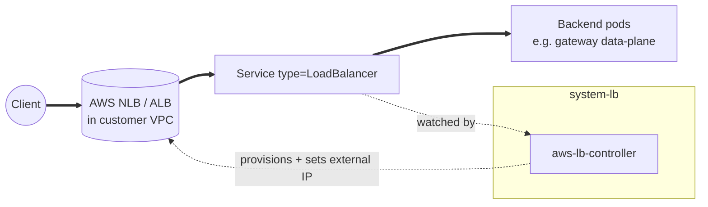
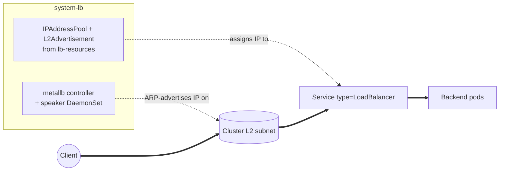
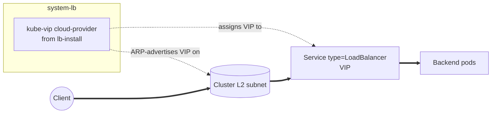

The cluster's LoadBalancer-Service provider, gated on
`lb_effective.enabled` and selected by `lb_effective.driver`. Three
drivers ship.

On EKS, `aws-lb-controller` provisions real AWS NLB and ALB resources.
The controller runs in the cluster; the load balancer it creates lives
in the customer's VPC.

`metallb` is a speaker DaemonSet that ARP- or BGP-advertises IPs from a
configured pool. It runs on docker, incus, and metal clusters.

`kube-vip` is a VIP-style provider for Talos clusters that uses ARP
for L2 advertisement.

The add-on is a `flux:` system entry (`lb`) so Flux can install the
controller before the resources that depend on it being live
(advertisement pools, cloud-provider patches). `install` ships the
controller Helm release for whichever driver is active
(aws-lb-controller, metallb, or kube-vip). `resources` ships the
advertisement / address-pool config that configures it (compiled
name: `lb-install` / `lb-resources`), and implicitly depends on
`install`. All three drivers ship a non-empty `install`, so `resources`
can always assume the controller ran first.

The namespace runs at PSA `privileged` because MetalLB's speaker
needs host networking, and aws-lb-controller shares the namespace
even though it doesn't.

## Recipes

Exactly one driver is wired per cluster, selected by
`lb_effective.driver`. The gateway add-on's data-plane Service gets
its external IP from whichever driver is on.

### AWS (EKS)



```yaml
flux:
  - name: lb
    dependsOn: [policy-resources]
    install:
      components: [aws-lb-controller]
      substitutions:
        cluster_name: <terraform_output('cluster', 'cluster_name')>
        vpc_id: <terraform_output('network', 'vpc_id')>
        aws_region: us-east-1
```

There's no `resources` block because AWS LB Controller handles address
management through the cloud API. `lb_effective.controller_required` is
true for this driver, so gateway-install depends on lb-install.

### MetalLB (docker / incus / metal)



```yaml
flux:
  - name: lb
    dependsOn: [policy-resources]
    install:
      components: [metallb]
    resources:
      - components: [metallb/arp, metallb/arp/internal-gateway]
        substitutions:
          loadbalancer_ip_range: 10.5.1.20-10.5.1.30
          gateway_internal_ip: 10.5.1.10
```

The speaker DaemonSet ARP-advertises IPs from the configured pools on
the cluster's L2 subnet. The range comes from
`network.loadbalancer_ips.{start,end}`, and each gateway gets its own
pool holding `gateway.<name>.ip`.

### Talos (kube-vip)



```yaml
flux:
  - name: lb
    dependsOn: [policy-resources]
    install:
      components: [kube-vip, kube-vip/arp]
```

kube-vip's advertisement mode (`kube-vip/arp`) patches its own
HelmRelease rather than shipping as a separate CR, so it builds in
`install` alongside the HelmRelease; `resources` is empty for this
driver.


## Substitutions

| Name | Required when | Effect |
|---|---|---|
| `cluster_name` | `aws-lb-controller` is enabled | AWS-side cluster name (LBC tag). Sourced from `terraform_output('cluster', 'cluster_name')`. No fallback — LBC tags every AWS resource it owns with this and filters reconciliation by it, so a generic default would let a second cluster in the same account race the tags. |
| `vpc_id` | `aws-lb-controller` is enabled | VPC ID the LBC operates against. Sourced from `terraform_output('network', 'vpc_id')`. |
| `aws_region` | `aws-lb-controller` is enabled | AWS region for LBC API calls. Sourced from top-level `aws.region`. |
| `loadbalancer_ip_range` | `metallb/*` or `kube-vip/cloud-provider` component is enabled | IP range the driver advertises (CIDR-style `start-end`). Read by MetalLB's `IPAddressPool` (in `resources`) and by the kube-vip cloud-provider HelmRelease directly (in `install`). Sourced from `network.loadbalancer_ips.start + '-' + network.loadbalancer_ips.end`. |
| `gateway_internal_ip` | `metallb/arp/internal-gateway` is enabled | Address of the internal gateway's pool. Sourced from `gateway.internal.ip`. |
| `gateway_external_ip` | `metallb/arp/external-gateway` is enabled | Address of the external gateway's pool. Sourced from `gateway.external.ip`. |

## Components — `lb-install`

### `aws-lb-controller`

_Enabled when platform is AWS._

Helm release of the AWS Load Balancer Controller in `system-lb`. Watches `Service type=LoadBalancer` (NLB) and `Ingress` (ALB) resources and provisions AWS-side LBs against the cluster's VPC. Talks to AWS via the IAM role + Pod Identity the cluster Terraform module provisioned. The chart's `crds/` directory is install-only (Helm never upgrades it); the CRDs are vendored under `kustomize/crds/` and applied via the facet `crds:` section so they stay current.

### `metallb`

_Enabled when `lb_effective.driver == 'metallb'`._

Helm release of MetalLB in `system-lb`. Installs the controller and speaker DaemonSet. The address pool and advertisement mode come from `lb-resources` (`metallb-arp` or `metallb-layer2`).

### `kube-vip`

_Enabled when `lb_effective.driver == 'kube-vip'`, the default with the flannel CNI on metal, vsphere, hyperv, incus, and proxmox._

Helm release of kube-vip in `system-lb`. Announces the addresses of LoadBalancer Services; pairs with `kube-vip/arp` for L2 advertisement.

| Variant | Enabled when | Effect |
|---|---|---|
| `arp` | kube-vip driver AND `network.loadbalancer_mode == 'arp'` (default) | Patches the kube-vip HelmRelease to enable ARP-based VIP advertisement (Layer 2). |
| `single-node` | kube-vip driver AND `topology == 'single-node'` | Turns off kube-vip's Service leader election. |
| `cloud-provider` | kube-vip driver AND `network.loadbalancer_ips` is set | Helm release of the kube-vip cloud-provider, which assigns addresses from `${loadbalancer_ip_range}` to Services that do not pin one. |

## Components — `lb-resources`

### `metallb-arp`

_Enabled when metallb driver AND `network.loadbalancer_mode == 'arp'` (default)._

MetalLB `IPAddressPool` (range = `${loadbalancer_ip_range}`) plus an `L2Advertisement` selecting it. Use this for flat L2 networks where speakers can ARP-respond on the cluster subnet.

| Variant | Enabled when | Effect |
|---|---|---|
| `internal-gateway` | metallb driver AND the internal gateway is a LoadBalancer with `gateway.internal.ip` | `IPAddressPool/gateway-internal` holding only that address, with `autoAssign: false`, plus an `L2Advertisement` selecting it. |
| `external-gateway` | metallb driver AND the external gateway is a LoadBalancer with `gateway.external.ip` | `IPAddressPool/gateway-external`, the same for the external gateway. |

### `metallb-layer2`

_Enabled when metallb driver AND `network.loadbalancer_mode == 'layer2'`._

Deprecated alias for `metallb-arp` (same L2Advertisement mechanism). Removed in v0.8.0.

## Dependencies

| Add-on | Required when | Reason |
|---|---|---|
| `policy-resources` | `policies.enabled: true` | lb-install depends on Kyverno's baseline policies being active before LB controller pods (which run privileged in `system-lb`) are admitted. |


## See also

- [contexts/_template/facets/platform-aws.yaml](../../contexts/_template/facets/platform-aws.yaml) for aws-lb-controller wiring.
- [contexts/_template/facets/platform-docker.yaml](../../contexts/_template/facets/platform-docker.yaml) for MetalLB wiring on docker hosts.
- [contexts/_template/facets/platform-incus.yaml](../../contexts/_template/facets/platform-incus.yaml) for MetalLB wiring on incus hosts.
- Related add-ons: [gateway](../gateway/) (data-plane Service consumes lb), [cni](../cni/) (Cilium's L2 announcer is an alternative to lb on Talos, see `cilium/l2`), [policy](../policy/).
