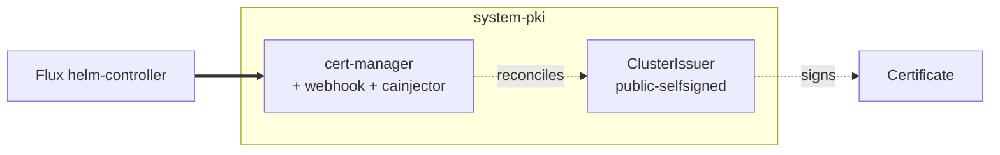
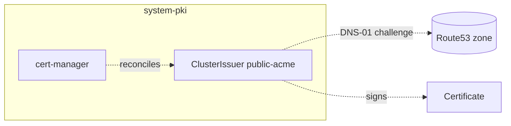
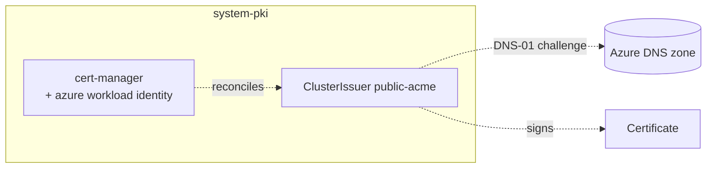
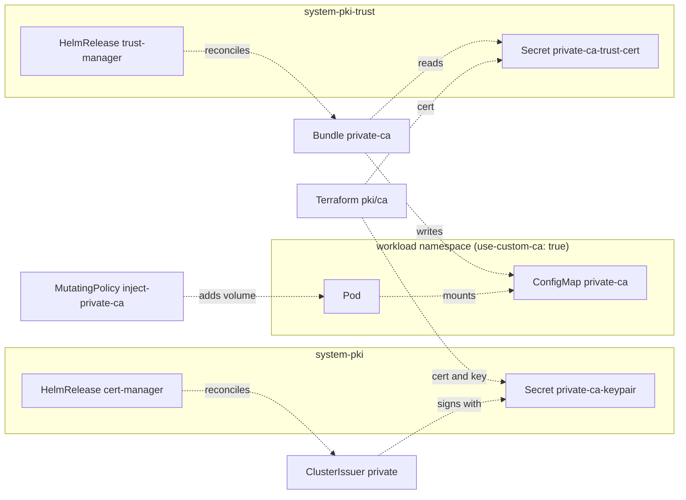

The cluster's certificate-issuance layer. cert-manager's CRDs are
vendored under `kustomize/crds/` and applied ahead of the stack via
the facet `crds:` section. The add-on is a `flux:` system entry
(`pki`) so Flux can reconcile the controller before the ClusterIssuer
CRs that depend on it. `install` installs cert-manager and trust-manager, plus optional patches
that enable Prometheus scraping, HA replicas, cloud workload identity,
and single-node leader-election tweaks. `resources` applies the
ClusterIssuers and implicitly depends on `install` (compiled name:
`pki-install` / `pki-resources`).

The ClusterIssuers keep the same names on every platform, so
downstream `Certificate` resources reference a stable name: `private`
for internal certificates, and `public-selfsigned` or `public-acme` for
the external gateway. Switching between selfsigned and ACME changes
only the issuer substitution, and cert-manager reissues into the same
Secret.

## Recipes

cert-manager runs in `system-pki` (PSA `baseline`); trust-manager, when
present, runs in `system-pki-trust` (PSA `restricted`).

### Baseline (selfsigned public issuer)



```yaml
flux:
  - name: pki
    install:
      components: [cert-manager]
      timeout: 20m
    resources:
      - components: [public-issuer/selfsigned]
        timeout: 5m
```

Issues gateway certificates against `public-selfsigned`. Browsers warn on
anything it signs.

### Public ACME on AWS



```yaml
flux:
  - name: pki
    resources:
      - components: [public-issuer/acme/route53]
        substitutions:
          acme_server: https://acme-v02.api.letsencrypt.org/directory
          acme_email: you@example.com
          acme_dns_zone: example.com
          acme_region: us-east-1
          acme_hosted_zone_id: <from terraform_output('dns-zone', 'zone_id')>
```

DNS-01 against Route53. Auth comes from the IAM role and Pod Identity
binding the AWS cluster Terraform module provisioned.

### Public ACME on Azure



```yaml
flux:
  - name: pki
    install:
      components: [cert-manager, cert-manager/azure-workload-identity]
      substitutions:
        cert_manager_client_id: <terraform_output('cluster', 'cert_manager_client_id')>
        cert_manager_tenant_id: <terraform_output('cluster', 'tenant_id')>
    resources:
      - components: [public-issuer/acme/azuredns]
        substitutions:
          acme_server: https://acme-v02.api.letsencrypt.org/directory
          acme_email: you@example.com
          acme_dns_zone: example.com
          acme_dns_zone_resource_group: <terraform_output('dns-zone', 'resource_group_name')>
          acme_dns_zone_subscription_id: <terraform_output('dns-zone', 'subscription_id')>
```

DNS-01 against Azure DNS, authed via the AKS federated workload
identity attached by `cert-manager/azure-workload-identity`.

### Cluster CA with trust-manager distribution

Every cluster runs this recipe.



```yaml
flux:
  - name: pki
    secrets:
      private-ca-keypair:
        namespaces: [system-pki]
        data:
          tls.crt: <terraform_output('pki', 'cert')>
          tls.key: <terraform_output('pki', 'key')>
      private-ca-trust-cert:
        namespaces: [system-pki-trust]
        data:
          tls.crt: <terraform_output('pki', 'cert')>
    install:
      components: [cert-manager, trust-manager]
    resources:
      - components: [private-issuer/ca, private-issuer/ca/kyverno-inject]
```

The `pki/ca` Terraform module generates the CA, or passes through
`pki.ca.cert` and `pki.ca.key` when both are set. The
facet's `secrets:` block writes the keypair into `system-pki`, where
ClusterIssuer `private` signs against it, and the cert alone into
`system-pki-trust`. trust-manager's `Bundle private-ca` merges that
cert with the default CAs into a `private-ca` ConfigMap in every
namespace labeled `use-custom-ca: "true"`. The Kyverno policy mounts
the ConfigMap into Pods carrying the same label.

## Operations

If `cert-manager-controller` restarts with `Last State: Terminated,
Reason: Completed` and its logs show `clockHealth failed: the system
clock is out of sync with the internal monotonic clock`, this is
expected on docker-desktop/colima after the host laptop sleeps. The VM
pauses. On wake its wall clock steps forward while the running
controller's monotonic baseline does not, which trips cert-manager's
`/livez` clock check (~5m tolerance, not configurable through Helm
values). The restart resets the baseline. It stops recurring once the
host stays awake long enough for the VM's clock sync to converge.


## Substitutions

| Name | Required when | Effect |
|---|---|---|
| `cert_manager_client_id` | `cert-manager/azure-workload-identity` is enabled | Azure AD client ID for the cert-manager managed identity. Sourced from `terraform_output('cluster', 'cert_manager_client_id')`. |
| `cert_manager_tenant_id` | `cert-manager/azure-workload-identity` is enabled | Azure AD tenant ID for the federated workload identity credential. |
| `acme_server` | any `public-issuer/acme/*` component is enabled | ACME directory URL. Resolves to `acme-staging-v02.api.letsencrypt.org` in dev, `acme-v02.api.letsencrypt.org` otherwise. |
| `acme_email` | any `public-issuer/acme/*` component is enabled | Contact email Let's Encrypt registers against the ACME account. Sourced from top-level `email`. |
| `acme_dns_zone` | any `public-issuer/acme/*` component is enabled | FQDN of the DNS zone cert-manager writes DNS-01 challenges into. Sourced from `dns.public_domain`. |
| `acme_region` | `public-issuer/acme/route53` is enabled | AWS region for the Route53 DNS-01 solver. Sourced from `aws.region`. |
| `acme_hosted_zone_id` | `public-issuer/acme/route53` is enabled | Route53 hosted zone ID. Threaded via deferred `terraform_output('dns-zone', 'zone_id')` so the ACME ClusterIssuer reissues automatically when the dns-zone stack first applies. |
| `acme_dns_zone_resource_group` | `public-issuer/acme/azuredns` is enabled | Azure resource group holding the public DNS zone. Sourced from `terraform_output('dns-zone', 'resource_group_name')`. |
| `acme_dns_zone_subscription_id` | `public-issuer/acme/azuredns` is enabled | Azure subscription ID for the public DNS zone. Sourced from `terraform_output('dns-zone', 'subscription_id')`. |
| `acme_dns_zone_project` | `public-issuer/acme/clouddns` is enabled | GCP project holding the public Cloud DNS zone. Sourced from `gcp.project_id`. |
| `cert_manager_service_account_email` | `cert-manager/gcp-workload-identity` is enabled | Email of the cert-manager Google Service Account. Sourced from `terraform_output('cluster', 'cert_manager_service_account_email')`. |

## Components — `pki-install`

### `cert-manager`

_Enabled when always._

Helm release of the `cert-manager` chart in `system-pki`. Installs the controller, webhook, and cainjector (chart CRD install is skipped). The cert-manager CRDs are vendored under `kustomize/crds/` and applied ahead of the controller via the facet `crds:` section, so `pki-resources` can consume ClusterIssuer / Certificate CRs.

### `cert-manager/single-node`

_Enabled when single-node topology._

Patches the cert-manager HelmRelease to disable leader election on the controller (single replica has nothing to elect against).

### `cert-manager/ha`

_Enabled when `topology == 'ha'`._

Patches the cert-manager HelmRelease to run 2 replicas each of the controller, webhook, and cainjector, with preferred pod anti-affinity across nodes.

### `cert-manager/azure-workload-identity`

_Enabled when platform is Azure AND `dns.public_domain` is set AND `dns.public_zone` is not `false`._

Patches the cert-manager Deployment to attach the AKS federated workload identity used by the DNS-01 ACME solver against Azure DNS. Reads `cert_manager_client_id` and `cert_manager_tenant_id`.

### `cert-manager/gcp-workload-identity`

_Enabled when platform is GCP AND `dns.public_domain` is set AND `dns.public_zone` is not `false`._

Annotates the cert-manager ServiceAccount with the GKE Workload Identity binding used by the DNS-01 ACME solver against Cloud DNS. Reads `cert_manager_service_account_email`.

### `cert-manager/prometheus`

_Enabled when `telemetry.metrics.enabled: true`._

Patches the cert-manager HelmRelease to enable Prometheus annotations / ServiceMonitor on the controller and webhook.

### `trust-manager`

_Always enabled._

Helm release of the `trust-manager` chart in `system-pki-trust` (PSA `restricted`). Depends on cert-manager. Consumes `Bundle` CRs to distribute the private CA into workload namespaces.

| Variant | Enabled when | Effect |
|---|---|---|
| `single-node` | single-node topology | Patches the trust-manager HelmRelease to disable leader election. |

## Components — `pki-resources`

### `private-issuer`

The cluster's internal trust anchor, issuing the etcd and private-gateway certificates.

| Variant | Enabled when | Effect |
|---|---|---|
| `ca` | always | ClusterIssuer `private` signing against the `private-ca-keypair` Secret in `system-pki`, plus `Bundle private-ca` reading the cert-only `private-ca-trust-cert` Secret in `system-pki-trust`. The facet's `secrets:` block fills both from `terraform_output('pki', ...)`. |
| `ca/kyverno-inject` | `policies.enabled` is not `false` | Kyverno MutatingPolicy `inject-private-ca` that mounts the `private-ca` ConfigMap into Pods labeled `use-custom-ca: "true"`. |

### `public-issuer`

ClusterIssuers for the external gateway certificate, named `public-selfsigned` or `public-acme`.

### `public-issuer/selfsigned`

_Enabled on AWS, Azure, GCP, and Hetzner when no `acme/*` variant is enabled; on other platforms when `dns.public_domain` is set; always when `dev: true`._

ClusterIssuer `public-selfsigned`. Bootstraps a working gateway cert immediately. Setting `dns.public_domain` with `dns.public_zone` and `pki.public_issuer` left at their defaults switches a cloud platform to `acme/*`, and cert-manager reissues into the same Secret.

### `public-issuer/acme/route53`

_Enabled when platform is AWS AND `dns.public_domain` is set AND `dns.public_zone` is not `false` AND `pki.public_issuer` is not `selfsigned`._

ClusterIssuer `public-acme` using the ACME DNS-01 solver against Route53. Auth is via the Pod Identity binding provisioned by the cluster Terraform module.

### `public-issuer/acme/azuredns`

_Enabled when platform is Azure AND `dns.public_domain` is set AND `dns.public_zone` is not `false` AND `pki.public_issuer` is not `selfsigned`._

ClusterIssuer `public-acme` using the ACME DNS-01 solver against Azure DNS. Auth is via the federated workload identity (see `cert-manager/azure-workload-identity`).

### `public-issuer/acme/clouddns`

_Enabled when platform is GCP AND `dns.public_domain` is set AND `dns.public_zone` is not `false` AND `pki.public_issuer` is not `selfsigned`._

ClusterIssuer `public-acme` using the ACME DNS-01 solver against Cloud DNS. Auth is via the GKE Workload Identity binding (see `cert-manager/gcp-workload-identity`).

### `public-issuer/acme/hetzner`

_Enabled when platform is Hetzner AND `dns.public_domain` is set AND `dns.public_zone` is not `false` AND `pki.public_issuer` is not `selfsigned`._

ClusterIssuer `public-acme` using the ACME DNS-01 solver against Hetzner DNS. Installs the `cert-manager-webhook-hetzner` HelmRelease in `system-pki`, which reads the API token from the `hetzner-dns` Secret.

## Dependencies

| Add-on | Required when | Reason |
|---|---|---|
| `telemetry-install` | `telemetry.metrics.enabled` or `telemetry.logs.enabled` is true | The ServiceMonitor added by `cert-manager/prometheus` needs Prometheus to be live to scrape. |


## See also

- [contexts/_template/facets/platform-base.yaml](../../contexts/_template/facets/platform-base.yaml) for the base cert-manager and the pki/ca Terraform step.
- [contexts/_template/facets/platform-aws.yaml](../../contexts/_template/facets/platform-aws.yaml) for ACME on Route53 wiring.
- [contexts/_template/facets/platform-azure.yaml](../../contexts/_template/facets/platform-azure.yaml) for ACME on AzureDNS plus workload-identity wiring.
- [contexts/_template/facets/addon-private-ca.yaml](../../contexts/_template/facets/addon-private-ca.yaml) for trust-manager and private CA wiring.
- Related add-ons: [policy](../policy/), [telemetry](../telemetry/), [gateway](../gateway/) (consumes the ClusterIssuer for the external gateway cert), [observability](../observability/) (Elasticsearch consumes the private CA).
