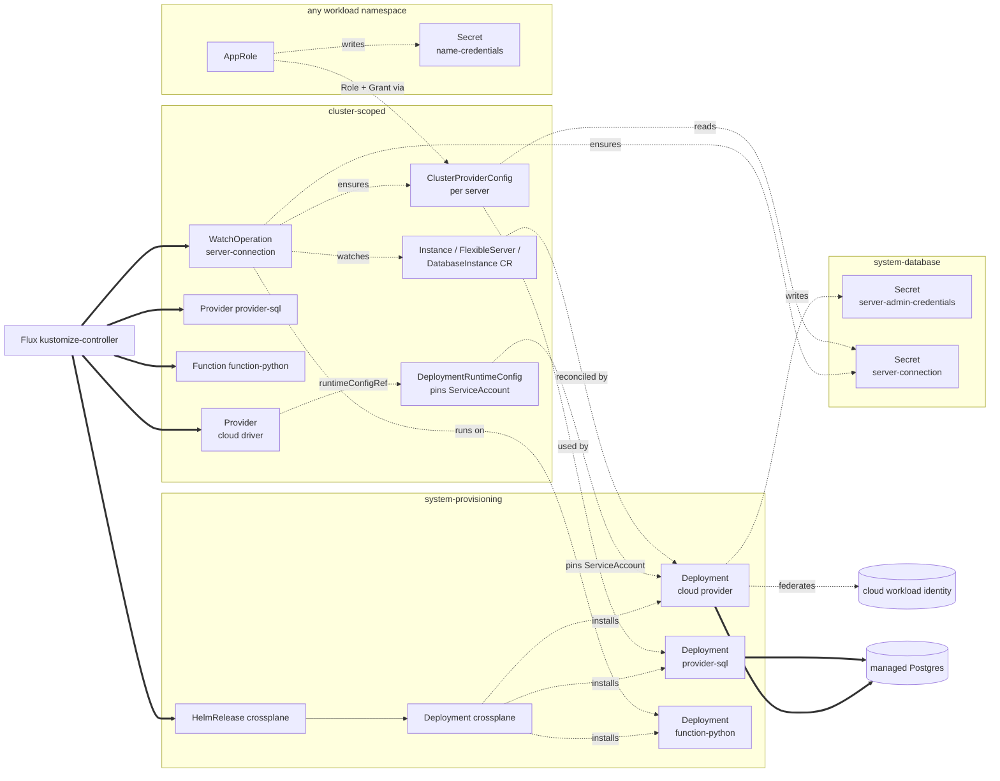

# Provisioning

A Kubernetes-native API for cloud-managed resources, so a Helm chart running
on top of core can request one without authoring its own Windsor blueprint.
It covers one capability today: a cloud-managed Postgres instance, enabled by
`database.postgres.cloud.enabled` (see [kustomize/database](../database/README.md)).
Crossplane runs the API, with `provider-aws-rds`, `provider-azure-dbforpostgresql`,
or `provider-gcp-sql` for the cloud driver. The cloud driver is
`database.postgres.cloud.driver`, which defaults from the platform.

The add-on installs Crossplane, the active driver's provider package,
`provider-sql`, and `function-python`. It creates no database. A chart
installed on top of core creates the `rds.aws.upbound.io` `Instance`,
`dbforpostgresql.azure.upbound.io` `FlexibleServer`, or `sql.gcp.upbound.io`
`DatabaseInstance` directly, the same posture as CloudNativePG's `Cluster` CR
in `kustomize/database`.

`system-provisioning` runs at PSA `baseline`, matching `system-database`.
The Crossplane chart's `securityContext` values add `capabilities.drop: [ALL]`
and `seccompProfile: RuntimeDefault`, which satisfies `restricted`. The
provider pods do not satisfy it. Hardening them through
`DeploymentRuntimeConfig` needs a `deploymentTemplate.spec.selector` matching
the pod labels Crossplane assigns per revision, which isn't hand-writable.

## Architecture



`addon-database.yaml` owns the one `provisioning` `flux:` entry, gated on
`database.postgres.cloud.enabled`. Its `install:` tier carries only the
Crossplane HelmRelease. Its `resources:` tier carries the cloud driver's
`Provider` and `DeploymentRuntimeConfig`, plus `provider-sql`,
`function-python`, `app-role`, and `postgres-monitor`. `healthCheckExprs`
hold that tier until every `Provider` and `Function` reports Healthy and
Installed and every XRD reports Established. The driver's `ProviderConfig`
and Kyverno policies live in [kustomize/database](../database/README.md),
whose resources tier depends on `provisioning-resources`.

Every driver's admin password lands in a `<server-name>-admin-credentials`
Secret in `system-database`. RDS and Flexible Server generate it through
their own `passwordSecretRef` or `administratorPasswordSecretRef` field.
`provider-gcp-sql` has no such field, so the Cloud SQL `WatchOperation`
(`databaseinstance-server-connection`) creates the Secret and an admin
`User` that applies it. The `app-role` component's Composition
(`app-role-postgres`) issues each chart's own login through the server's
`ClusterProviderConfig`.

## Consuming from a chart

Once enabled, a chart needs only the database definition. It sets no
provider wiring and no credentials.

AWS (cloud driver `rds`):

```yaml
apiVersion: rds.aws.upbound.io/v1beta3
kind: Instance
metadata:
  name: my-app-db
spec:
  forProvider:
    region: us-east-1
    engine: postgres
    instanceClass: db.t4g.micro
    autoGeneratePassword: true
    passwordSecretRef:
      name: my-app-db-admin-credentials
      namespace: system-database
      key: password
    # ...
```

`providerConfigRef` is omitted because `default` is the field's default and
the name of the `ProviderConfig` that `kustomize/database` creates. Kyverno
policies from `kustomize/database` default `dbSubnetGroupName`
(`rds-<context-id>`), `kmsKeyId`, and `vpcSecurityGroupIds`, and force-set
the `windsorcli.dev/cluster` tag on admission. The
`<cluster-name>-crossplane-rds` IAM role conditions `CreateDBInstance` on
that request tag and `ModifyDBInstance`/`DeleteDBInstance` on the same
resource tag, so the role can't touch an RDS instance it didn't create.

Azure (cloud driver `azuredb`):

```yaml
apiVersion: dbforpostgresql.azure.upbound.io/v1beta1
kind: FlexibleServer
metadata:
  name: my-app-db
spec:
  forProvider:
    location: eastus
    version: "16"
    administratorLogin: myapp
    administratorPasswordSecretRef:
      name: my-app-db-admin-credentials
      namespace: system-database
      key: password
    autoGeneratePassword: true
---
apiVersion: dbforpostgresql.azure.upbound.io/v1beta1
kind: FlexibleServerDatabase
metadata:
  name: myapp
spec:
  forProvider:
    name: myapp
    serverIdRef:
      name: my-app-db
```

The database is a separate CR from the server, since `FlexibleServer` has
no `dbName` field. Kyverno policies from `kustomize/database` force-set
`resourceGroupName` to the context's dedicated postgres resource group and
default `delegatedSubnetId` and `privateDnsZoneId`. The
`crossplane-identity/azure` custom role is scoped to that resource group,
so the identity can't touch a server it didn't create.

GCP (cloud driver `cloudsql`):

```yaml
apiVersion: sql.gcp.upbound.io/v1beta2
kind: DatabaseInstance
metadata:
  name: my-app-db
spec:
  forProvider:
    region: us-central1
    databaseVersion: POSTGRES_16
    settings:
      tier: db-f1-micro
      ipConfiguration:
        ipv4Enabled: false
---
apiVersion: sql.gcp.upbound.io/v1beta1
kind: Database
metadata:
  name: myapp
spec:
  forProvider:
    instanceRef:
      name: my-app-db
```

Kyverno policies from `kustomize/database` force-set `project` and default
`settings.ipConfiguration.privateNetwork`. The `WatchOperation` creates the
admin credentials described above.

## Components

### `crossplane`

_Enabled when `database.postgres.cloud.enabled == true`._

Helm release of Crossplane in `system-provisioning`, with the `--enable-operations` flag that `WatchOperation` requires. Each driver's `ProviderConfig` lives in `kustomize/database`.

### `crossplane/provider-sql`

_Enabled when `database.postgres.cloud.enabled == true`._

`Provider` CR for `crossplane-contrib/provider-sql` plus a `DeploymentRuntimeConfig` setting its resource requests/limits. Its `Role`/`Database`/`Grant` CRDs speak the Postgres wire protocol, so one install per context serves every driver.

### `crossplane/function-python`

_Enabled when `database.postgres.cloud.enabled == true`._

`Function` CR for `crossplane-contrib/function-python` plus a `DeploymentRuntimeConfig` setting its resource requests/limits. Runs every `WatchOperation` and Composition in this domain.

### `crossplane/app-role`

_Enabled when `database.postgres.cloud.enabled == true`._

The `AppRole` XRD and its Composition (`app-role-postgres`), the equivalent of a CNPG app user. A chart creates one namespaced `AppRole` naming an instance and a database, and gets a login `Role` owning that database plus a `<name>-credentials` Secret in its own namespace. A role that needs role membership, a privilege subset, or `CREATEDB` uses provider-sql's own `Role`/`Grant` against the instance's `ClusterProviderConfig`.

### `crossplane/postgres-monitor`

_Enabled when `database.postgres.cloud.enabled == true` AND `telemetry.metrics.enabled` (default true)._

A `WatchOperation` watching every `ClusterProviderConfig` cluster-wide ensures a `PostgresMonitor` XR per server, for any driver. Its Composition builds the `<server-name>-monitor` `Role` and its `pg_monitor` `Grant` in `system-database`, then once that `Role` is `Ready`, a `postgres_exporter` Deployment/Service/PodMonitor reading its connection Secret. Composing none of them once the server's `deletionTimestamp` is set prunes them while the database is still reachable.

### `crossplane/aws-rds`

_Enabled when `database.postgres.cloud.enabled == true` AND the cloud driver is `rds`._

`Provider` CRs for `provider-aws-rds` (`skipDependencyResolution: true`) and its `provider-family-aws` dependency, plus a `DeploymentRuntimeConfig` that fixes the provider pod's ServiceAccount name to `provider-aws-rds` so the `provisioning/crossplane-identity/aws` Terraform module's Pod Identity association can target it. Also carries a `WatchOperation` watching every `rds.aws.upbound.io` `Instance` cluster-wide: ensures one `ClusterProviderConfig` named after the instance and the `<server-name>-connection` Secret in `system-database` it reads, both owned by the instance for garbage collection. A chart's own `Role`/`Grant` reference the `ClusterProviderConfig` by the instance's name.

### `crossplane/azure-postgres`

_Enabled when `database.postgres.cloud.enabled == true` AND the cloud driver is `azuredb`._

Azure twin of `crossplane/aws-rds`. `Provider` CRs for `provider-azure-dbforpostgresql` (`skipDependencyResolution: true`) and its `provider-family-azure` dependency, plus a `DeploymentRuntimeConfig` that fixes the provider pod's ServiceAccount name to `provider-azure-dbforpostgresql` and wires AKS Workload Identity (client-id/tenant-id annotations, the `azure.workload.identity/use` label on both the ServiceAccount and the pod) so the `provisioning/crossplane-identity/azure` Terraform module's federated credential can target it. Also carries the `WatchOperation` ensuring `FlexibleServer`'s `ClusterProviderConfig` and connection Secret, same as `crossplane/aws-rds`.

### `crossplane/gcp-cloudsql`

_Enabled when `database.postgres.cloud.enabled == true` AND the cloud driver is `cloudsql`._

GCP twin of `crossplane/aws-rds`. `Provider` CRs for `provider-gcp-sql` (`skipDependencyResolution: true`) and its `provider-family-gcp` dependency, plus a `DeploymentRuntimeConfig` that wires GKE Workload Identity (the `iam.gke.io/gcp-service-account` annotation on the provider ServiceAccount) so the `provisioning/crossplane-identity/gcp` Terraform module's Workload Identity binding can target it. Its `WatchOperation` does one thing more than `crossplane/aws-rds`'s: `provider-gcp-sql` has no auto-generate-password field, so it first ensures `<server-name>-admin-credentials` and an admin `User` CR applying it, before building the `ClusterProviderConfig` and connection Secret.


## See also

- [contexts/_template/facets/addon-database.yaml](../../contexts/_template/facets/addon-database.yaml) for the `provisioning` `flux:` system entry.
- [terraform/cluster/aws-eks](../../terraform/cluster/aws-eks/), [terraform/database/aws-rds](../../terraform/database/aws-rds/), [terraform/provisioning/crossplane-identity/aws](../../terraform/provisioning/crossplane-identity/aws/) for the AWS IAM role, Pod Identity association, and DB subnet group.
- [terraform/database/azure-postgres](../../terraform/database/azure-postgres/), [terraform/provisioning/crossplane-identity/azure](../../terraform/provisioning/crossplane-identity/azure/) for the Azure resource group, private DNS zone, and Workload Identity federation.
- [terraform/database/gcp-cloudsql](../../terraform/database/gcp-cloudsql/), [terraform/provisioning/crossplane-identity/gcp](../../terraform/provisioning/crossplane-identity/gcp/) for the Cloud SQL private service connection and Workload Identity binding.
- Related add-ons: [database](../database/) (`ProviderConfig` and Kyverno policies).
