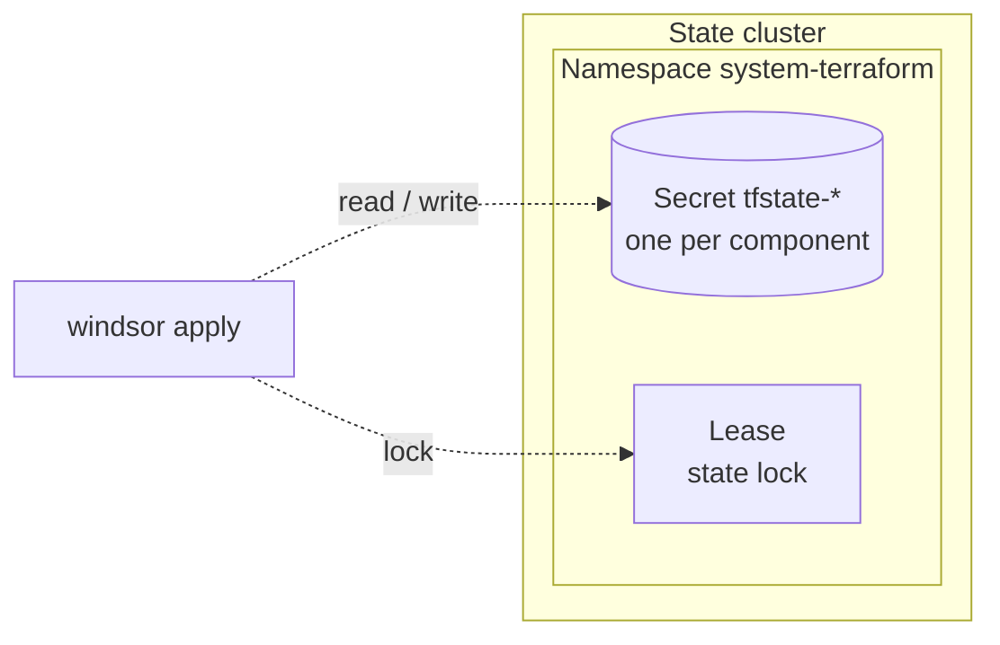

Creates the namespace that holds Terraform state on the Kubernetes
backend. Terraform's Kubernetes backend stores each component's state
in a Secret and does not create the namespace those Secrets live in.

## Recipe



```yaml
terraform:
  backend:
    type: kubernetes
```

The namespace defaults to `system-terraform`. Set
`terraform.backend.kubernetes.namespace` to use a different one. The
module reaches the cluster through the backend's own `config_path` and
`config_context`, or through `KUBE_CONFIG_PATH` when neither is set, so
it always writes to the cluster that holds the state.

When Windsor creates the cluster, the module runs right after the
`cluster` component. To keep state in a cluster that already exists,
point the backend at it and disable the cluster:

```yaml
cluster:
  enabled: false
terraform:
  backend:
    type: kubernetes
    kubernetes:
      config_path: /path/to/state-cluster/kubeconfig
```

The module is then the only component that runs before the others.

## Operations

The bootstrap pass applies this module, and every component before it,
with local state. Windsor then migrates their state into the namespace
and applies the remaining components against it.

Deleting the namespace deletes every component's state. A full
`windsor destroy` copies all state to local before it destroys
anything, and Windsor refuses to destroy this component by itself.

A Lease in the namespace holds the state lock. A crashed
`windsor apply` can leave it held; delete the Lease after confirming no
apply is running.

## Security

Each state Secret holds the component's outputs and resource
attributes in plain text, including generated credentials. Anyone who
can read Secrets in the namespace can read every component's state.
Limit Secret access in the namespace to the operators who run Windsor.

<!-- BEGIN_TF_DOCS -->
## Requirements

| Name | Version |
|------|---------|
| <a name="requirement_terraform"></a> [terraform](#requirement\_terraform) | >= 1.12.2 |
| <a name="requirement_kubernetes"></a> [kubernetes](#requirement\_kubernetes) | 3.3.0 |

## Providers

| Name | Version |
|------|---------|
| <a name="provider_kubernetes"></a> [kubernetes](#provider\_kubernetes) | 3.3.0 |

## Modules

No modules.

## Resources

| Name | Type |
|------|------|
| [kubernetes_namespace_v1.this](https://registry.terraform.io/providers/hashicorp/kubernetes/3.3.0/docs/resources/namespace_v1) | resource |

## Inputs

| Name | Description | Type | Default | Required |
|------|-------------|------|---------|:--------:|
| <a name="input_config_context"></a> [config\_context](#input\_config\_context) | Kubeconfig context for the state cluster. Empty uses the current context. | `string` | `""` | no |
| <a name="input_config_path"></a> [config\_path](#input\_config\_path) | Path to the kubeconfig for the state cluster. Empty uses KUBE\_CONFIG\_PATH. | `string` | `""` | no |
| <a name="input_namespace"></a> [namespace](#input\_namespace) | Namespace that holds the Terraform state Secrets. | `string` | n/a | yes |

## Outputs

| Name | Description |
|------|-------------|
| <a name="output_namespace"></a> [namespace](#output\_namespace) | Namespace that holds the Terraform state Secrets. |
<!-- END_TF_DOCS -->
