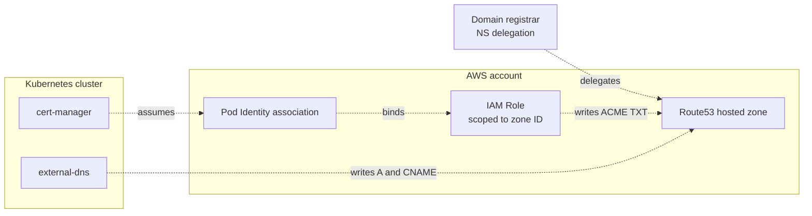
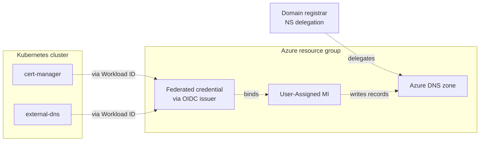
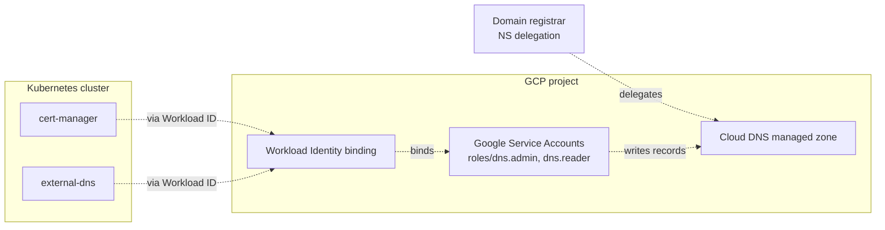
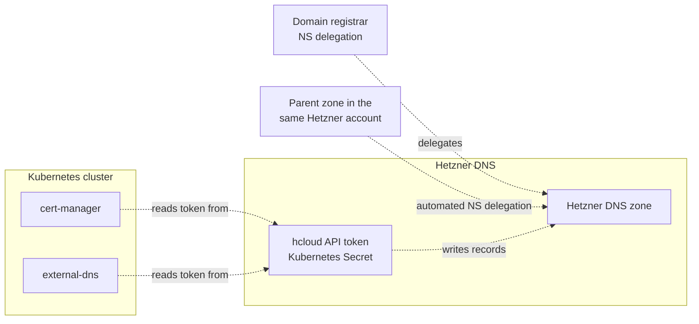

# DNS

The dns category has four drivers under `dns/zone/`: `route53`
provisions a public Route53 hosted zone on AWS, `azure-dns` a public
DNS zone on Azure, `gcp-dns` a public Cloud DNS managed zone on GCP,
and `hetzner` a public zone on Hetzner DNS. The driver is selected by
`platform`, and the zone module only runs when `dns.public_domain` is
set and `dns.public_zone` is not `false`. Without a zone, the cluster
falls back to self-signed certificates.

Zones are provisioned in their own Terraform stack so they have an
independent lifecycle. Tearing down the cluster doesn't drag the zone
(and its NS delegation effort) along with it.

cert-manager solves DNS-01 ACME challenges to issue real Let's
Encrypt certificates. external-dns keeps record sets in sync with
Ingress and HTTPRoute objects. The cluster module wires the identity
binding for both consumers on the matching cloud.

## Recipes

### AWS Route53



```yaml
platform: aws
dns:
  public_domain: example.windsorcli.dev
```

The module provisions a Route53 public hosted zone in the active
account. The cluster module then provisions a scoped IAM role for
cert-manager (the role's record-write actions are limited to this
zone's ID via `cert_manager_hosted_zone_ids`) and the Pod Identity
association.

After the apply, delegate the parent domain at your registrar to the
four name servers in the module output (`name_servers`). Until
delegation propagates, ACME challenges fail and external-dns warns
but doesn't block.

### Azure DNS



```yaml
platform: azure
dns:
  public_domain: example.windsorcli.dev
```

The module provisions an Azure DNS public zone in the resource group.
Workload Identity is configured on the AKS cluster for cert-manager
and external-dns to write records into this zone.

### Google Cloud DNS



```yaml
platform: gcp
gcp:
  project_id: my-gcp-project
dns:
  public_domain: example.windsorcli.dev
```

The module provisions a public Cloud DNS managed zone in the project.
The cluster module provisions dedicated Google Service Accounts for
cert-manager and external-dns, each granted `roles/dns.admin` on the
zone and bound to their Kubernetes service accounts through GKE
Workload Identity.

After the apply, delegate the parent domain at your registrar to the
name servers in the module output (`name_servers`).

### Hetzner DNS



```yaml
platform: hetzner
dns:
  public_domain: example.windsorcli.dev
```

The module provisions a public Hetzner DNS zone. Unlike the other
three drivers, there's no cloud IAM or Workload Identity binding: the
same `hetzner.token` API token used for the compute/network stack is
written as a Kubernetes Secret that cert-manager's ACME solver and
external-dns's Hetzner webhook provider both read.

Set `hetzner.dns_parent_zone` to a zone already in the same Hetzner
account to skip the registrar step entirely — the module creates the
NS delegation record in the parent zone automatically. Otherwise,
delegate the parent domain at your registrar to the name servers in
the module output (`name_servers`), the same as the other drivers.

### Self-signed (no public domain)

```yaml
platform: aws    # or any platform
# dns.public_domain unset
```

No DNS zone module runs. The cluster uses a self-signed ClusterIssuer
for gateway TLS, which is the just-works mode for dev clusters and
local deployments. Browsers will warn on the cert, but everything
else works.

## Operations

ACME challenges that fail with NXDOMAIN almost always mean NS
delegation at the registrar hasn't propagated yet. Run
`dig NS example.windsorcli.dev` against the public root resolvers;
until that returns the zone's name servers, cert-manager can't write
the DNS-01 record where ACME expects to read it.

On AWS, cert-manager's IAM role names the zone ID in its resource ARN.
If the zone is re-created out of band with a new ID, DNS-01 challenges
fail with `AccessDenied` until you re-apply the cluster module.

Destroying a Route53 zone with active records fails, because Route53
refuses to delete a zone that still contains record sets.
`terraform destroy` on the dns-zone stack won't succeed until
external-dns has cleaned up. Drain the cluster first, then destroy
the zone.

`dns.private_domain` doesn't trigger a separate zone module. The
network module creates the VPC- or VNet-linked private zone on AWS,
Azure, and GCP, and in-cluster CoreDNS serves it elsewhere. There's no
`dns/zone/private/*` module.

## Security

On AKS and GKE, the cert-manager and external-dns identities can write
only to the zones they're granted: this module's public zone, plus the
private zone for external-dns when `dns.private_domain` is set. On
EKS, the cert-manager role is scoped to this zone, but the
external-dns policy allows record changes in every hosted zone in the
account.

The zone module exports name servers but no credentials. Delegation
is an out-of-band operation the operator does at their registrar.

Self-signed mode has no root CA. The `public-selfsigned` ClusterIssuer
signs each certificate with its own key. The `private` ClusterIssuer
signs with the cluster CA that the `pki/ca` Terraform module generates.

<!-- BEGIN_TERRAFORM_MODULES -->

## Modules

- [zone/azure-dns](zone/azure-dns/) — DNS zone on Azure DNS.
- [zone/gcp-dns](zone/gcp-dns/) — DNS zone on Google Cloud DNS.
- [zone/hetzner](zone/hetzner/) — Creates a primary Hetzner DNS zone via the official hcloud provider.
- [zone/route53](zone/route53/) — Public DNS zone on AWS Route53.
<!-- END_TERRAFORM_MODULES -->

## See also

- [zone/route53/](zone/route53/), [zone/azure-dns/](zone/azure-dns/), [zone/gcp-dns/](zone/gcp-dns/), and [zone/hetzner/](zone/hetzner/) for the per-driver Terraform reference.
- [../cluster/](../cluster/) for the cluster module that provisions the identity binding (IAM Pod Identity, Workload Identity).
- [../../kustomize/pki/](../../kustomize/pki/) for cert-manager and the ClusterIssuers.
- [../../kustomize/dns/](../../kustomize/dns/) for the external-dns reconciler.
