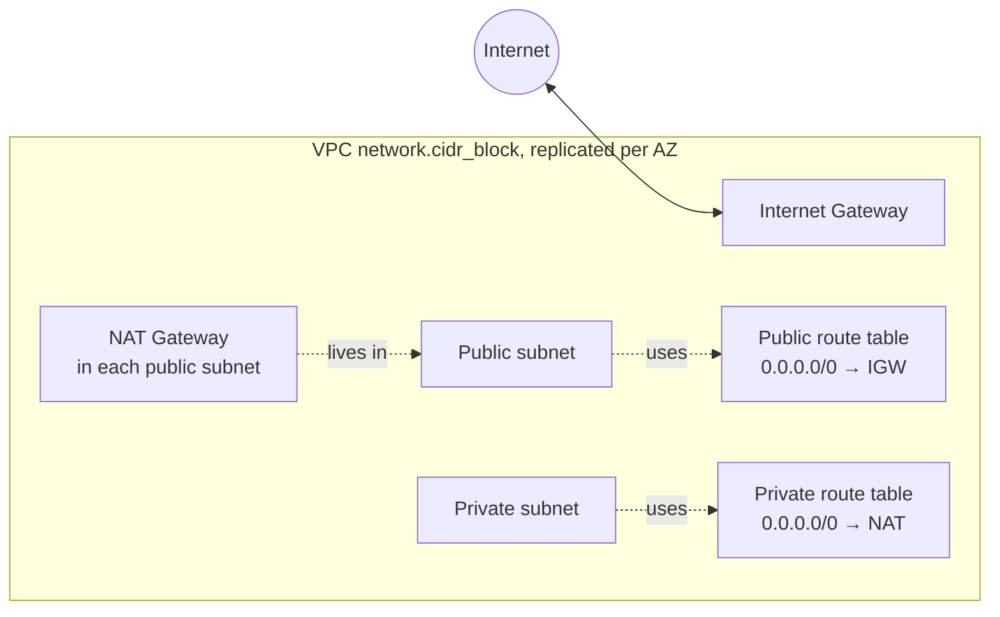
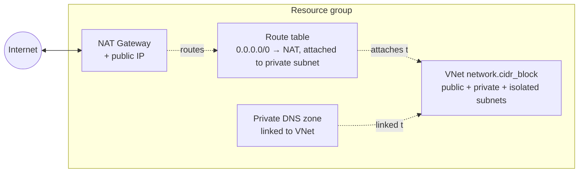

The network category has two drivers. `aws-vpc` builds a VPC with
public and private subnets, an Internet Gateway, and per-AZ NAT
Gateways. `azure-vnet` builds a VNet with public, private, and
isolated subnets along with a NAT Gateway for private egress. The
driver is selected by `platform`. Local platforms (`docker`,
`hyperv`, `incus`, `proxmox`, and `metal`) don't use this layer; their compute
driver creates networking directly on the host (bridges, NAT,
NodePort forwards). Both paths read `network.cidr_block`.

The network module runs after `backend` and before `cluster`. The
cluster modules then consume the VPC or VNet IDs and subnet IDs as
inputs.

## Recipes

### AWS VPC



```yaml
platform: aws
network:
  cidr_block: 10.20.0.0/16    # default 10.5.0.0/16
dns:
  private_domain: corp.example.internal    # optional
```

The module provisions a multi-AZ VPC. Each AZ has a public and a
private subnet, with the public subnet routed through the Internet
Gateway and the private subnet routed through a NAT Gateway that
lives in the public subnet. When `dns.private_domain` is set, the
module also creates a VPC-scoped private Route53 zone so workloads
inside the VPC resolve internal names. The module also enables VPC
flow logs (delivered to CloudWatch under a KMS key) for audit.

### Existing AWS VPC

```yaml
platform: aws
network:
  existing:
    id: vpc-0a1b2c3d4e5f
    subnets:
      public:   [subnet-0aaa, subnet-0bbb]
      private:  [subnet-0ccc, subnet-0ddd]
      isolated: [subnet-0eee, subnet-0fff]
```

Setting `network.existing.id` swaps `aws-vpc` for `aws-vpc-data`
under the same `network` step. The module reads the VPC and subnets
through data sources and creates only the RDS DB subnet group, so
`windsor destroy` leaves the network in place. `network.cidr_block`
is ignored. Cluster nodes go in the `private` subnets, which must span
at least two availability zones. RDS needs `isolated` subnets across
two zones. `public` may be empty. One subnet may appear in more than
one tier when the network has fewer than three.

### Azure VNet



```yaml
platform: azure
network:
  cidr_block: 10.30.0.0/16
```

The module provisions a resource group, a VNet with three subnets
(public, private, isolated), and a NAT Gateway with a dedicated
public IP. The NAT Gateway is associated with the private subnet so
egress goes through it. A private DNS zone is linked to the VNet so
internal names resolve inside it. See Operations below for subnet
sizing — AKS pulls Pod IPs straight from the VNet, so an undersized
block exhausts quickly.

### Local (no terraform/network module)

```yaml
platform: hyperv    # or docker, incus, proxmox, metal
network:
  cidr_block: 10.5.0.0/16
```

No terraform module runs here. The compute driver creates the
host-local network (Hyper-V NetNat, Incus bridge, Docker bridge).
`cidr_block` is still authoritative though, since node IPs, the
cluster API endpoint, and the load balancer IP pool all derive from
it.

## Operations

The default `network.cidr_block` of `10.5.0.0/16` collides with
corporate VPNs in some environments. Pick an unused /16 in private
space before the first apply, because changing it later requires
destroying compute and re-provisioning.

AKS pod IP exhaustion is a quiet failure mode. Azure CNI pulls Pod
IPs from the VNet rather than from an overlay. If `cidr_block` is too
small for the max pods per node times the node count, AKS Pods stay
Pending with no obvious error. Size the VNet for peak pod density.

If `dns.private_domain` is unset on AWS, no private Route53 zone is
created. In-VPC workloads then only resolve via public DNS or VPC
DNS, so any operator-defined internal names won't work.

The AWS VPC module's `azs`, `public_subnets`, and `private_subnets`
lists are positional. Entry `i` of each list describes the same AZ. A
length mismatch is an error at plan time.

In an existing AWS VPC, the network owner provides egress, flow logs,
and the private Route53 zone. Size the private subnets for nodes plus
pods, since the VPC CNI gives every pod a subnet address. A `/26` per
AZ caps the cluster near sixty pods, and the failure shows up as
Pending pods long after apply succeeds.

## Security

VPC private subnets have no public IPs and no inbound routes from the
Internet. Egress flows through NAT Gateways (one per AZ for HA).

The AWS VPC module creates a private Route53 zone, and the records in
that zone are visible only inside the VPC. VPC flow logs land in
CloudWatch and are encrypted by a KMS key the module manages.

Azure VNet subnets carry no NSG by default. Security boundaries are
enforced by AKS network policies and the cluster's CNI rather than at
the subnet layer.

<!-- BEGIN_TERRAFORM_MODULES -->

## Modules

- [aws-vpc-data](aws-vpc-data/) — Reads an existing VPC and its subnets for EKS.
- [aws-vpc](aws-vpc/) — VPC + public/private subnets + NAT for EKS.
- [azure-vnet](azure-vnet/) — VNet + subnets for AKS.
- [gcp-vpc](gcp-vpc/) — VPC, subnets, and firewall rules for GKE.
<!-- END_TERRAFORM_MODULES -->

## See also

- [../cluster/](../cluster/) for the managed-cluster modules that consume the network.
- [../dns/](../dns/) for the public DNS zones (the private zone inside the VPC module is separate).
- [../compute/](../compute/) for the local compute drivers that create their own host networking.
